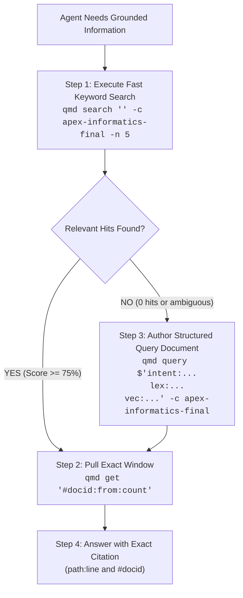

# QMD Two-Tier Search Speed Protocol & Latency Economics

> **Governance Authority:** Decision `DEC-QMD-01` in [`07-INTEGRATION-PLAN-AND-OPERATIONAL-DECISIONS.md`](file:///c:/GitDev/apexai-os-meta/apex-meta/informatics/final/07-INTEGRATION-PLAN-AND-OPERATIONAL-DECISIONS.md).  
> **Complements:** [`SKILL.md`](../SKILL.md), [`mcp-setup.md`](mcp-setup.md), [`structured-query-craft.md`](structured-query-craft.md).

---

## 1. The Measured Performance Differential

Empirical timing benchmarks measured directly on the Windows 11 host environment (`Intel Core Ultra 7 258V / Arc 140V Vulkan / 32 GB RAM`) against `apex-informatics-final` (152 markdown files, 961 chunks):

| Search Command | Underlying Pipeline | Measured Latency | Resource Overhead | Optimal Use Case |
|---|---|---|---|---|
| **`qmd search "<term>"`** | SQLite FTS5 (BM25) | **0.32 seconds** (321 ms) | Zero GPU/VRAM, zero AI model calls | Exact keywords, rule IDs (`AD-01`), authors, benchmark names (`SpecBench`). |
| **`qmd query $'intent:...\nlex:...\nvec:...'`** | Structured query document + single vector embed + cross-encoder rerank | **8.4 seconds** | 1 vector pass + Qwen3 reranking | Semantic concepts with caller-authored keywords and negative space. |
| **`qmd query --no-rerank "<text>"`** | 1.7B LLM expansion + 4 vector passes + BM25 | **19.4 seconds** | Expansion model + embedding passes | Broad exploratory search when cross-encoder reranking is not needed. |
| **`qmd query "<text>"`** | 1.7B LLM expansion + 4 vector passes + Qwen3 reranking | **43.7 seconds** | High (expansion + embedding + cross-encoder) | Unstructured natural language when exact terminology is unknown. |

> **Key Rule (`DEC-QMD-01`):** `qmd search` is **130x faster** than `qmd query`. Agents MUST execute `qmd search` first.

---

## 2. Mandatory Escalation Workflow



---

## 3. Surgical Slicing Protocol (`AD-04`, `AD-19`)

- **Prohibition:** Agents MUST NOT read entire 500-line research documents into memory when a specific fact is sought.
- **Mandatory Directive:** Extract the exact 20–40 line slice around the match hit:
  ```bash
  # Retrieve lines 140 to 175 of document #6e12d5
  qmd get "#6e12d5:140:35"
  ```
- **Citation Format:** Always cite the `#docid` and exact line numbers in working responses:
  ```text
  Grounding: qmd://apex-informatics-final/research/03-research-of-file-10/RESULTS-05.md:18-24 (#6e12d5)
  ```
