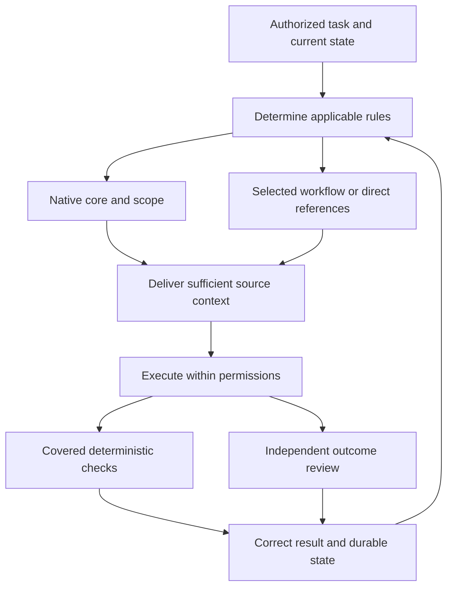

# Proposed architecture

**Keep Apex’s current semantic owners and 23-rule XML. Use native discovery, three bounded workflow candidates and small optional adapters to close measured delivery gaps.** The registry is a maintainable map of that lifecycle. It is not a new runtime service, policy interpreter, permission authority or orchestration system.

This document specifies the proposed behavior. [Decisions](02-decisions.md) explain the alternatives and trade-offs; [integration entries](design/integration-map.json) identify every proposed destination and approval boundary. The [compatibility specification](compatibility/compatibility.md) owns platform facts. The [registry](registry/rules.json) owns proposed rule-level activation metadata. Existing repository owners retain normative meaning. Nothing in this package installs or enables a component.

## 1. Ownership and the smallest useful component set

| Component | Owns | Does not own | Existing or proposed |
|---|---|---|---|
| Ultra XML and detailed specifications | Accepted domain meaning, scope and source-authored priority | Native event implementation | Existing owners retained |
| Root and scoped native carriers | A deliberate projection of the applicable core and project/path information | A second independently edited contract | Existing carriers retained; tested simplification proposed |
| Rule registry | Stable locator IDs, origin, owner resolution, applicability, delivery/verification metadata, adoption state | New policy text or automatic acceptance | New proposed metadata artifact |
| Workflow skill | The ordered procedure for a recognizable task and references to its owners | Duplicated schemas, global invariants or project authority | Three new pilot candidates; existing skills retained |
| Native adapter | Loader/event schema, supported context delivery, tool normalization, coverage status | A generic cross-CLI guarantee | Small proposed host-specific configuration/handler layer |
| Narrow deterministic predicate | A defined precondition for a known covered action | Comprehension, semantic quality or authorization outside its inputs | Reuse existing checks; add only for a demonstrated gap |
| Durable task/run state | Current authorized target, progress, unresolved constraints and next useful action | A new board, external memory database or acceptance policy | Existing run files; optional proposed receipt sidecar |
| Independent verifier | Whether the actual output/action satisfies original requirements and owners | Permission to amend those requirements | Existing review doctrine, proportionate task use |

The proposed baseline has **no always-running daemon, model-router service, new database, automatic scheduler, universal installer, or mandatory new agent fleet**. These exclusions follow D-01, D-14 and D-25: the current problem can be made concrete using files and native facilities. Reopen a deferred component only for a demonstrated unmet requirement.

Repository basis: `apex-meta/informatics/final/specs/file-architecture.md`, FA-01/03/04; `apex-meta/informatics/final/specs/writing-profile.md`, WP-23; `apex-meta/orchestration/ARCHITECTURE.md`, §§2–7; Hermes `DECISIONS.md`, D01–D10. External capability support is claim-linked in [compatibility claims](compatibility/claims.json).

## 2. Repository and local-agent organization

The following are **target proposals**, not a second copy of the live repository. A path marked “pilot” is a candidate destination. The shared-source D05 promotion gate remains open until the exact loader and deployment arrangement passes its tests.

| Target path, relative to the relevant repository | Treatment | Purpose and owner |
|---|---|---|
| `apex-meta/informatics/final/specs/apex_contract_v1.0_ultra.xml` | Retain | Sole current reduced-contract master; preserve all 23 named tags |
| `apex-meta/informatics/final/specs/` and `apex-meta/informatics/final/specs/execution-modes/` | Retain and link | Detailed rule/schema/procedure ownership; no mass relocation |
| `AGENTS.md`, `CLAUDE.md`, `GEMINI.md`, `.github/copilot-instructions.md` | Retain initially; adapt only after a scoped loader probe | Native/project projections; core bytes or deliberate base-reference differences are controlled by existing carrier tooling |
| `.claude/CLAUDE.md` | Retain | Explicit system selection, project boundaries and backbone routing |
| `.claude/skills/{apex-plan,apex-sync,apex-session,weekly-orchestrator,AIRouting}/` | Retain | Existing procedures and their source-owned scope; AIRouting is provider/model/profile advice, not this rule selector |
| `.agents/skills/qmd/` | Retain; reconcile one policy discrepancy after review | Existing retrieval procedure, scoped by its current owner |
| `apex-meta/informatics/final/activation/rules.json` | Add after approval | Proposed registry metadata owner corresponding to this package’s `registry/rules.json` |
| `apex-meta/informatics/final/activation/rule-registry.schema.json` | Add with registry | Exact metadata schema; not a replacement for any domain schema |
| `apex-meta/informatics/final/activation/history.json` | Add with registry | Supersessions and retained decision lineage, kept out of the current activation view |
| `.agents/skills/apex-decision-support/` | New pilot candidate | Coherent Q&A/comparison workflow with canonical QA/bake-off references |
| `.agents/skills/apex-governed-authoring/` | New pilot candidate | Governed specification/knowledge creation with authoring and task-spec owners |
| `.agents/skills/apex-research-cycle/` | New pilot candidate | Sustained research and state recovery using existing iterative/handover owners |
| `.agents/hooks/apex_hook.py` plus a small adjacent native-adapter module only if needed | Conditional candidate from the retained hook design | A shared pure predicate boundary and native handlers; no runtime code is installed by this package |
| `.codex/hooks.json`, `.claude/settings.json`, `.agents/hooks.json` | Per-profile candidate adapters | Enable only the host-supported events actually needed; preserve unrelated existing configuration |
| `apex-meta/informatics/final/tools/{apex_carrier_sync,check_vendor_drift,okf_validator}.py` | Reuse; bounded extensions proposed | Comparison, drift and structural diagnostics; separate unavailable/unknown from pass |
| Existing task/run directory in the owning project | Retain | Task state and artifacts stay with their actual owner |
| `<existing-run-dir>/activation-state.json` | Optional proposed sidecar | Receipt/coverage observations only; cannot promote authority or replace handoff state |

Examples remain outside live discovery roots. Native deployment templates carry explicit example labels; offline probes, schemas and recorded results are supporting artifacts, not installed configuration. A later implementation may deploy a portable skill to a supported native root or create a tracked projection. It must not expose two same-name copies to the same host, assume symlink support everywhere, or rewrite all current skill directories merely for uniform appearance. D-16 and the native probes govern that choice.

Global/account roots are **profile parameters**, not hard-coded new paths. Resolve the repository root, user configuration root, account identity, OS/path conventions and working directory through a read-only profile probe. Do not copy credentials, trust grants, permissions or raw user memory as part of skill distribution. Existing Windows and WSL sources describe scoped environments; this proposal does not migrate them.

## 3. Activation from request to useful outcome

The loop returns to applicability only when the target, operation, source state or authorization changes. It does not rerun a heavyweight preflight on every conversational turn.

### 3.1 Determine scope by the requested outcome

At task entry, the executor uses the already-active core and the actual request to distinguish a material decision, governed authoring, ordinary engineering, sustained research, an explicitly selected named system, and a trivial or quoted-trigger case. Native skill metadata may perform this selection; an explicit skill invocation is a recoverable alternative. The registry is a reference for authoring metadata, checking coverage and diagnosing misses. The normal agent does **not** bulk-load its 145 rows on every task.

For a conversational ranking, `XML.trade_off` and EM-06 apply even without a tool write. If the request is a landscape comparison, EM-07/GS-13 also apply: retain the owned four phases and weighted criterion matrix. Raw I/E/R stays separate from those criterion scores. A typo in a sentence containing “rank” triggers neither workflow merely because the word appears.

For a governed test-specification file, the target and authoring task select the authoring workflow, the current EM-13 fields when its nontrivial, unapproved-task condition holds, and the relevant FA/WP owners. An already-approved bounded step does not need a repeated alignment preflight. “Use pytest” in an ordinary software discussion does not by itself create a governed test specification. New file creation needs source reading before the first governed output, even when no existing file is available to trigger a path loader.

The current operator’s narrow correction changes the active target immediately. Keep unrelated decisions and source records, but invalidate receipts that depend on the corrected scope. Do not restart broad research or reopen settled operator choices solely to demonstrate process.

### 3.2 Deliver sufficient source context

The registry distinguishes `required_on_match` from `conditional_details`. All seven current XML `ref` paths remain traceable; the workflow follows the current `pointers` rule. The relevant procedure is delivered when its trigger matches, while additional detail is read only when required to execute or resolve uncertainty. A filename mention alone is not a read.

Three delivery paths can supply context:

1. **Native loading:** observe the loader trace/context display where the host supports it. A file existing at an expected path proves presence only. If a native trace cannot expose loaded bytes, record that uncertainty explicitly.
2. **Skill selection and tool read:** load the selected workflow, then the current source section needed for the task. A successful result must contain sufficient actual source content. A Glob hit, attempted shell read or citation copied from old notes is insufficient.
3. **Supported event injection:** a configured hook may add a concise task-specific reminder or state excerpt at an event whose documented semantics permit injection. It may reference a source/hash, but it must not pretend a pointer delivered the source body.

There is no universal “before model” injection contract. Codex `PreModelRequest`/`PostModelRequest` are diagnostic-only. Its supported prompt/session events, Claude events and Antigravity invocation events have different effects and trust requirements. See the exact profiles and wire examples in [compatibility](compatibility/compatibility.md) and [native examples](examples/native/README.md).

### 3.3 Execute and verify different properties separately

| Observation | Evidence that can support it | What remains unproved |
|---|---|---|
| Applicability | A case’s independently authored expected rule set; actual task and exclusions | Native selection success |
| Activation | Selected skill/rule record, native trace or explicit invocation | Source delivery or comprehension |
| Delivery | Successful content result/load trace bound to source/version/section and time | Correct use of that content |
| Execution | Actual artifact, tool result and before/after state | Semantic adequacy by themselves |
| Adherence | Specific rule checks against actual behavior, with failed/unknown states preserved | Overall usefulness if checks are narrow |
| Outcome | Original target satisfied within scope, independently reviewed | Universal reliability on other tasks or platforms |

An output can satisfy frontmatter and still omit the requested architecture. A valid hook response can have unsupported runtime semantics. A successful exit code can represent a soft denial. A useful answer can satisfy the task without creating a file. The evaluation design measures these distinctions rather than collapsing them into a single “compliant” flag.

## 4. Hook and validator responsibilities

### 4.1 A bounded policy interface

If the pilot demonstrates a useful hard gate, its shared predicate consumes a normalized **observation**, not raw host-specific policy text. The observation contains the task/run identity, source digest and required delivery receipt, intended action/target set, normalized tool class, effective capability profile and an explicit coverage status. It returns allow, deny with a concrete repair path, or unknown/advisory. Native adapters decide which of these responses the host can express.

This is a proposed interface boundary, not an installed engine or a new authoritative schema for every tool. Production code is deliberately not fabricated from the benchmark fixture. The package’s complete canaries exercise native encoding/schema behavior; they do not enforce Apex policy. The retained `armB_hook_agy.py` is a benchmark fixture with task-specific matching and fail-open paths, not a safe universal implementation to copy into production.

Potential pilot predicates are limited to an already-authorized task: a required source read before a governed write, a target path outside an explicit allowed mutation set, or a missing confirmed authority precondition for a canonical mutation. A semantic answer’s quality is not a reliable shell regex. Native permissions and the existing Session/authority contracts remain the permission boundary.

### 4.2 Coverage and failure states

| State | Meaning | Required behavior |
|---|---|---|
| `covered_verified` | Exact event/tool path and native response behavior passed the profile probe | Apply only the tested predicate; keep outcome review |
| `disabled` | Handler is intentionally off | Use the explicit workflow/direct-read fallback; report the absent guarantee when material |
| `untrusted` | Native trust or hook review prevents execution | Do not grant trust automatically; continue safe authorized work that does not depend on the guard |
| `unsupported` | Host/surface/tool has no relevant observable event | Do not call it mechanically enforced; require an approved alternative for any mandatory precondition |
| `error` | Handler/configuration/receipt parsing failed | Preserve the failure; do not convert it to success or zero violations |
| `unknown` | No reliable observation establishes the current coverage | Probe or use a bounded fallback; block only the dependent action if its required guarantee is unavailable |

The host may fail open on an error. The architecture cannot change that fact with prose. A high-risk operation that requires a missing guarantee is unready on that coverage profile. Preserve any existing operator authorization and use an already-authorized supported fallback when available; safe reads and work toward the reviewable result continue. Do not make every task contingent on every optional hook being healthy.

### 4.3 Validators

Reuse the actual `patch_intent.v1` schema in `.claude/skills/deterministic-markdown-patcher2/references/patch-intent-schema.json`; do not retype a weakened variant. Reuse OKF diagnostics for supported frontmatter/link/ID properties, but distinguish advisories from violations and reject missing or failed checker evidence. Add exact mutation-scope diffs and substantive artifact checks when the original target requires them.

The two known domain-schema owners remain separate: `file-architecture.md` owns frontmatter fields; governance describes the validation view. The package’s registry and optional activation-state schemas are clearly named **new proposals**. They do not add fields to `handoff_packet`, authority-state or review-verdict.

## 5. State recovery and delegation

### 5.1 Reuse authoritative task state

Use the existing run/task directory and current EM-09/EM-14 owners. At a meaningful work boundary, persist the authorized outcome, actual completed artifacts, current source revision/hash references, decisions with acceptance status, remaining uncertainty, the next useful action and its prerequisite. This checkpoint is concise enough to resume from but preserves load-bearing constraints. No fixed token ceiling permits deleting a material operator correction.

A checkpoint is due before an intentional interruption, after a consequential correction, when a long research phase has produced stable findings, and before known compaction when the native interface exposes it. It is not due after every trivial tool call. A crashed process can lose its last unpersisted step; the resume procedure verifies artifact state rather than trusting a “completed” sentence.

The optional [activation-state schema](examples/activation-state.schema.json) stores only delivery/coverage observations alongside that current state. It is useful when a pilot needs reproducible receipts. Ordinary tasks can omit it entirely. Source hashes, task scope and a context epoch prevent an old receipt being treated as proof for a new request or a new source version.

### 5.2 Resume procedure

1. Establish the current task, repository/profile and authorization from the authoritative run record and the latest operator instruction.
2. Inspect the actual artifact/file state for the last meaningful step. Resolve disagreement between a checkpoint and observed state before claiming completion.
3. Revalidate source versions and any receipt needed for the **next** action. Reload only the necessary constraints and source sections; broaden when a real gap remains.
4. Restore unresolved decisions as unresolved. A summary must not turn candidate into verified or proposed into confirmed.
5. Continue the next useful authorized step and inspect that first action. Do not merely print a handover and stop.

Use a supported native startup/resume/compaction event when present. Otherwise run this procedure at the next supported invocation or explicitly on restart. Antigravity has no dedicated compaction hook established by the opened sources. Native summary retention, skill retention and vendor history are helpful facilities, not durable authority guarantees.

### 5.3 Delegation and existing handoffs

When the named Multi-Agent system is explicitly active, use its existing `handoff_packet` schema, lifecycle stage, authority object and independent Detective lenses. The required fields are owned in `apex-meta/orchestration/schemas/handoff-packet.schema.md`; do not add activation-specific fields there without an owner-approved schema change. A source digest identifies the reviewed basis; candidate/verified/invalidated is distinct from proposed/computed/confirmed and from operator validation.

For ad hoc subagents outside that system, use EM-09’s existing four dimensions where applicable: Input & Priority Ledger; Process; Output (Predefined Meta-Layer & Examples); and Definition of Done & Independent Verification. The owner is `apex-meta/informatics/final/specs/execution-modes/handover.md`, §5.1. Task identity, exact revision, scope/exclusions and uncertainty transport are proposed supporting metadata, not new fields in that domain contract. The named system’s handoff_packet remains distinct. A child receives the applicable owner slices, not the full research transcript. Parent and child cannot assume inherited skills, filesystem permissions or loaded context are identical merely because both use “agents.” Current Codex custom-agent files inherit parent approval/sandbox/provider constraints. A “read only” role instruction is a behavioral constraint, not a proven operating-system sandbox.

## 6. Named systems and roles

| Existing responsibility | Infrastructure contribution | Boundary preserved |
|---|---|---|
| Alfred | Uses current target and system selection; receives verified bounded results | Main-conversation accountability, not auto-spawned by this package |
| Meta Ops | Coordinates approved operational integration and existing backbone use | No silent authority promotion or new scheduler |
| Strategy / domain workers | Receive focused evidence and task-specific skills | Remain within explicitly selected system and packet scope |
| Detective | Independent validity/alignment review against source and actual output | Existing process; automatic digest enforcement remains an open implementation item |
| Weekly Orchestrator | Can consume shared source-delivery capability | Weekly remains separate; no automatic Multi-Agent activation or new Plan stage |
| Plan | Proposal construction | Does not mutate confirmed canonical state |
| Sync | Deterministic computation/reports under its owner | Not the generic Git sync keyword adapter |
| Session | Confirmed mutation | Retains explicit operator confirmation and current authority constraints |
| AIRouting | Provider/model/profile/quota recommendations | Not the semantic rule-selection mechanism in this design |
| QMD skill | Scoped source discovery | Not a source-of-truth service or prerequisite for authenticated online retrieval |

Source basis: `.claude/CLAUDE.md`; `apex-meta/orchestration/CURRENT-SYSTEM-MANIFEST.yaml`; `.claude/skills/{apex-plan,apex-sync,apex-session,weekly-orchestrator,AIRouting}/SKILL.md`; `.agents/skills/qmd/SKILL.md`. The Git adapter `apex-meta/informatics/final/specs/execution-modes/git-sync.md` exists and is reused. Its duplicate EM-12 declaration in the general execution-modes file is an unresolved owner-consolidation detail (registry RC-11), not permission to invent a third owner.

## 7. Distribution, drift and maintenance

Use the existing carrier map and comparison scripts as the starting point. Proposed bounded extensions are: resolve selected roots from a profile rather than fixed workstation paths; include the new registry, native JSON/TOML and handler/schema assets; distinguish unavailable source, unknown, drift and verified equality; and produce a preview of exact scoped mutations. Matching bytes establishes distribution integrity only. The native startup/selection probe establishes delivery.

A source change triggers a targeted maintenance transaction: identify affected registry rows, refresh exact owner evidence, assess whether skill metadata or adapter behavior changes, update only those projections after approval, and rerun their positive/negative cases. Preserve historical candidates and rejected alternatives in history. Do not append a running debate to the live rule body or keep two current semantic owners.

The proposal does not call `--sync`, run a vendor manifest rewrite, grant hook trust, enable a plugin or write global configuration. In particular, `check_vendor_drift.py` can skip an unavailable master and exit zero; automation must inspect explicit state before calling the result in-sync. Its current Markdown coverage does not prove JSON/Python adapter integrity. An approved implementation should separate “refresh expected manifest” from “compare against accepted expected state.”

For rollback, capture the exact pre-change bytes and configuration scope in the approved implementation transaction. Remove only the new pilot projection or restore only the changed approved block. Never reset a repository or overwrite unrelated work to undo an adapter. Source hashes and selected target paths make the rollback reviewable.

## 8. Adoption and remaining limits

The proposed order is S0 review, S1 source/evaluator repair and one read-only host audit, S2 one workflow pilot without mandatory hard gates, S3 justified covered guards and carrier simplification, S4 explicitly approved expansion. [The evaluation plan](evaluation/evaluation-plan.md) owns the concrete gates, cases and decision sheet. Every stage can keep the improved-existing-system fallback.

The operator’s installed versions, account roots, trust configuration and local hooks remain unverified. Cross-repository deployment, silent local overrides, headless soft denials and source-read observability can change the acceptable adapter. The package supplies native probes instead of treating documentation as installation evidence. No architecture choice depends on a fabricated model trial, a hardware assumption or uninspected external trace files.

**Failure guard:** keep one semantic owner, distinguish delivery from adherence, and report the exact enforcement boundary. If an adapter adds no demonstrated value, remove that adapter rather than compensating with another layer. Continue authorized work until the useful target is complete, while preserving the explicit boundary before live installation or accepted-state change.
