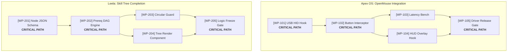

# Handover — Matrix 1 Project Architecture, Epics & Critical Path

## 1. 4-Dimensional Handover Contract

### 1.1 Input & Priority Ledger
- **Authoritative Sources**:
  - `apex-meta/tools/project-improvement-orchestration-weekly/01-weekly-command-brief/DESIGN-DECISIONS.md`: Foundation decisions for project coverage and work granularity.
  - `apex-meta/tools/project-improvement-orchestration-weekly/01-weekly-command-brief/SPEC-DUAL-VIEW-WEEKLY-PRECAP.md`: Master dual-view specification.
  - Canonical OpenProject work package queries via `node C:\GitDev\agent-skills\skills\openproject\client\opCall.js wp.list`.
- **Information Extracted**: Project Epics, hierarchical work packages (`[OP-WP#...]`), prerequisite blocking links, and estimated effort.
- **Deliberately Excluded**: Calendar times, hourly scheduling, and calendar sequences (which belong strictly to Matrix 2).

### 1.2 Process & Anti-Drift Boundaries
- **De-sequencing Rule**: Matrix 1 must NEVER be categorized by calendar sequences (Sequence 1–4). It is categorized exclusively by **Project & Epic**.
- **Hierarchy Standard**: Project $\rightarrow$ Epic $\rightarrow$ Task $\rightarrow$ Subtasks $\rightarrow$ Iterative Sprint Unit.
- **Critical Path Tagging**: Every work package that gates a downstream project deliverable or cross-project milestone must be tagged `[CRITICAL PATH]`.
- **Reasoning Framework**: Dependency Network Analysis (Topological sort of tasks to expose blockers, prerequisite order, and parallel streams).

### 1.3 Output Specification
- **Deliverable**: High-density hierarchical view in Markdown and SVG/Mermaid DAG.
- **Required Fields per Project**:
  - `Project Title` & `Weekly Strategic Target`
  - `Epic Name & Description`
  - `Tasks & Subtasks` (with OpenProject ID, `(I/E/R)` metrics, and `[CRITICAL PATH]` tag where applicable)
  - `Dependency & Blockers Ledger` (Explicit "Depends on", "Unblocks", "Why this week")
  - `Iterative Working Steps (Sprints)`: Granular 30-minute actionable units that feed downstream Matrix 2.

### 1.4 Definition of Done (DoD)
- Matrix 1 presents all active projects (Apex OS, Leela, Investment, Master of Arts, Priority Website).
- Zero mentions of "Sequence 1", "Sequence 2" in Matrix 1 headings.
- Explicit critical path identified from baseline to Saturday milestone.
- Every task decomposes into concrete 30-minute sprint units.

---

## 2. Specification & Template Architecture for Matrix 1

### 2.1 Concrete Structural Pattern

```markdown
### Project: Apex OS (OpenMouse Integration)
**Weekly Strategic Target:** Establish kernel event bindings and hardware button click intercept.
**Critical Path Summary:** `[WP-APEX-01]` Driver Hook ➔ `[WP-APEX-02]` Intercept ➔ `[WP-APEX-03]` Latency Bench ➔ Release Gate.

#### Epic 1: Hardware Driver Bus Bindings
- **[OP-WP#101] USB HID Polling Hook** `(I95/E90/R20: 81)` **[CRITICAL PATH]**
  - • Subtask 1: Parse raw HID descriptor tables (`drivers/openmouse/hid_parser.c`)
  - • Subtask 2: Register kernel interrupt callback handler
  - • Dependency: None (Baseline input bus active)
  - • Unblocks: [OP-WP#102] Button Click Interceptor
  - • Why this week: Hardware prototype arrives Monday; blocks all software layers.
  - • **Iterative Sprint Units (30m each)**:
    - ↳ Sprint Unit A: Map button register bitmasks.
    - ↳ Sprint Unit B: Implement interrupt service routine.
    - ↳ Sprint Unit C: Verify zero packet drop in kernel ring buffer.

#### Epic 2: Button Event Interceptor & Dispatcher
- **[OP-WP#102] Click & Hold Event Listener** `(I92/E85/R25: 75)` **[CRITICAL PATH]**
  - • Subtask 1: Implement software debounce filter (5ms threshold)
  - • Subtask 2: Wire userland IPC socket dispatcher
  - • Dependency: Depends on [OP-WP#101]
  - • Unblocks: [OP-WP#104] HUD Overlay hook
  - • **Iterative Sprint Units (30m each)**:
    - ↳ Sprint Unit A: Write debounce timer state machine.
    - ↳ Sprint Unit B: IPC event packet serialization.
    - ↳ Sprint Unit C: Local socket end-to-end loopback test.
```

### 2.2 Visual Critical Path Representation (Mermaid DAG)



---

## 3. 5-Component Forensic Report

1. **Observation**: Matrix 1 in previous iterations mistakenly reused the calendar sequence labels (`Seq 1`, `Seq 2`), conflating project functional scope with time-block allocation.
2. **Logic Chain**: Project functional planning is timeless; it maps deliverables, dependencies, epics, and technical risks. Sequences are execution vehicles. Decoupling them allows projects to be broken down into Epics, Tasks, and 30-minute Sprint Units that can then be scheduled flexibly into any sequence or time slot in Matrix 2.
3. **Caveats**: When OpenProject is offline (`ECONNREFUSED`), work package IDs are provisional (`[OP-OFFLINE: WP-*]`), pending server wake and reconciliation.
4. **Conclusion**: Matrix 1 is now strictly a **Project Architecture, Epics & Critical Path Ledger**.
5. **Verification Method**: Inspect `WEEKLY_PRECAP_DRAFT_W45.md` to confirm Matrix 1 contains zero `Seq X` references and is organized by Project $\rightarrow$ Epic $\rightarrow$ Task $\rightarrow$ Subtasks with explicit `[CRITICAL PATH]` tags.
