# Weekly Command Brief — 2026-W45

> **Weekly State:** `READY_WITH_REVIEW`  
> **Direction:** Execute Apex OS OpenMouse hardware event loop bindings, complete the Leela skill tree prerequisite DAG and visual render, verify Investment ingestion retry pipeline and query dashboard, and deploy Master of Arts website navigation flexbox and invoice generation engine.  
> **Next Action:** `APPROVE_WEEK`  
> **Review Needed:** DEC-01 (OpenProject daemon offline; reconciliation gate upon container wake).  
> **Scope:** 5 Active Projects; 8 Major Epics; 4 Daily Sequences (2h each); 30m Sprint Units with 3 items each.

---

## 1. Operator Decisions (Informatics Governed)

- **DEC-01 [P0 | I95/E20/R15] OpenProject Service Reconnection & ID Reconciliation**
  - • Context: Canonical runner `opCall.js doctor` returned `ECONNREFUSED` on port 8083.
  - • OpenProject Anchor: `[OP-OFFLINE: SYSTEM-01]`
  - • Action Required: Reconcile temporary `[OP-OFFLINE: WP-*]` tags with live work package IDs once host container is online.
  - • Status: `PROPOSED`

- **DEC-02 [P1 | I90/E40/R20] Apex OpenMouse Hardware Event Intercept Priority**
  - • Context: OpenMouse button handler requires driver interrupt stability before HUD integration.
  - • OpenProject Anchor: `[OP-OFFLINE: WP-APEX-01]`
  - • Action Required: Allocate Monday–Tuesday 09:00–11:00 deep focus sequences strictly to hardware loop latency benchmarking.
  - • Status: `APPROVED`

- **DEC-03 [P1 | I88/E35/R10] Master of Arts Invoicing Engine Logic Lock**
  - • Context: Invoicing calculation and tax logic must be frozen before automated batch PDF generation runs.
  - • OpenProject Anchor: `[OP-OFFLINE: WP-MA-03]`
  - • Action Required: Sign off on formula verification unit test suite during Wednesday afternoon review.
  - • Status: `PROPOSED`

---

## 2. Weekly Direction

**Portfolio North Star:** Ship the functional OpenMouse hardware button intercept loop in Apex OS, lock the Leela skill tree progression mechanics, verify the Investment ingestion harness and dashboard query pipeline, and deploy the modernized website header and automated billing flow for Master of Arts.

### Highlight Goals by Project:
- **Apex OS:** Deliver functional USB HID driver polling and button click/hold event intercept loop.
- **Leela:** Finalize skill tree node schema, Directed Acyclic Graph (DAG) prerequisite resolver, and UI tree graph.
- **Investment:** Resolve upstream ingestion timeout risks with automated retry harness and connect live query views to the data dashboard.
- **Master of Arts:** Deploy responsive CSS flexbox header on the website and build automated template invoice generator.
- **Priority Website:** Complete core responsive layout audit and asset optimization.

**Cross-Portfolio Capacity Floor:** 38 Net Focus Hours across Monday–Friday (four 2h sequences daily, minus protected anchors and meetings); Saturday reserved for gate review and buffer.

---

## 3. Weekly Architecture

### Matrix 1: Project Architecture, Epics & Critical Path (Non-Temporal)

```mermaid
flowchart TD
  subgraph ApexOS["Apex OS: OpenMouse Button Integration"]
    A1["[WP-APEX-01] USB HID Polling Hook<br/><b>CRITICAL PATH</b>"] --> A2["[WP-APEX-02] Click & Hold Interceptor<br/><b>CRITICAL PATH</b>"]
    A2 --> A3["[WP-APEX-03] Latency Benchmarking"]
    A2 --> A4["[WP-APEX-04] HUD Overlay Integration"]
    A3 --> A5["[WP-APEX-05] Driver Packaging Release<br/><b>CRITICAL PATH</b>"]
    A4 --> A5
  end

  subgraph Leela["Leela: Skill Tree Completion"]
    L1["[WP-LEELA-01] Node JSON Hierarchy Schema<br/><b>CRITICAL PATH</b>"] --> L2["[WP-LEELA-02] DAG Prereq Resolver Engine<br/><b>CRITICAL PATH</b>"]
    L2 --> L3["[WP-LEELA-03] Circular Dependency Guard"]
    L2 --> L4["[WP-LEELA-04] Interactive Tree Render"]
    L3 --> L5["[WP-LEELA-05] Tree Logic Gate Freeze<br/><b>CRITICAL PATH</b>"]
    L4 --> L5
  end

  subgraph MasterOfArts["Master of Arts: Website & Invoices"]
    M1["[WP-MA-01] Responsive Nav Flexbox"] --> M2["[WP-MA-02] Copy & Asset Sync"]
    M3["[WP-MA-03] Invoice Data Schema<br/><b>CRITICAL PATH</b>"] --> M4["[WP-MA-04] PDF Template Engine<br/><b>CRITICAL PATH</b>"]
    M4 --> M5["[WP-MA-05] Accounting Export Gate<br/><b>CRITICAL PATH</b>"]
  end

  subgraph Investment["Investment: Pipeline & Dashboard"]
    I1["[WP-INV-01] Pipeline Timeout Trace"] --> I2["[WP-INV-02] Ingestion Retry Harness<br/><b>CRITICAL PATH</b>"]
    I2 --> I3["[WP-INV-03] Batch Cleansing & Cast"]
    I3 --> I4["[WP-INV-04] Dashboard Query Wiring<br/><b>CRITICAL PATH</b>"]
  end
```



---

#### Project 1: Apex OS
- **Weekly Strategic Target:** Establish kernel event bindings and hardware button click intercept for OpenMouse.
- **Critical Path Summary:** `[WP-APEX-01]` Driver Hook ➔ `[WP-APEX-02]` Intercept ➔ `[WP-APEX-03]` Latency Bench ➔ Release Gate.

##### Epic 1: Hardware Driver Bus Bindings
- **[OP-OFFLINE: WP-APEX-01] USB HID Polling Hook** `(I95/E90/R20: 81)` **[CRITICAL PATH]**
  - • Subtask 1: Parse raw HID descriptor tables (`drivers/openmouse/hid_parser.c`)
  - • Subtask 2: Register kernel interrupt callback handler
  - • Dependency: None (Baseline input bus active)
  - • Unblocks: `[WP-APEX-02]` Button Interceptor
  - • Why this week: Hardware prototype arrives Monday morning; gates all userland controls.
  - • **Iterative Sprint Units (30m each)**:
    - ↳ Sprint Unit A: Map button register bitmasks.
    - ↳ Sprint Unit B: Implement interrupt service routine.
    - ↳ Sprint Unit C: Verify zero packet drop in kernel ring buffer.

##### Epic 2: Button Event Interceptor & Dispatcher
- **[OP-OFFLINE: WP-APEX-02] Click & Hold Event Listener** `(I92/E85/R25: 75)` **[CRITICAL PATH]**
  - • Subtask 1: Implement software debounce filter (5ms threshold)
  - • Subtask 2: Wire userland IPC socket dispatcher
  - • Dependency: Depends on `[WP-APEX-01]`
  - • Unblocks: `[WP-APEX-04]` HUD Overlay hook
  - • **Iterative Sprint Units (30m each)**:
    - ↳ Sprint Unit A: Write debounce timer state machine.
    - ↳ Sprint Unit B: IPC event packet serialization.
    - ↳ Sprint Unit C: Local socket loopback test.

##### Epic 3: Verification & Packaging
- **[OP-OFFLINE: WP-APEX-03] Input Latency Benchmarking** `(I85/E90/R15: 77)`
  - • Subtask 1: Run microsecond timestamp deltas under CPU load
  - • Subtask 2: Compile binary driver release artifact

---

#### Project 2: Leela
- **Weekly Strategic Target:** Finalize skill tree node schema, prerequisite dependencies, and visual progression.
- **Critical Path Summary:** `[WP-LEELA-01]` Schema ➔ `[WP-LEELA-02]` DAG Engine ➔ `[WP-LEELA-03]` Cycle Guard ➔ Logic Gate.

##### Epic 1: Node Hierarchy & Data Architecture
- **[OP-OFFLINE: WP-LEELA-01] Node JSON Hierarchy Schema** `(I94/E92/R15: 84)` **[CRITICAL PATH]**
  - • Subtask 1: Define typed skill tiers (Tier 1 Core to Tier 4 Mastery)
  - • Subtask 2: Establish cost and stat unlock prerequisites
  - • Dependency: None
  - • Unblocks: `[WP-LEELA-02]` DAG Resolver
  - • **Iterative Sprint Units (30m each)**:
    - ↳ Sprint Unit A: Draft JSON Schema definition.
    - ↳ Sprint Unit B: Validate sample node definitions against schema.
    - ↳ Sprint Unit C: Build automated schema validation test.

##### Epic 2: Prerequisite Resolution Engine
- **[OP-OFFLINE: WP-LEELA-02] DAG Dependency Engine** `(I96/E85/R20: 79)` **[CRITICAL PATH]**
  - • Subtask 1: Implement topological graph traversal algorithm
  - • Subtask 2: Build circular dependency lockout guard (`[WP-LEELA-03]`)
  - • Dependency: Depends on `[WP-LEELA-01]`
  - • Unblocks: Visual rendering and progression unlock
  - • **Iterative Sprint Units (30m each)**:
    - ↳ Sprint Unit A: Implement graph adjacency list builder.
    - ↳ Sprint Unit B: Implement recursive dependency resolver.
    - ↳ Sprint Unit C: Unit test multi-branch unlock cascades.

##### Epic 3: UI Graph Visualization
- **[OP-OFFLINE: WP-LEELA-04] Interactive Tree Render** `(I85/E80/R15: 69)`
  - • Subtask 1: SVG/Canvas node rendering component
  - • Subtask 2: Wire hover state and requirement tooltips

---

#### Project 3: Master of Arts (Website & Invoices)
- **Weekly Strategic Target:** Modernize website frontend layout and deploy operational invoice billing flow.
- **Critical Path Summary:** `[WP-MA-03]` Invoice Schema ➔ `[WP-MA-04]` PDF Engine ➔ `[WP-MA-05]` Export Gate.

##### Epic 1: Responsive Website Navigation
- **[OP-OFFLINE: WP-MA-01] Responsive Navigation Bar** `(I88/E95/R15: 82)`
  - • Subtask 1: Refactor CSS navigation bar with modern flexbox
  - • Subtask 2: Test breakpoints on desktop, tablet, and mobile
  - • **Iterative Sprint Units (30m each)**:
    - ↳ Sprint Unit A: CSS flexbox structure and link states.
    - ↳ Sprint Unit B: Mobile toggle menu and slide-out drawer.
    - ↳ Sprint Unit C: Asset minification and cross-browser test.

##### Epic 2: Automated Invoicing Engine
- **[OP-OFFLINE: WP-MA-03] Invoice Generator Engine** `(I92/E80/R30: 71)` **[CRITICAL PATH]**
  - • Subtask 1: Define billing line-item JSON schema
  - • Subtask 2: Write tax and subtotal recalculation unit tests
  - • Subtask 3: Connect PDF export renderer (`[WP-MA-04]`)
  - • **Iterative Sprint Units (30m each)**:
    - ↳ Sprint Unit A: Data schema and currency formatter.
    - ↳ Sprint Unit B: Tax calculation logic and edge case test.
    - ↳ Sprint Unit C: HTML-to-PDF template binding pass.

---

#### Project 4: Investment
- **Weekly Strategic Target:** Recheck data ingestion pipeline and connect live queries to dashboard.
- **Critical Path Summary:** `[WP-INV-01]` Timeout Audit ➔ `[WP-INV-02]` Retry Harness ➔ `[WP-INV-04]` Dashboard Wire.

##### Epic 1: Pipeline Reliability & Ingest Harness
- **[OP-OFFLINE: WP-INV-01] Pipeline Timeout Audit & Retry Harness** `(I94/E85/R25: 76)` **[CRITICAL PATH]**
  - • Subtask 1: Profile upstream API latency and payload drop points
  - • Subtask 2: Implement exponential backoff and persistent retry queue
  - • **Iterative Sprint Units (30m each)**:
    - ↳ Sprint Unit A: Add request logging and timeout instrumentation.
    - ↳ Sprint Unit B: Build retry wrapper with jittered backoff.
    - ↳ Sprint Unit C: Stress test simulated network dropouts.

##### Epic 2: Data Dashboard Query Integration
- **[OP-OFFLINE: WP-INV-04] Dashboard View Query Wire** `(I85/E90/R15: 77)`
  - • Subtask 1: Map database aggregations to summary table
  - • Subtask 2: Verify metric calculation against source ledgers

---

### Matrix 2: Timeline & Real Calendar View (2h Sequences, 30m Sprints & 3 Items/Slot)

The table below integrates the daily sequence blocks (2 hours each) and sprints (30 minutes each) into the actual operating day (`08:00 – 18:30`), alongside protected routine anchors and external meetings.

| Time Window | Block Type | Monday | Tuesday | Wednesday | Thursday | Friday | Saturday |
| :--- | :--- | :--- | :--- | :--- | :--- | :--- | :--- |
| **08:00 – 09:00** | 🔒 **Protected Anchor** | **Morning Setup**<br>• Agenda lock<br>• Calendar verify<br>• Email scan | **Morning Setup**<br>• Day kickoff<br>• Health check<br>• Focus prep | **Morning Setup**<br>• Day kickoff<br>• Progress audit<br>• Focus prep | **Morning Setup**<br>• Day kickoff<br>• Blocker review<br>• Focus prep | **Morning Setup**<br>• Day kickoff<br>• Sprint checklist<br>• Focus prep | **Weekly Review**<br>• Retrospective<br>• Clean room<br>• Metrics audit |
| **09:00 – 11:00** | ⚡ **Sequence 1 (2h)**<br>*Deep Focus* | **Apex OS: Driver Hook**<br>**Sp 1 (09:00–09:30):**<br>1. Parse HID tables<br>2. Map bitmask registers<br>3. Stub kernel hook<br>**Sp 2 (09:30–10:00):**<br>1. Interrupt service routine<br>2. Ring buffer allocate<br>3. Zero drop verify<br>**Sp 3 (10:00–10:30):**<br>1. Latency bench pass<br>2. Timestamp delta log<br>3. Kernel trace audit<br>**Sp 4 (10:30–11:00):**<br>• Buffer & cleanup | **Apex OS: Button Intercept**<br>**Sp 1 (09:00–09:30):**<br>1. Click event listener<br>2. 5ms debounce timer<br>3. State machine test<br>**Sp 2 (09:30–10:00):**<br>1. Hold event listener<br>2. Long-press threshold<br>3. Release event hook<br>**Sp 3 (10:00–10:30):**<br>1. IPC socket serialization<br>2. Event loop dispatch<br>3. Loopback verify<br>**Sp 4 (10:30–11:00):**<br>• Buffer & log check | **Leela: DAG Resolver**<br>**Sp 1 (09:00–09:30):**<br>1. Adjacency list builder<br>2. Graph node indexing<br>3. Root node traversal<br>**Sp 2 (09:30–10:00):**<br>1. Recursive dependency<br>2. State cache lookup<br>3. Branch cascade test<br>**Sp 3 (10:00–10:30):**<br>1. Circular guard rule<br>2. Cycle lockout test<br>3. Recursion guard pass<br>**Sp 4 (10:30–11:00):**<br>• Buffer & doc write | **Leela: Tree Render**<br>**Sp 1 (09:00–09:30):**<br>1. SVG canvas setup<br>2. Node position calc<br>3. Tier level lanes<br>**Sp 2 (09:30–10:00):**<br>1. Connector bezier curve<br>2. Locked state tint<br>3. Available state tint<br>**Sp 3 (10:00–10:30):**<br>1. Tooltip cost card<br>2. Prereq highlight<br>3. Click unlock handler<br>**Sp 4 (10:30–11:00):**<br>• Visual polish pass | **Apex OS: Release Gate**<br>**Sp 1 (09:00–09:30):**<br>1. End-to-end input test<br>2. Sustained load run<br>3. Memory leak audit<br>**Sp 2 (09:30–10:00):**<br>1. Build binary package<br>2. Install script verify<br>3. Rollback script test<br>**Sp 3 (10:00–10:30):**<br>1. Signoff checklist<br>2. Artifact hash write<br>3. Archive binary<br>**Sp 4 (10:30–11:00):**<br>• Gate documentation | **Buffer / Overflow**<br>• Catch-up work<br>• Documentation pass<br>• System maintenance |
| **11:00 – 11:30** | ☕ **Buffer / External** | ☕ Transition break | 📅 **External Meeting**<br>• Stakeholder sync | ☕ Transition break | ☕ Transition break | ☕ Transition break | Clean room reset |
| **11:30 – 12:30** | ⚡ **Sequence 2 (1h)**<br>*Compressed Focus* | **Leela: Schema Design**<br>**Sp 1 (11:30–12:00):**<br>1. Draft JSON schema<br>2. Define tier enum<br>3. Set cost properties<br>**Sp 2 (12:00–12:30):**<br>1. Sample node fixtures<br>2. Schema validator unit<br>3. Error message check | **Leela: Schema Review**<br>**Sp 1 (11:30–12:00):**<br>1. Edge cases check<br>2. Multi-parent rules<br>3. Orphan node lockout<br>**Sp 2 (12:00–12:30):**<br>1. Freeze schema v1<br>2. Commit definitions<br>3. Tag release | **Investment: Timeout Trace**<br>**Sp 1 (11:30–12:00):**<br>1. Latency log audit<br>2. Drop point trace<br>3. Payload size check<br>**Sp 2 (12:00–12:30):**<br>1. Upstream probe test<br>2. Endpoint status log<br>3. Diagnostic report | **Investment: Cleansing**<br>**Sp 1 (11:30–12:00):**<br>1. Schema field cast<br>2. Null value sanitizer<br>3. Date format normalize<br>**Sp 2 (12:00–12:30):**<br>1. Cleansing batch run<br>2. Row count checksum<br>3. Database load test | **Leela: Freeze Gate**<br>**Sp 1 (11:30–12:00):**<br>1. Full E2E tree pass<br>2. Lock state assert<br>3. Unlock state assert<br>**Sp 2 (12:00–12:30):**<br>1. Logic freeze signoff<br>2. Package version bump<br>3. Readme update | Portfolio sync prep |
| **12:30 – 13:30** | 🔒 **Protected Anchor** | **Midday Reset & Lunch** | **Midday Reset & Lunch** | **Midday Reset & Lunch** | **Midday Reset & Lunch** | **Midday Reset & Lunch** | Lunch break |
| **13:30 – 15:30** | ⚡ **Sequence 3 (2h)**<br>*Core Build* | **Master of Arts: Nav Bar**<br>**Sp 1 (13:30–14:00):**<br>1. CSS flexbox header<br>2. Nav link list styling<br>3. Active state selector<br>**Sp 2 (14:00–14:30):**<br>1. Tablet breakpoint<br>2. Mobile drawer layout<br>3. Hamburger animation<br>**Sp 3 (14:30–15:00):**<br>1. Asset minification<br>2. Cross-browser check<br>3. Lighthouse audit<br>**Sp 4 (15:00–15:30):**<br>• Git commit & push | **Master of Arts: Content**<br>**Sp 1 (13:30–14:00):**<br>1. Page copy sync<br>2. Typography verify<br>3. Image aspect ratios<br>**Sp 2 (14:00–14:30):**<br>1. Broken link scan<br>2. Internal link routing<br>3. Meta tags verify<br>**Sp 3 (14:30–15:00):**<br>1. Form validation pass<br>2. Submit hook wire<br>3. Success modal test<br>**Sp 4 (15:00–15:30):**<br>• Staging deploy pass | **Master of Arts: Invoices**<br>**Sp 1 (13:30–14:00):**<br>1. Invoice JSON schema<br>2. Line-item fields<br>3. Currency formatting<br>**Sp 2 (14:00–14:30):**<br>1. Subtotal calculation<br>2. Tax formula unit test<br>3. Zero discount edge<br>**Sp 3 (14:30–15:00):**<br>1. Invoice template HTML<br>2. CSS print stylesheet<br>3. Dynamic data bind<br>**Sp 4 (15:00–15:30):**<br>• Unit test signoff | **Master of Arts: PDF Export**<br>**Sp 1 (13:30–14:00):**<br>1. HTML-to-PDF engine<br>2. Page break logic<br>3. Header/footer stamp<br>**Sp 2 (14:00–14:30):**<br>1. File naming schema<br>2. Accounting path wire<br>3. PDF metadata inject<br>**Sp 3 (14:30–15:00):**<br>1. Batch invoice run<br>2. File size optimize<br>3. Visual diff check<br>**Sp 4 (15:00–15:30):**<br>• Export CLI wrapper | **Investment: Dashboard**<br>**Sp 1 (13:30–14:00):**<br>1. Query adapter hook<br>2. DB aggregate view<br>3. Metric card wire<br>**Sp 2 (14:00–14:30):**<br>1. Summary table render<br>2. Sort/filter controls<br>3. Timestamp displays<br>**Sp 3 (14:30–15:00):**<br>1. Ledger audit pass<br>2. Parity check vs raw<br>3. Performance verify<br>**Sp 4 (15:00–15:30):**<br>• Dashboard signoff | End-of-week gate signoff |
| **15:30 – 15:45** | ☕ **Buffer** | Transition break | Transition break | Transition break | Transition break | Transition break | Saturday Wrap |
| **15:45 – 17:45** | ⚡ **Sequence 4 (2h)**<br>*Systems & Secondary* | **Investment: Retry Harness**<br>**Sp 1 (15:45–16:15):**<br>1. Exponential backoff<br>2. Jitter calculator<br>3. Max retry threshold<br>**Sp 2 (16:15–16:45):**<br>1. Persistent retry queue<br>2. Error state logging<br>3. Dead-letter queue<br>**Sp 3 (16:45–17:15):**<br>1. Dropout simulation<br>2. Recovery verification<br>3. Log trace check<br>**Sp 4 (17:15–17:45):**<br>• Harness unit pass | **Priority Website**<br>**Sp 1 (15:45–16:15):**<br>1. Layout audit pass<br>2. CSS reset verify<br>3. Container widths<br>**Sp 2 (16:15–16:45):**<br>1. Image optimization<br>2. WebP conversion<br>3. Lazy loading flags<br>**Sp 3 (16:45–17:15):**<br>1. Contrast ratio audit<br>2. Accessibility test<br>3. Semantic HTML pass<br>**Sp 4 (17:15–17:45):**<br>• Audit checklist log | **Investment: Feed Loop**<br>**Sp 1 (15:45–16:15):**<br>1. Ingest loop worker<br>2. Threading/async pool<br>3. CPU memory profile<br>**Sp 2 (16:15–16:45):**<br>1. Database batch insert<br>2. Transaction safety<br>3. Rollback verify<br>**Sp 3 (16:45–17:15):**<br>1. 10k row stress test<br>2. Ingest rate metric<br>3. Health endpoint test<br>**Sp 4 (17:15–17:45):**<br>• Pipeline freeze | **Apex OS: HUD Integration**<br>**Sp 1 (15:45–16:15):**<br>1. HUD overlay window<br>2. Event listener bind<br>3. Click animation trigger<br>**Sp 2 (16:15–16:45):**<br>1. State feedback icon<br>2. Hold duration gauge<br>3. Tooltip text hook<br>**Sp 3 (16:45–17:15):**<br>1. Frame rate profile<br>2. Window focus test<br>3. IPC latency check<br>**Sp 4 (17:15–17:45):**<br>• HUD integration test | **Master of Arts: Billing**<br>**Sp 1 (15:45–16:15):**<br>1. E2E invoice run<br>2. Test email send<br>3. PDF receipt verify<br>**Sp 2 (16:15–16:45):**<br>1. Export ledger match<br>2. Tax ledger match<br>3. Audit archive save<br>**Sp 3 (16:45–17:15):**<br>1. Signoff checklist<br>2. Production smoke run<br>3. Tag release v1.0<br>**Sp 4 (17:15–17:45):**<br>• Documentation pass | Off-duty |
| **17:45 – 18:00** | ☕ **Buffer** | Daily recap notes | Daily recap notes | Daily recap notes | Daily recap notes | Weekly recap notes | Rest |
| **18:00 – 18:30** | 🔒 **Protected Anchor** | **Evening Shutdown**<br>• FlowRecap run<br>• Git commit sync<br>• Next day preview | **Evening Shutdown**<br>• FlowRecap run<br>• Git commit sync<br>• Next day preview | **Evening Shutdown**<br>• FlowRecap run<br>• Git commit sync<br>• Next day preview | **Evening Shutdown**<br>• FlowRecap run<br>• Git commit sync<br>• Next day preview | **Evening Shutdown**<br>• Weekly wrap<br>• Clean workstation<br>• Precap prep | Off-duty |

---

## 4. Compact Downstream Handoff

```yaml
presentation_handoff:
  artifact_type: "Weekly_Command_Brief"
  artifact_ref: "apex-meta/tools/project-improvement-orchestration-weekly/01-weekly-command-brief/WEEKLY_PRECAP_DRAFT_W45.md"
  week: "2026-W45"
  result_state: "READY_WITH_REVIEW"
  weekly_intent: "Implement Apex OS OpenMouse button bindings, Leela skill tree DAG, Investment ingestion/dashboard pipeline, and Master of Arts website/invoice workflows."
  project_priority_refs:
    - project_ref: "apex-os"
      priority_ref: "WP-APEX-01"
    - project_ref: "leela"
      priority_ref: "WP-LEELA-01"
    - project_ref: "master-of-arts"
      priority_ref: "WP-MA-03"
    - project_ref: "investment"
      priority_ref: "WP-INV-01"
  fixed_constraints:
    - "OpenProject daemon offline; temporary OP-OFFLINE tags require reconciliation on wake"
    - "Tuesday 11:00-11:30 Stakeholder Sync external meeting"
    - "Standard protected routine anchors: 08:00-09:00, 12:30-13:30, 18:00-18:30"
  review_status: "OPERATOR_REVIEW_PENDING"
  next_consumer: "PreCap_Next_Day_Brief"
  next_target_day: "Monday"
  monday_hourly_schedule:
    08_00_09_00: "Morning Setup Anchor"
    09_00_11_00:
      sequence: "Seq 1 (Apex OS: Driver Hook)"
      sprints:
        sp_1: ["1. Parse HID tables", "2. Map bitmask registers", "3. Stub kernel hook"]
        sp_2: ["1. Interrupt service routine", "2. Ring buffer allocate", "3. Zero drop verify"]
        sp_3: ["1. Latency bench pass", "2. Timestamp delta log", "3. Kernel trace audit"]
    11_30_12_30:
      sequence: "Seq 2 (Leela: Schema Design)"
      sprints:
        sp_1: ["1. Draft JSON schema", "2. Define tier enum", "3. Set cost properties"]
        sp_2: ["1. Sample node fixtures", "2. Schema validator unit", "3. Error message check"]
    12_30_13_30: "Midday Reset & Lunch Anchor"
    13_30_15_30:
      sequence: "Seq 3 (Master of Arts: Nav Bar)"
      sprints:
        sp_1: ["1. CSS flexbox header", "2. Nav link list styling", "3. Active state selector"]
        sp_2: ["1. Tablet breakpoint", "2. Mobile drawer layout", "3. Hamburger animation"]
        sp_3: ["1. Asset minification", "2. Cross-browser check", "3. Lighthouse audit"]
    15_45_17_45:
      sequence: "Seq 4 (Investment: Retry Harness)"
      sprints:
        sp_1: ["1. Exponential backoff", "2. Jitter calculator", "3. Max retry threshold"]
        sp_2: ["1. Persistent retry queue", "2. Error state logging", "3. Dead-letter queue"]
        sp_3: ["1. Dropout simulation", "2. Recovery verification", "3. Log trace check"]
    18_00_18_30: "Evening Shutdown Anchor"
```
