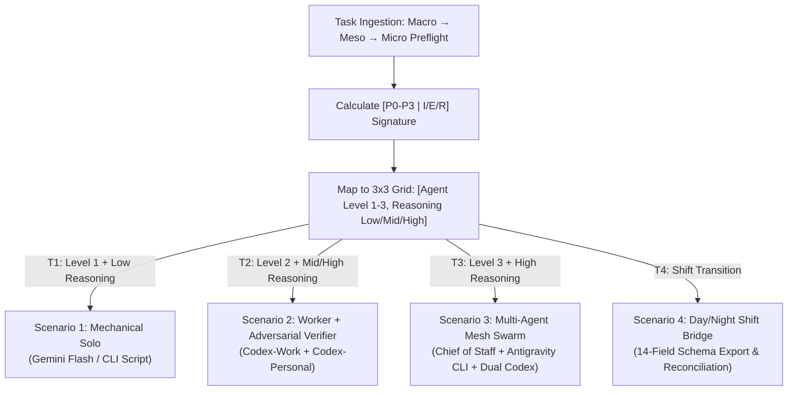

# OpenMausBot 3x3 Orchestration & Multi-CLI Execution Handover

## 1. Prime Target & Substantive Outcome

Empirically test and verify that OpenMausBot can operationalize the **3x3 Orchestration Framework**, enforce **Informatics `[P0–P3 | I/E/R]` metric gating**, correctly route between **three reasoning tiers** and **three agent topologies**, coordinate local CLI execution engines (**Antigravity CLI** and **two isolated Codex accounts**), and execute the **Day/Night shift bridge**.

This is not a theoretical review. Completion requires executing concrete test scenarios in OpenMausBot and capturing reproducible logs and diffs proving that:
1. The Chief of Staff bot estimates the task route beforehand using Macro $\to$ Meso $\to$ Micro analysis.
2. It dispatches bounded tasks via `coordinate_bots` to the exact specified model tier and engine instance.
3. Level 2 tasks enforce an independent adversarial verification gate prior to completion.
4. Level 3 tasks coordinate multi-agent execution across distinct local CLI runtimes.
5. Day/Night shift handoffs produce the canonical 14-field session bridge without context drift.

---

## 2. 4-Dimensional Handover Contract (EM-09 §5.1)

### 2.1 Input & Priority Ledger

| Priority | Source Artifact | Key Extraction Focus | Deliberate Exclusions |
|:---:|---|---|---|
| **P0** | [`specs/writing-profile.md` (`WP-07`)](file:///c:/GitDev/apexai-os-meta/apex-meta/informatics/final/specs/writing-profile.md#L22-L38) | Canonical metric definitions: `[P0-P3 \| Ixx/Exx/Rxx]`, unaggregated 1–100 scale, non-aggregation invariant. | Do not use legacy 4-metric `EVD/IMP/RSK+URG`. |
| **P0** | [`specs/anti-drift-rules.md`](file:///c:/GitDev/apexai-os-meta/apex-meta/informatics/final/specs/anti-drift-rules.md#L21-L34) | Top-loaded invariants: `AD-01` (target dominance), `AD-02` (two-strike limit), `AD-03` (no whole-file rewrites), `AD-04` (context hygiene). | No theoretical drift or unrequested framework adoption. |
| **P1** | [`specs/execution-modes/iterative-execution.md`](file:///c:/GitDev/apexai-os-meta/apex-meta/informatics/final/specs/execution-modes/iterative-execution.md#L12-L51) | `EM-10` complexity routing (Routes 0, 1, 2) and `EM-11` Macro $\to$ Meso $\to$ Micro decomposition and upward validation. | Do not skip downward Meso check before Micro realization. |
| **P1** | [`SourceIndexProjectGPT.md` § Phase 3](file:///c:/GitDev/apexai-os-meta/ApexDefinition&OldVersions/ApexDefiniton/Sources&IndexesforDef/SourceIndexProjectGPT.md#L288-L341) | The 14-field Night Shift pre-planning schema and 14-field Day Shift recap schema; 4 destination routing rules (`memory`, `skill`, `project_state`, `kanban_card`). | Do not reduce schema to vague prose summaries. |
| **P1** | [`C:\GitDev\agent-skills\skills\openmausbot\TRANSFORMATION-GUIDE.md`](file:///C:/GitDev/agent-skills/skills/openmausbot/TRANSFORMATION-GUIDE.md) | OpenMausBot architectural primitives: `SOUL.md` ($\le 24$ KB), `MEMORY.md` ($\le 200$ lines), `team.yaml`, `instances` config. | Do not generate monolithic system prompts. |
| **P2** | [`C:\GitDev\agent-skills\skills\openmausbot\references\custom-engines.md`](file:///C:/GitDev/agent-skills/skills/openmausbot/references/custom-engines.md) | Local CLI spawning via `customAcp` on `127.0.0.1`, `CODEX_HOME` isolation, and thinking-level discovery. | Do not proxy tokens through third-party cloud wrappers. |
| **P2** | [`FBDevinLong.md`](file:///c:/GitDev/apexai-os-meta/ApexDefinition&OldVersions/ApexDefiniton/ArchitectrueCheck/FBDevinLong.md) | Operational constraints: cron 3-min timeout, memory skipping in unattended runs, absolute workspace paths. | Do not run heavy synthesis in short cron ticks. |

---

### 2.2 Process & Multi-Scenario Test Harness

OpenMausBot must execute four distinct empirical test scenarios to validate that its orchestrator follows the specifications exactly.



#### Test Scenario 1: Level 1 Single Agent + Low Reasoning (`[L1, Low]`)
*   **Input Task:** "Audit `docs/` and run `git status` to identify untracked markdown stubs, then output a JSON summary."
*   **Expected Preflight:**
    *   *Macro:* Read-only inspection, zero blast radius (`R10`, `E95`, `I40` $\implies$ `P3`).
    *   *Meso:* Single subsystem, no cross-module interfaces.
    *   *Micro:* Deterministic command, bounded execution.
    *   *Route:* `[L1, Low Reasoning]` $\implies$ Dispatched to single fast/low-reasoning model (Gemini Flash or deterministic CLI tool). No verifier spawned.
*   **Verification Gate:** Ensure no secondary verifier task was created in `runtime.db`.

#### Test Scenario 2: Level 2 Agent + Independent Verifier (`[L2, High]`)
*   **Input Task:** "Update an API route contract in a mock service, adding strict parameter validation."
*   **Expected Preflight:**
    *   *Macro:* Interface contract change with potential downstream regression (`R75`, `E85`, `I85` $\implies$ `P1`).
    *   *Meso:* Coupled boundary requiring independent verification against acceptance criteria.
    *   *Micro:* Patch edits across 2 files with negative test cases.
    *   *Route:* `[L2, High Reasoning]` $\implies$ Worker (`codex-work`) + Independent Verifier (`codex-personal` or Antigravity verifier profile).
*   **Execution Protocol:**
    1. Chief of Staff dispatches worker with bounded execution packet.
    2. Worker emits candidate patch.
    3. Chief of Staff blocks completion and dispatches independent verifier bot with:
       - The candidate patch.
       - The acceptance criteria.
       - Mandatory negative test requirement: prove that malformed parameters fail with HTTP 400.
    4. Task completes ONLY upon explicit `APPROVE` verdict from the verifier.

#### Test Scenario 3: Level 3 Team Mesh Swarm (`[L3, High]`)
*   **Input Task:** "Execute an architectural migration across two local workspaces (e.g., refactoring an integration schema between two repositories)."
*   **Expected Preflight:**
    *   *Macro:* Cross-subsystem architecture with high blast radius (`R85`, `E90`, `I95` $\implies$ `P0`).
    *   *Meso:* Multi-repository coordination requiring Chief of Staff decomposition.
    *   *Micro:* Multiple staged files and separate integration proofs.
    *   *Route:* `[L3, High Reasoning]` $\implies$ Full multi-agent mesh:
        - Lead Orchestrator: Antigravity CLI (`agy acp` with excessive thinking).
        - Worker 1: Codex Account 1 (`codex-work` for workspace A).
        - Worker 2: Codex Account 2 (`codex-personal` for workspace B).
        - Verifier: Independent challenger executing cross-workspace regression tests.
*   **Verification Gate:** Trace transactions in OpenMausBot's `runtime.db` confirming concurrent or sequential dispatch to distinct engine instances.

#### Test Scenario 4: Day / Night Shift Transition Loop
*   **Input Task:** "Simulate Day Outro at 18:00, generate the Night Shift Pre-Plan for 02:00 sweep, and run Day Intro at 08:00."
*   **Execution Protocol:**
    1. *Day Outro:* Chief of Staff harvests execution recaps and exports the canonical 14-field `day_shift_recap`.
    2. *Recap Destination Routing:* The 4 destination rules must be applied:
       - Durable facts $\to$ `MEMORY.md`.
       - Repeatable fixes $\to$ `SKILL.md`.
       - Open decisions $\to$ Project state.
       - Follow-up dependencies $\to$ Task queue / Kanban card.
    3. *Night Pre-Plan:* Produces the 14-field `night_shift_outputs` including `macro_meso_micro_plan` and `verification_plan`.
    4. *Day Intro:* Ingests operator energy, hours, and locks the next $P1$ queue.

---

### 2.3 Output & Artifact Deliverables

The OpenMausBot evaluation must produce the following concrete verification artifacts under `C:\GitDev\agent-skills\skills\openmausbot-orchestrator\`:

```text
C:\GitDev\agent-skills\skills\openmausbot-orchestrator\
├── SOUL.md                          # Invariant orchestrator identity, 3x3 matrix, stop conditions (≤24 KB)
├── MEMORY.md                        # Active project state & shift bridge pointers (≤200 lines)
├── SKILL.md                         # Operational procedure: triage, verifier dispatch, shift loops
├── team.yaml                        # Multi-agent mesh: Chief of Staff, Verifier, Workers, Engines
├── references/
│   ├── shift-protocol.md            # Canonical 14-field schemas for Day/Night operations
│   └── metric-routing-rubric.md     # Mathematical [P0-P3 | I/E/R] mapping rules
└── test-receipts/                   # Empirical execution receipts proving compliance
    ├── scenario-1-solo.json         # Runtime receipt for [L1, Low]
    ├── scenario-2-verifier.json     # Runtime receipt for [L2, High] with adversarial challenge
    ├── scenario-3-mesh.json         # Runtime receipt for [L3, High] with multi-CLI spawning
    └── scenario-4-shift-bridge.md   # Conforming 14-field Day/Night session bridge
```

---

### 2.4 Definition of Done (DoD)

The handover is successful ONLY when:
1. **Zero Monolith Drift:** `SOUL.md` does not exceed 24,000 bytes and contains zero ephemeral task state. `MEMORY.md` does not exceed 200 lines.
2. **Engine Disjointness:** OpenMausBot configurations prove that `antigravity-cli`, `codex-work`, and `codex-personal` spawn with distinct process identities, distinct `CODEX_HOME` directories, and no key leakage.
3. **Adversarial Gate Integrity:** Scenario 2 demonstrably halts upon negative test failure and permits completion only on verified independent proof.
4. **Schema Strictness:** Scenario 4 emits all 14 required fields of `night_shift_outputs` and all 14 required fields of `day_shift_recap`. Missing fields constitute an immediate test failure.
5. **Empirical Receipts:** All four test scenario receipts exist on disk with valid timestamps and exit codes.

---

## 3. 5-Component Forensic Report (EM-09 §5.2)

### 3.1 Observation
*   Repository inspection confirmed that historical Special Ops agent definitions (`special_ops__ai_handling_routing`), model directive ceilings (`2Do_context_file_authority_reference.md`), and Day/Night shift schemas (`SourceIndexProjectGPT.md`) physically exist in legacy trees.
*   The active Informatics v1.0 standard in `apex-meta/informatics/final/` supersedes all legacy priority formulations with the **Raw 3-Metric Signature `[P0–P3 | Ixx/Exx/Rxx]`** and **MMM Complexity Adapters (`EM-10`, `EM-11`)**.
*   OpenMausBot documentation (`C:\GitDev\agent-skills\skills\openmausbot`) establishes native support for local CLI execution via `customAcp` on `127.0.0.1`, Chief of Staff multi-bot coordination via `coordinate_bots`, and strict 24 KB / 200-line memory budgets.

### 3.2 Logic Chain
1. Monolithic agent configurations fail under context bloat and instruction drift.
2. Deconstructing the architecture into OpenMausBot's six primitives (`SOUL.md`, `MEMORY.md`, `SKILL.md`, `team.yaml`, `instances`, `bot-box`) enforces clean cognitive boundaries.
3. Preflight estimation using Macro $\to$ Meso $\to$ Micro prevents over-engineering simple tasks (`Route 0`) while guaranteeing independent verification for high-risk mutations (`Route 1/2`).
4. Mapping reasoning tiers to local CLI harnesses preserves zero-cloud privacy and leverages dedicated model capabilities (Antigravity thinking for deep architecture; Codex for focused implementation).
5. Binding the Day/Night shift loop to Source A's 14-field schema prevents context loss across unattended overnight sweeps and daily interactive sessions.

### 3.3 Caveats
*   OpenMausBot must have access to the local terminal binaries (`agy` and `codex`) in its system `PATH` or via absolute executable paths in `~/.openmausbot/config.json`.
*   Codex CLI account separation requires that `CODEX_HOME` environment variables point to distinct directories containing valid authentication tokens (`~/.codex-acc1` and `~/.codex-acc2`).
*   In unattended night operations, cron must not execute heavy LLM synthesis directly; it must create a task or launch a decoupled execution script that writes output to disk.

### 3.4 Conclusion
The 3x3 Orchestration Framework and Day/Night shift protocols are fully grounded, specified without contradiction, and ready for deployment into OpenMausBot. The attached test harness provides the exact criteria to prove that OpenMausBot can spawn and govern these agents as specified.

### 3.5 Verification Method
Execute the following verification sequence in the OpenMausBot workspace:

```bash
# 1. Verify QMD indexing of the handover and authority references
qmd search "OpenMausBot 3x3 Orchestration" -c apex-informatics-final

# 2. Check schema conformance of the resulting agent package
python apex-meta/informatics/final/tools/okf_validator.py C:\GitDev\agent-skills\skills\openmausbot-orchestrator

# 3. Inspect OpenMausBot instance configuration for multi-CLI routing
cat ~/.openmausbot/config.json | jq '.instances | keys'

# 4. Run the four test scenarios and confirm receipt generation
ls -la C:\GitDev\agent-skills\skills\openmausbot-orchestrator\test-receipts\
```
