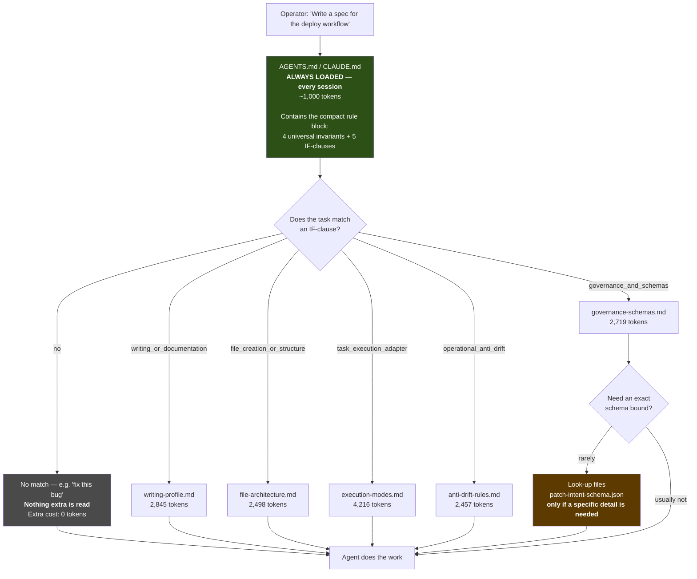
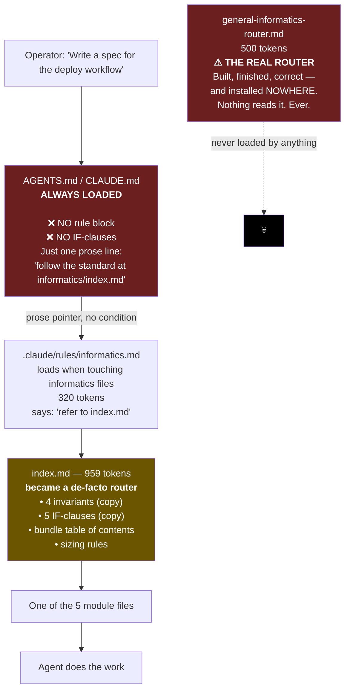
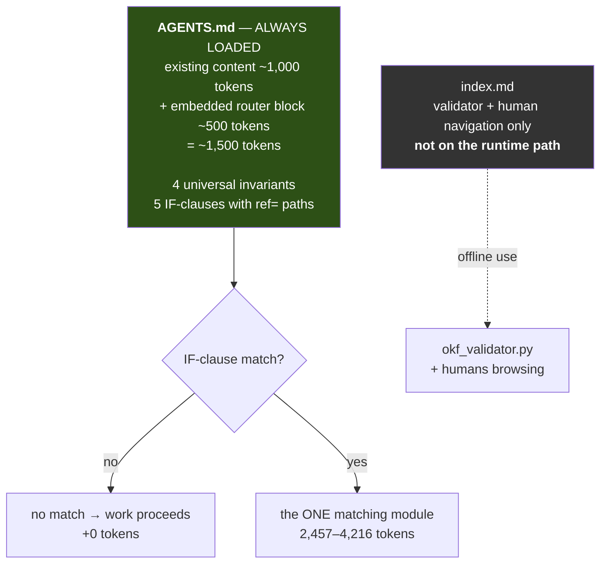
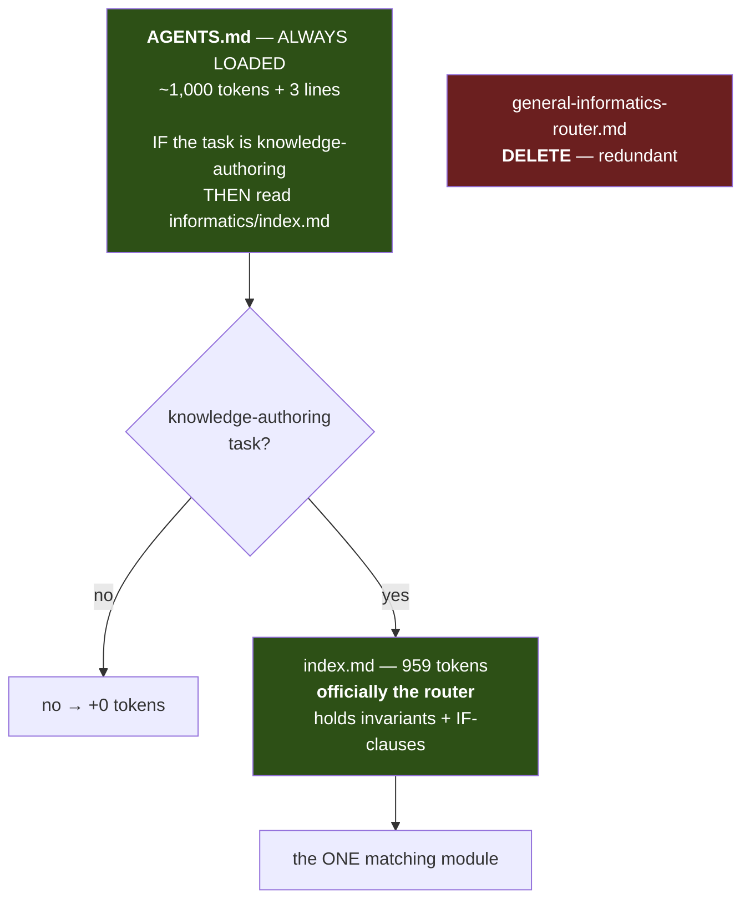
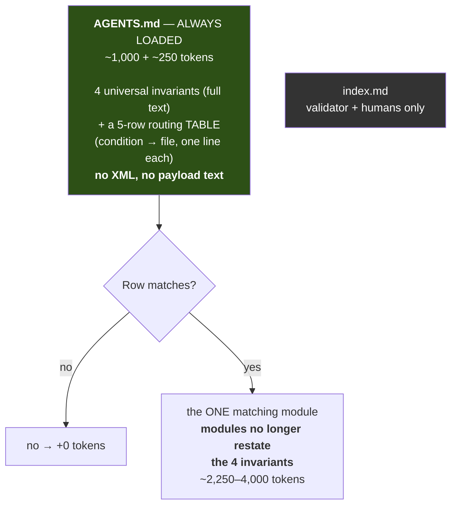
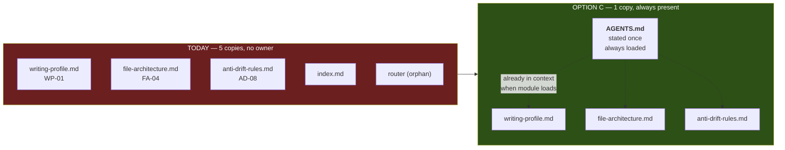

# How The Routing Works — Plain Language

**The one-sentence diagnosis:** you designed a compact rule block that was supposed to be **pasted
into `AGENTS.md`**, it was built correctly, and **it was never installed**. `index.md` quietly grew
a copy of it to fill the gap. So there are now two routers, neither is officially live, and that is
the chaos you are sensing.

---

## 0. First, two corrections to what I told you

**Correction 1 — I analysed the wrong files.** I measured `CLAUDE.md` and `AGENTS.md` as a 3,031-token
"always-on tier to audit." You've told me those are placeholders awaiting exactly this work. So that
number is not a problem to fix — **it is the budget the new rule block has to fit inside.** Different
question entirely. My "Decision 3: audit the always-on tier" was malformed and I'm withdrawing it.

**Correction 2 — "Is `index.md` the router?" was the wrong question.** I asked you to decide whether
`index.md` is a guaranteed kernel. Reading your own prior design settles it: **it isn't the router
and was never meant to be.** I'm withdrawing that decision too and replacing it with the real one.

Your design is stated explicitly in
[08-TIER-A-XML-EMBEDDED-PILOT-v0.2.md](../../../../handoff/universal-ai-instruction-system/08-TIER-A-XML-EMBEDDED-PILOT-v0.2.md):

> *"The intended production use is to embed the XML block directly inside `AGENTS.md` / equivalent.
> Agents should not be instructed to read this file at runtime."*
>
> *"Plain paths are JIT pointers, not import directives. Do not auto-expand them into context."*

That is exactly what you described: a terse rule set living *inside* the always-on file, carrying
IF-clauses that point at detail files.

---

## 1. Vocabulary — three words, no jargon

I used terms like "Level 1 / Level 2" without defining them. Here they are in plain language. There
are only three kinds of file in this system:

| Plain name | What it means | Cost |
|---|---|---|
| **Always-on file** | The agent reads it at the start of *every* session, whether it needs it or not. `AGENTS.md`, `CLAUDE.md`. | Paid on every task, forever |
| **On-demand file** | The agent reads it **only when a condition matches**. `writing-profile.md` and friends. | Paid only when triggered |
| **Look-up file** | A reference the agent opens only if it needs a specific detail. `patch-intent-schema.json`. | Usually never paid |

The whole architecture is one question: **what goes in which bucket?**

Things go in the always-on bucket only if they're needed on *most* tasks. Everything else goes
on-demand, with an IF-clause in the always-on file pointing at it. That's it. That's progressive
disclosure — the principle your pilot document already calls `<context progressive-disclosure>`.

---

## 2. How it is SUPPOSED to work

**Read it like this:** the green box is paid on every task. The IF-clauses are the gates. A bug-fix
task pays nothing extra. A spec-writing task pays one module. The orange look-up file is almost
never paid.

**Where does `index.md` sit in this picture?** Nowhere on the runtime path. It is the knowledge
bundle's table of contents — it exists so the validator can check the bundle and so a human can
navigate it. It is not read during normal work.

---

## 3. How it ACTUALLY works right now

### What's actually broken

| # | Problem | Consequence |
|---|---|---|
| 1 | **The router is orphaned.** `general-informatics-router.md` is a finished deliverable sitting in a folder. Nothing loads it. | The IF-clause routing you designed is not running at all. |
| 2 | **No IF-clauses in the always-on file.** `AGENTS.md` just says "follow the standard at index.md" — unconditional prose, not a gate. | An agent either ignores it, or reads `index.md` on tasks that don't need it. |
| 3 | **`index.md` wears three hats** — bundle index, invariant list, and router. | Two copies of the dispatch block exist. Nobody declared which is live. This is the drift you feel. |
| 4 | **Routing costs an extra hop.** `AGENTS.md` → `.claude/rules/informatics.md` → `index.md` → module. | 959 tokens of index read before the module, on every informatics task, to learn something the always-on file should already have said. |

**And this is why my duplication analysis was confusing.** I was reasoning about which file "owns"
a rule, while the file that's supposed to carry the universal rules isn't carrying them. You can't
sensibly answer "should `AD-03` restate `EM-01`?" until you know whether the always-on block states
it for both of them.

---

## 4. The three architectures you could choose

### Option A — Install the router into `AGENTS.md` (your original design)

- **Always-on cost:** ~1,500 tokens (+500 vs today)
- **Spec-writing task:** 1,500 + 2,845 = **4,345**
- **Bug-fix task:** 1,500 + 0 = **1,500**
- **Best practice?** ✅ Yes. This is the documented pattern for agent instruction files — a lean
  always-on surface plus conditional pointers. It is what your own pilot document specifies, and it
  matches how Agent Skills work: a tiny always-loaded description, full instructions only on trigger.
- **Removes:** the orphan, the extra hop, and the two-routers ambiguity.
- **Cost:** `AGENTS.md` grows by 500 tokens, paid on every task in the repository — including tasks
  that have nothing to do with informatics.

### Option B — Keep the pointer, make it conditional

- **Always-on cost:** ~1,050 tokens (+50 only)
- **Spec-writing task:** 1,050 + 959 + 2,845 = **4,854**
- **Bug-fix task:** 1,050 + 0 = **1,050**
- **Best practice?** ⚠️ Acceptable, not ideal. Two-stage routing (gate → router → module) is a known
  pattern and keeps the always-on file very lean. But you pay 959 tokens of index on *every*
  informatics task to learn which module to read — information that could have been one line in the
  always-on file.
- **Removes:** the orphan (by deleting it) and the ambiguity (by making `index.md` officially the
  router).
- **Cost:** `index.md` must then serve two masters — runtime router *and* OKF bundle index — which
  is what caused the current confusion in the first place.

### Option C — Hybrid: invariants always-on, routing table always-on, details on demand

- **Always-on cost:** ~1,250 tokens (+250)
- **Spec-writing task:** 1,250 + ~2,600 = **3,850** ← cheapest of the three
- **Bug-fix task:** 1,250 + 0 = **1,250**
- **Best practice?** ✅ Yes, and it is the strictest reading of the principle. The 4 universal
  invariants are genuinely universal, so they belong in the always-on file; once they're there,
  every module can stop restating them.
- **This is the option that resolves the duplication question** — see §6.
- **Cost:** requires editing all 5 modules to remove the restatements, and rewriting the test that
  currently asserts the duplication.

### Side-by-side

| | Today | A — install router | B — conditional pointer | C — hybrid |
|---|---:|---:|---:|---:|
| Always-on tokens | 1,000 | 1,500 | 1,050 | 1,250 |
| Bug-fix task total | 1,000 | 1,500 | 1,050 | 1,250 |
| Spec-writing task total | 2,279 + module | **4,345** | 4,854 | **3,850** |
| Orphan router resolved | ❌ | ✅ installed | ✅ deleted | ✅ replaced |
| Two-routers ambiguity | ❌ | ✅ | ✅ | ✅ |
| `index.md` has one job | ❌ | ✅ | ❌ | ✅ |
| Modules stay self-sufficient | ✅ | ✅ | ✅ | ⚠️ depends on always-on |
| Work to implement | — | small | small | **medium** |

---

## 5. Worked example — the same request through each option

**Request:** *"Write a specification file for the new deployment workflow."*

**Today**
1. `AGENTS.md` loads (1,000). Says "follow the standard at `informatics/index.md`" — no condition, so the agent must decide for itself whether this applies.
2. The file path matches, so `.claude/rules/informatics.md` loads (320). It says: refer to `index.md`.
3. `index.md` loads (959). *Now* the agent sees the IF-clauses.
4. Task matches two gates — writing *and* file-creation. It reads `writing-profile.md` (2,845), and probably `file-architecture.md` too (2,498).
5. **Total: 7,622.** Three files read before learning which two files it actually needed.

**Option A**
1. `AGENTS.md` loads (1,500) — the IF-clauses are already there.
2. Agent matches the gates immediately, reads both modules (5,343).
3. **Total: 6,843.** Two hops saved. `index.md` never touched.

**Option C**
1. `AGENTS.md` loads (1,250) — invariants plus a 5-row routing table.
2. Reads both modules, now ~500 tokens lighter because they no longer restate the 4 invariants (~4,850).
3. **Total: 6,100.** Cheapest, and the agent never encounters the same invariant twice.

---

## 6. This is what resolves the duplication question

Here is the thing I couldn't explain properly before, stated concretely.

Right now **"Substance Over Ceremony"** is written out in **five** files: `writing-profile.md`,
`file-architecture.md`, `anti-drift-rules.md`, `index.md`, and the orphaned router.

**Why the copies exist today:** because no file is guaranteed to carry the rule, each module carries
its own copy so it works when loaded alone. That's defensible — but it means five places to edit,
and five places to drift apart. Two of this pass's confirmed defects (`D2`, `D9`) were exactly that:
copies that silently stopped agreeing.

**Why Option C fixes it:** once the invariant is in the always-on file, it is *already in the
agent's context* whenever any module loads. The module doesn't need its own copy — not because it
can "go look it up," but because the rule is already there. **No hop, no copy.**

That is the distinction I failed to make. "Extract to a shared place" sounds like it costs an extra
read. It doesn't, when the shared place is the file that was already loaded.

The established rule for when to do this is the **Rule of Three** (Martin Fowler): one or two copies,
leave them alone; at three or more, pull it out. Applied here:

| Concept | Copies | Verdict |
|---|---:|---|
| Substance Over Ceremony | 5 | → always-on file |
| Never rewrite whole files | 5 | → always-on file |
| Instruction parsimony | 4 | → always-on file |
| Step-by-step context loading | 4 | → always-on file |
| TARGET dominance | 4 | → always-on file |
| Top-loaded primacy | 3 | → always-on file |
| Durable IDs | 3 | → always-on file |
| Residual name eradication | 3 | → always-on file |
| Two-strike, BLUF, grounding, command-claims, checkable ambiguity | 2 each | leave duplicated |

Eight concepts to the always-on file. Five stay where they are — two copies is below the threshold
and not worth the churn.

Note this is **not** the same as the 4 invariants currently in the router. The router has 4; the
Rule of Three says 8 qualify. Option C's always-on block would carry all 8 (~250 tokens).

---

## 7. What I recommend, and what I need from you

**Recommendation: Option C, built in two steps.**

**Step 1 — install the routing (low risk, reversible).** Put the 8 invariants plus a 5-row routing
table into `AGENTS.md`. Delete the orphaned router or mark it a generated artifact. Strip the
duplicate dispatch block out of `index.md` so it becomes purely a bundle index. Nothing in the five
modules changes yet, so nothing can break — the modules still carry their own copies, which is now
harmless redundancy rather than load-bearing redundancy.

**Step 2 — strip the module restatements (only after Step 1 is proven).** Remove the 8 invariants
from the 5 modules. Rewrite `test_olt_07`, which currently asserts the duplication by name.

Splitting it this way means Step 1 can be verified in real use before Step 2 removes the safety net.

### The decisions, restated properly

| # | Question | Options | My lean |
|---|---|---|---|
| **1** | Which architecture? | A install router / B conditional pointer / C hybrid | **C** — cheapest per task and the only one that resolves the duplication cleanly |
| **2** | What is `index.md` for? | Runtime router / bundle index only | **Bundle index only.** It should stop carrying invariants and IF-clauses. |
| **3** | What happens to `general-informatics-router.md`? | Install into `AGENTS.md` / delete / keep as a portable artifact for other repos | **Keep as a portable artifact**, clearly labelled, once `AGENTS.md` carries the live block |
| **4** | Do Step 2 at all? | Yes / Step 1 only | **Yes, but only after Step 1 runs in practice** |

### Withdrawn

- ~~"Is `index.md` a guaranteed kernel?"~~ — wrong question; it isn't the router.
- ~~"Audit the always-on tier"~~ — I was auditing placeholder files as if they were finished.

Nothing here is applied.
