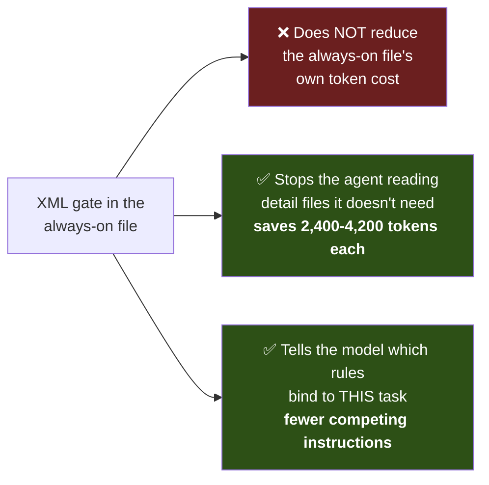
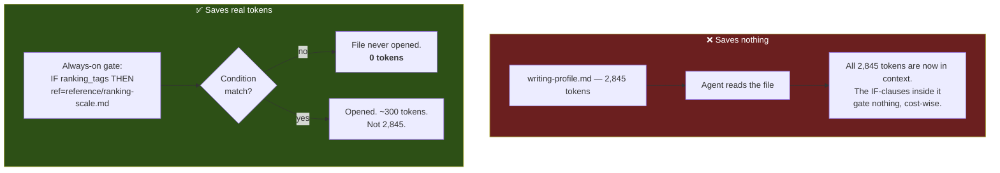
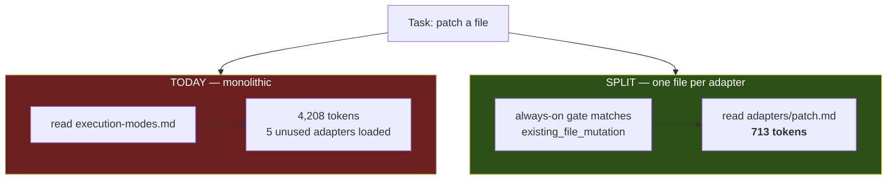
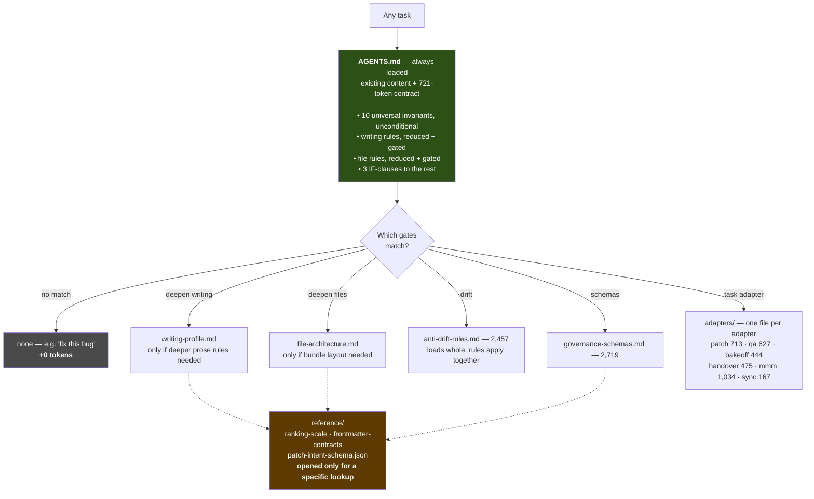

# Candidate Always-On Block — Measured

**Your design works. It measures 721 tokens.** One mechanical correction is needed first, and it
changes one word in the design — not the design.

---

## 1. The correction: what an IF-clause can and cannot save

This is the thing worth getting straight before anything else, because the whole design hinges on it.

> **An IF-clause inside a file that is already loaded does not save any tokens.**

Once `AGENTS.md` is in the agent's context, **every token in it is spent** — including the branches
that don't match. There is no mechanism by which a model "skips" part of a file already placed in
its context window. The XML gate is read along with everything else.

So this part of what you described cannot work as stated:

> *"if it is more than 1,000 tokens in total, it should still be structured in a way that the agent
> is not going to read the whole file but only what is necessary"*

For an **always-on** file, no. It reads all of it, always. The 1,000-token budget is therefore a
hard budget, not something structure can get you out of.

### But the gates buy two real things



The second one is not decorative. Research on instruction interference finds that ~12% of
individually-satisfiable instruction pairs fail when stacked together
([Instruction Stacking Collapse](https://arxiv.org/pdf/2608.02639)). A gate that marks nine of
thirteen rules as "not applicable to this task" reduces the number of instructions actually
competing for compliance. **So gating inside the always-on file is worth doing — for precision, not
for cost.** Your instinct to use `when=` everywhere is right; the payoff is just different from what
you expected.

### The one-word substitution

Where you said IF-clauses would load *"only the context that is actually important"* inside a detail
file — that only works if the branch points to a **separate file**, not a section of the same file.



**A conditional branch only saves tokens when it crosses a file boundary.** That is the entire
mechanical rule. Everything else in your design follows from it unchanged.

---

## 2. The draft block — 721 tokens, measured

This is your design implemented: reduced-form rules always present, every group behind an XML
trigger, detail files as just-in-time pointers.

```xml
<apex_contract v="0.3">

<always>
Target: realize the substantive outcome asked for. Files, tests and schemas are evidence of success, never substitutes for it.
Scope: do only the authorized task. No adjacent cleanup, redesign or speculative work.
Surgical: never rewrite a whole existing file. Edit by exact-match replacement. Move files with git mv/cp, never by regenerating content.
Context: load just-in-time. Never bulk-read directories or long manuals upfront. Materialize each iteration's output to a file.
Substance: technical correctness overrides every numeric target below. Exceed any ceiling when adherence would omit load-bearing context or break accuracy.
Ground: verify claims against the originating artifact (path:line) or tool output, never memory or a secondary summary. Absence and count claims carry their command.
Reuse: prefer an existing proven solution in its established form. Invent only when evidence shows nothing suitable fits.
Two-strike: if two fixes to one subsystem fail to advance the product, stop and change approach.
Current-truth: state active truth only. History goes to a changelog, never inline.
Parsimony: ~30-50 directives max per instruction file. Split a domain out before a file becomes a rule-wall.
</always>

<writing when="producing_prose_docs_or_rules" ref="apex-meta/informatics/writing-profile.md" deepen_when="ranking_tags_or_information_mapping">
Active voice, explicit actor. One imperative command per sentence. No modal hedging. Conclusion first, then rationale. ~20-word procedural, ~25-word descriptive sentences. Tables for multi-attribute comparison, bullets for inventories, numbered lists only for sequences. Durable IDs (WP-01) carry no priority tier. Tag governed rules [P0-P3 | I/E/R] on 1-100, never aggregated. Link files you list so the reader can open them.
</writing>

<files when="creating_or_restructuring_governed_files" ref="apex-meta/informatics/file-architecture.md" deepen_when="five_planes_or_bundle_layout">
Flat YAML frontmatter only, every line has a colon, inline [brackets] for lists, never multiline dashes. Concept files declare type, id, title, description, status. Bundle roots declare okf_version "0.2". One responsibility per file. Front-load P0 rules in the first ~500 tokens; close on the failure-mode guard.
</files>

<dispatch>
IF resolving a trade-off, comparing candidates, patching a file, writing a handover, or running multi-step iterative work THEN ref="apex-meta/informatics/execution-modes.md"
IF work is drifting into ceremony, orchestration or test infrastructure instead of the product THEN ref="apex-meta/informatics/anti-drift-rules.md"
IF validating schemas, patch intents, or bundle conformance THEN ref="apex-meta/informatics/governance-schemas.md"
Paths are just-in-time pointers. Do not expand them into context unless the condition matches.
</dispatch>

</apex_contract>
```

### Measured

| Section | Tokens | Carries |
|---|---:|---|
| `<always>` | 303 | The 10 universal invariants, unconditional |
| `<writing>` | 140 | Writing profile in reduced form + pointer |
| `<files>` | 113 | File architecture in reduced form + pointer |
| `<dispatch>` | 133 | 3 IF-clauses for the remaining modules |
| **Total** | **721** | — |

That answers your question directly: **a functional reduced form of the whole system fits in
721 tokens.** Not 2,000. Not 1,000. 721.

### Why writing and files are inline but the other three are pointers

Exactly your reasoning: the agent writes prose and touches files on nearly every task, so those
rules earn their always-on cost (253 tokens combined). Patch discipline, anti-drift and schema
validation are *conditional* — real tasks, but not most tasks — so they stay as pointers.

---

## 3. Where this leaves the detail files

The block above still points at `execution-modes.md`, which is **4,208 tokens**. A patch task pays
all of it to use one adapter. Measured section sizes:

| Section | Tokens |
|---|---:|
| Core invariants + IF-dispatch | 599 |
| Adapter 1 — Q&A Decision Matrix | 627 |
| Adapter 2 — Bake-Off Rubric | 444 |
| Adapter 3 — Exact-Match Patch | 713 |
| Adapter 4 — Handover | 475 |
| Adapter 5 — Iterative / MMM | 1,034 |
| Adapter 6 — Git Sync | 167 |
| **Total** | **4,208** |



**A patch task: 4,208 → 713 tokens. An 83% cut on the heaviest module in the suite.**

That is your "the files are again used with trigger IF-clauses" idea — implemented the only way it
actually saves tokens, by splitting into files rather than sections.

The same logic applies to the other modules, but execution-modes is the one where it clearly pays:
its six adapters are genuinely mutually exclusive. `anti-drift-rules.md` (2,457) is the opposite —
its rules apply together, so splitting it would just add hops.

---

## 4. The full picture



### Measured cost per task type

| Task | Today | This design |
|---|---:|---:|
| "Fix this bug" | 1,000 | **721** |
| "Patch `execution-modes.md`" | 7,622 | **1,434** (721 + patch adapter) |
| "Write a spec file" | 7,622 | **721** — reduced writing + file rules often suffice |
| "Write a spec, need exact frontmatter schema" | 7,622 | **~3,200** (721 + file-architecture) |
| "Emit a patch_intent" | 8,378 | **~1,500** (721 + schema contract) |

---

## 5. What was, and wasn't, right in my earlier framing

| My earlier claim | Status |
|---|---|
| "Modules must stay self-sufficient, so keep the duplicates" | **Wrong under this design.** Once the 10 invariants are always-on, modules never need to restate them. |
| "Option C: 8 invariants to the always-on file" | Right direction, **but I had it as a bare routing table.** Your version — reduced *rules*, not just pointers — is better and costs only ~250 tokens more. |
| "`index.md` is not the router" | Still correct. In this design it is the bundle index for the validator and for humans. Nothing reads it at runtime. |
| "Audit the 3,031-token always-on tier" | **Withdrawn.** Those files are what this block gets installed into. |
| "L1/L2/L3" | Bad vocabulary. Read it as always-on / on-demand / look-up. |

**Your reading was right:** it is Option C *with* the XML payload — closer to A+C than to either
alone. The reason I didn't present it is that I never drafted and measured it, so I was arguing
about structure without knowing whether a functional reduced form could fit the budget. It can.

---

## 6. The honest open risks

1. **Nobody has tested whether reduced-form rules are sufficient.** 721 tokens of compressed rules
   may under-specify behavior that the 2,845-token writing profile gets right. The `deepen_when`
   pointer is the escape hatch, but it depends on the agent correctly noticing it needs depth. This
   is the real risk in the whole design and it is empirical, not architectural — `RBL-01`.

2. **Splitting `execution-modes.md` into six files is a real refactor** — six new files, six new
   gates, and roughly twenty test literals currently asserting those sections exist in one file.

3. **The draft block above is my wording, not yours.** Every reduced rule is a lossy compression of
   a rule you wrote. Each one needs your eye before installation — particularly `<always>`, where I
   compressed ten rules into ten lines.

4. **`AGENTS.md` and `.claude/CLAUDE.md` currently hold ~2,000 tokens of their own content** that I
   have not examined for overlap with this block. Installing 721 on top without checking would
   likely duplicate the Git Dispatch, Directness and Core Intent Execution sections, which already
   say some of the same things.

Risk 4 is the one to resolve before anything is installed.

---

## 7. Proposed next step

Not installation — a merge analysis. `AGENTS.md` already contains Git Dispatch, Directness, Core
Intent Execution, Informatics Routing and Scope sections. Several of those restate invariants in
the draft `<always>` block. The next useful artifact is a line-by-line map of
**existing `AGENTS.md` content → draft block content**, showing what merges, what is replaced, and
what is genuinely new — and a measurement of the merged result against your ~1,000-token target.

That is a read-only analysis. Nothing changes until you have seen the merged file.
