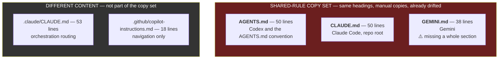
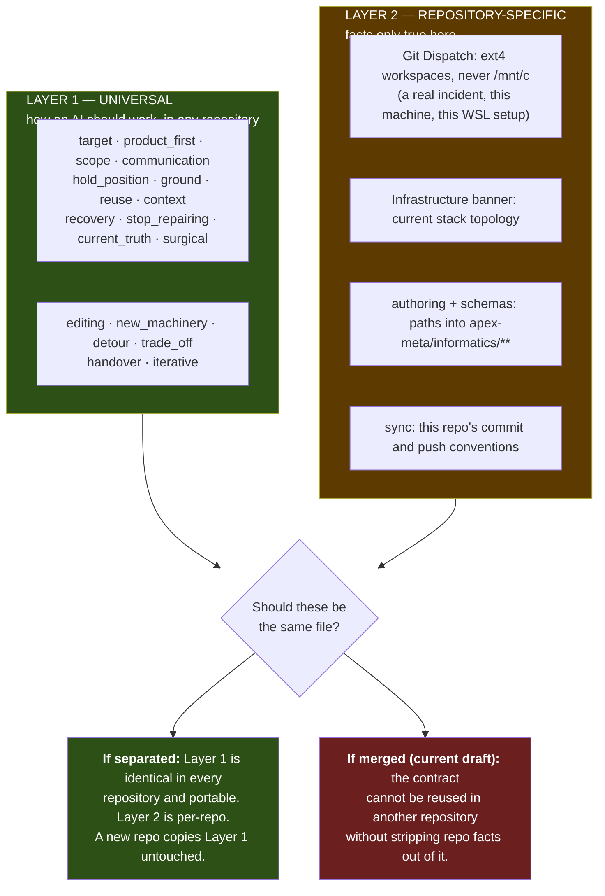

# Instruction Surface Architecture — Five Files, Two Layers

**Two findings, one new question.**

1. **Measured:** this repository has five agent instruction surfaces. Three are hand-maintained
   copies of each other and have already drifted apart.
2. **New question, from the operator:** the contract being built mixes two different kinds of rule —
   *how an AI should work in general* and *facts about this specific repository*. Those should
   probably not live in the same layer. Nothing in this project has addressed that yet.

---

## 1. The surface map — measured



Shared headings across the copy set: `Git Dispatch`, `Directness`, `Core Intent Execution`, `Scope`,
and `Informatics & Knowledge Routing` in two of three.

### Drift already present

| Comparison | Finding |
|---|---|
| `AGENTS.md` vs `CLAUDE.md` | Infrastructure banner diverged — different wording, different ordering, different description of which files are superseded |
| `AGENTS.md` vs `GEMINI.md` | **`GEMINI.md` is missing the entire `## Informatics & Knowledge Routing` section** |

**`D10`** `[P1 | I86/E100/R10]` — Gemini agents currently receive no informatics routing at all.
Nothing detected this. Same class as `D2` and `D9`: a hand-maintained copy that silently stopped
agreeing. Live today, independent of the contract work, fixable now.

Reproduce:

```bash
diff <(sed 's/[[:space:]]*$//' AGENTS.md) <(sed 's/[[:space:]]*$//' GEMINI.md)
```

---

## 2. The layering question — new, and unresolved

The operator's framing:

> *"We give every AI this kind of like, but we are building now so that it understands how to work
> in general. And then it gets specific information by the agent's repo."*

That is a **two-layer model**, and the contract as currently drafted violates it by mixing both
layers in one block.



### Why this matters now

The v0.5 block is **already mixed**. `<authoring>` and `<schemas>` carry `ref=` paths into
`apex-meta/informatics/**`. `<sync>` encodes this repository's git conventions. Those are Layer 2.
Everything else is Layer 1 and would be valid, unchanged, in any repository.

If the layers were separated, Layer 1 — roughly **1,200 of the 1,622 tokens** — becomes a portable
artifact. That is also a partial answer to the sizing pressure: the *per-repo* surface shrinks to
Layer 2 only, even though the total an agent loads does not change.

### What this does **not** resolve

Separating the layers does not reduce what any single agent loads. Both layers still load. The gain
is **portability and single-ownership**, not token count. Stating that plainly because the sizing
discussion has been running in parallel and these two things are easy to conflate.

---

## 3. What is verified, and what I am assuming

I have been reasoning about which tool reads which file without verifying it. Stated honestly:

| Claim | Status |
|---|---|
| Five instruction files exist with these sizes and headings | **Verified** — direct inspection |
| `AGENTS.md`, `CLAUDE.md`, `GEMINI.md` have drifted | **Verified** — `diff` output above |
| No `@path` import is used in any of them | **Verified** — grep |
| The suite's own P0 rule forbids eager `@path` imports | **Verified** — `index.md:15`, router `:13` |
| Claude Code reads `CLAUDE.md` and `.claude/CLAUDE.md` | **Assumed** |
| Gemini reads `GEMINI.md` and **only** `GEMINI.md` | **Assumed** — the operator raised this directly and it is unverified |
| Codex reads `AGENTS.md` | **Assumed** |
| `AGENTS.md` is becoming a cross-tool convention several tools honour | **Assumed, and load-bearing** — if true, the copy set may be unnecessary |

**The last two matter most.** If `AGENTS.md` is genuinely cross-tool, maintaining three copies is
solving a problem that no longer exists. If each tool strictly reads only its own file, the copy set
is mandatory and the byte-identity test is the right answer. **The entire `DEC-21` resolution turns
on which of these is true, and I do not know.** Routed to `RP-10`.

---

## 4. Open questions

| # | Question | Where |
|---|---|---|
| Q1 | Does each tool read only its own file, or is `AGENTS.md` cross-tool? | `RP-10` |
| Q2 | Does every repository get an `AGENTS.md` by convention, or only some? | `RP-10` |
| Q3 | Should universal rules and repo-specific facts be separate files, separate sections, or separate layers inside one file? | `RP-10` |
| Q4 | Is there an established mechanism for keeping one rule set consistent across tool-specific files? | `RP-03`, `RP-09`, `RP-10` |
| Q5 | If Layer 1 is portable, where does it live so several repositories can share it? | `RP-10` |

---

## 5. Provisional position — hold loosely

Pending `RP-10`, the working assumption is:

- **Layer 1** (universal) is the contract block, minus the `ref=` paths and `<sync>`.
- **Layer 2** (repo-specific) is `Git Dispatch`, the infrastructure banner, the informatics paths,
  and the sync conventions.
- They live in the **same file** for now, visually separated, because splitting them before Q1 and
  Q5 are answered would be structure invented ahead of evidence.
- `D10` gets fixed immediately — it needs no architecture decision.

**This position is weakly held.** It exists so work can continue, not because it is settled.
