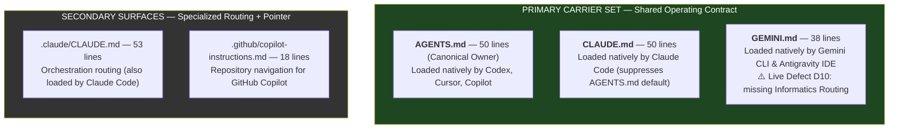
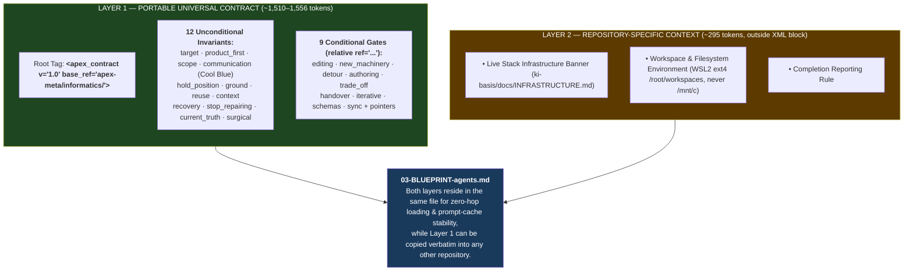

# Instruction Surface Architecture — Five Files, Two Layers (`v1.0`)

> **Status: Finalized Architecture (`RP-10` Verified).** Integrates the vendor-documented 2026 loader precedence matrix from [RESULTS-10-surface-layering.md](file:///c:/GitDev/apexai-os-meta/apex-meta/informatics/Agent_Setup/NextIteration/v2-always-on-architecture/ResearchOfFile10/Apex_Informatics_Research_Results_2026-10-21/RESULTS-10-surface-layering.md) and resolves all five open architectural questions (`Q1`–`Q5`).

---

## 1. The Five-Surface Map & Measured Drift

### Verified Drift in Live Root Files Today
| Comparison | Verified Finding |
|---|---|
| `AGENTS.md` vs `CLAUDE.md` | Infrastructure banner diverged (different wording, ordering, and superseded-file notices). |
| `AGENTS.md` vs `GEMINI.md` | **`D10` `[P1 \| I86/E100/R10]`:** `GEMINI.md` is missing the entire `## Informatics & Knowledge Routing` section. |

---

## 2. Verified 2026 Tool Loader Matrix (`RP-10` Fact-Finding)

Legend: **Y** = native default load; **C** = conditional; **N** = not loaded by default. Sources: [Anthropic Claude Code Memory Docs](https://code.claude.com/docs/en/memory), [Gemini CLI Context Docs](https://geminicli.com/docs/cli/gemini-md/), [OpenAI Codex Prompting Guide](https://developers.openai.com/cookbook/examples/gpt-5/codex_prompting_guide), [GitHub Copilot Instructions Matrix](https://docs.github.com/en/copilot/reference/custom-instructions-support), [Cursor Rules Docs](https://docs.cursor.com/context/rules-for-ai).

| Tool / Environment | `AGENTS.md` | `CLAUDE.md` | `GEMINI.md` | `.claude/CLAUDE.md` | `.github/copilot-instructions.md` | Key Precedence / Loader Rule |
|---|---|---|---|---|---|---|
| **Codex CLI** | **Y** | N | N | N | N | Loads `AGENTS.md` hierarchically root-to-CWD. |
| **Claude Code (>=2.1.277)** | **C (Skipped here)** | **Y** | N | **Y** | N | Supports `AGENTS.md` **only if** no `CLAUDE.md` or `.claude/CLAUDE.md` exists (unless configured to `claude-md-and-agents-md`). Because this repo has `CLAUDE.md` and `.claude/CLAUDE.md`, Claude skips `AGENTS.md` by default. |
| **Gemini CLI & Antigravity IDE** | **N** (unless configured) | N | **Y** | N | N | Defaults to `GEMINI.md`. Antigravity IDE injects `AGENTS.md` and `GEMINI.md` via `<RULE>` tags. |
| **GitHub Copilot (CLI / VS Code / Cloud)** | **Y** | Y (CLI/Cloud) | Y (CLI/Cloud) | Y (CLI) | **Y** | Combines applicable instruction files; VS Code Chat reads `AGENTS.md` and `.github/copilot-instructions.md`. |
| **Cursor** | **Y** (root) | N | N | N | N | Reads root `AGENTS.md` and `.cursor/rules/*.mdc`. |

### Critical Engineering Consequence (Why Physical Byte-Identical Carriers Beat `@import` Shims)
`RESULTS-10` noted that Claude Code CLI (`@AGENTS.md`) and Gemini CLI (`@./AGENTS.md`) support file imports in CLI mode. **However**, IDE rule injectors (such as Antigravity's `<RULE>` injector, VS Code extensions, and third-party harnesses) read `AGENTS.md`, `CLAUDE.md`, and `GEMINI.md` as **raw text** without running CLI-specific `@` preprocessors.
- Therefore, replacing `GEMINI.md` or `CLAUDE.md` with a 1-line `@AGENTS.md` shim would cause IDE-based agents to see only the literal string `@AGENTS.md` and lose the entire contract!
- **Finalized Solution (`DEC-21` + `RP-09` DITA Single-Source Projection):** `AGENTS.md` is the canonical owner, and `CLAUDE.md` and `GEMINI.md` carry byte-identical `<apex_contract v="1.0">` blocks verified by an automated `pytest` gate. Zero runtime `@import` fragility, zero extra `read_file` hops, and 100% compatibility across every CLI and IDE.

---

## 3. Finalized Two-Layer Architecture (`Layer 1` Portable vs. `Layer 2` Repo-Specific)

---

## 4. Resolution of All Five Architectural Questions (`Q1`–`Q5`)

| # | Question | Finalized `v1.0` Resolution `[P-Tier \| I/E/R]` |
|---|---|---|
| **Q1** | Does each tool read only its own file, or is `AGENTS.md` cross-tool? | **`[P0 \| I95/E95/R05]`** `AGENTS.md` is read by Codex, Cursor, and Copilot, **but skipped by default in Claude Code (when `CLAUDE.md` exists) and Gemini CLI**. All three primary carriers (`AGENTS.md`, `CLAUDE.md`, `GEMINI.md`) must remain populated. |
| **Q2** | Does every repository get an `AGENTS.md` by convention? | **`[P1 \| I85/E90/R05]`** Yes — `AGENTS.md` is the canonical cross-tool root owner in every Apex repository. |
| **Q3** | Separate files, separate sections, or separate layers inside one file? | **`[P0 \| I92/E90/R08]`** **Two clearly delimited layers inside one file** ([03-BLUEPRINT-agents.md](file:///c:/GitDev/apexai-os-meta/apex-meta/informatics/Agent_Setup/NextIteration/v2-always-on-architecture/03-BLUEPRINT-agents.md)): Layer 1 (`<apex_contract v="1.0" base_ref="...">`) + Layer 2 (Markdown sections outside the XML block). Avoids Turn-1 file-read latency while preserving 100% copy-paste portability. |
| **Q4** | Mechanism for keeping the rule set consistent across tool-specific files? | **`[P0 \| I94/E95/R08]`** Single canonical source (`13-candidate-3A-xml.md` / `AGENTS.md`) + automated `pytest` byte-identity assertion across `AGENTS.md`, `CLAUDE.md`, and `GEMINI.md`. |
| **Q5** | Where does portable Layer 1 live so several repositories can share it? | **`[P1 \| I90/E88/R08]`** Inside `<apex_contract v="1.0" base_ref="apex-meta/informatics/">` (owned during spec development by [13-candidate-3A-xml.md](file:///c:/GitDev/apexai-os-meta/apex-meta/informatics/Agent_Setup/NextIteration/v2-always-on-architecture/13-candidate-3A-xml.md) / [14-candidate-3B-hybrid.md](file:///c:/GitDev/apexai-os-meta/apex-meta/informatics/Agent_Setup/NextIteration/v2-always-on-architecture/14-candidate-3B-hybrid.md), and mirrored to the portable router artifact upon deployment). Changing `base_ref` on line 1 adapts the entire contract to any repository layout. |
