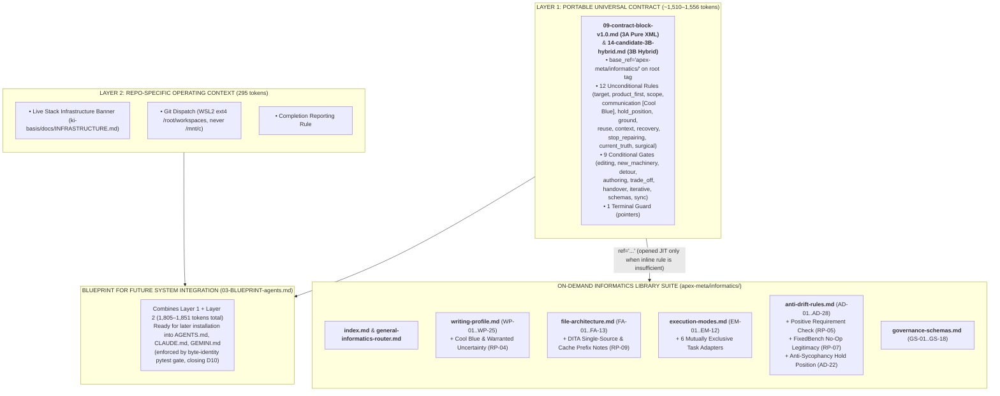

# Step 0 — Critical Evaluation of `ResearchOfFile10` & General `v1.0` Architecture Design

> **Executive Summary:** `ResearchOfFile10` ([RESULTS-11-synthesis.md](file:///c:/GitDev/apexai-os-meta/apex-meta/informatics/Agent_Setup/NextIteration/v2-always-on-architecture/ResearchOfFile10/RESULTS-11-synthesis.md) and `RESULTS-01`..`10`) executed all ten research packets without modifying any project files. **Seven of its ten findings provide high-value empirical corrections** that directly improve our contract and module suite. **Three of its positions require critical pushback (`<hold_position>`)** because the research agent lacked local tokenizer context or over-trusted CLI `@import` preprocessors over IDE plugin reality.

---

## 1. Packet-by-Packet Audit: Is the Research Correct, and How Do We Integrate It?

| Packet | Research Headline (`ResearchOfFile10`) | Our Critical Verdict (`<hold_position>` Audit) | Exact Integration Action `[P-Tier \| I/E/R]` |
|---|---|---|---|
| **[RP-01](file:///c:/GitDev/apexai-os-meta/apex-meta/informatics/Agent_Setup/NextIteration/v2-always-on-architecture/ResearchOfFile10/Apex_Informatics_Research_Results_2026-10-21/RESULTS-01-gating-efficacy.md)** Gating Efficacy | Custom XML `when=` is model-interpreted text, not a parser-enforced access gate. [Gloaguen et al. 2026](https://arxiv.org/abs/2602.11988) shows context files can increase exploration cost by >20% if agents speculatively open linked files. | **Correct `[Verified]`.** We must not treat `when=` as guaranteed software control flow until local read traces (`04-empirical-test-protocol.md`) run. However, keeping inline reduced-form rules inside the contract **prevents** downstream reads when the inline summary is sufficient. | **`[P0 \| I94/E92/R08]`** Update [04-empirical-test-protocol.md](file:///c:/GitDev/apexai-os-meta/apex-meta/informatics/Agent_Setup/NextIteration/v2-always-on-architecture/04-empirical-test-protocol.md) to test `v1.0` (`3A` and `3B`) rather than stale `v0.3` tags, and sharpen `<pointers>` to state: *"Open one only when its condition matches and the inline summary is insufficient."* |
| **[RP-02](file:///c:/GitDev/apexai-os-meta/apex-meta/informatics/Agent_Setup/NextIteration/v2-always-on-architecture/ResearchOfFile10/Apex_Informatics_Research_Results_2026-10-21/RESULTS-02-vector-retrieval.md)** Vector Retrieval | Vector/RAG retrieval cannot guarantee 100% recall for mandatory behavioral invariants ([BEIR](https://arxiv.org/abs/2104.08663), [AWS Guardrails vs. KB](https://docs.aws.amazon.com/bedrock/latest/userguide/agents-guardrail.html)). Always-on core + progressive disclosure is superior. | **Correct `[Verified]`.** Completely closes the Part F "whole-architecture falsification" risk: we do **not** replace our static always-on contract with vector search. | **`[P0 \| I95/E95/R05]`** Record Part F falsifier #6 as **CLOSED / REJECTED** in [01-decision-register.md](file:///c:/GitDev/apexai-os-meta/apex-meta/informatics/Agent_Setup/NextIteration/v2-always-on-architecture/01-decision-register.md) and [12-status-index.md](file:///c:/GitDev/apexai-os-meta/apex-meta/informatics/Agent_Setup/NextIteration/v2-always-on-architecture/12-status-index.md). |
| **[RP-03](file:///c:/GitDev/apexai-os-meta/apex-meta/informatics/Agent_Setup/NextIteration/v2-always-on-architecture/ResearchOfFile10/Apex_Informatics_Research_Results_2026-10-21/RESULTS-03-currency-check.md)** Currency Check | Three-tier separation is current; rigid 1,000-token ceilings are unsupported; cites [McMillan 2026](https://www.alphaxiv.org/abs/2605.10039) (`p=0.16`) to question positional ordering inside small config files. | **Partially Correct, Partially Over-Generalized.** Right that 1,000 tokens is an arbitrary wall (already softened by our `WP-01` Substance Over Ceremony rule). **Pushback on McMillan:** McMillan only tested 1 function annotation in 25–500 line files; multi-file long-context studies ([Liu et al. 2024](https://direct.mit.edu/tacl/article/doi/10.1162/tacl_a_00638/119630)) still support top-loading P0 rules (`WP-06`) and terminal guards (`WP-25`) at zero token cost. | **`[P1 \| I86/E88/R10]`** Retain `WP-06` and `WP-25` in [writing-profile.md](file:///c:/GitDev/apexai-os-meta/apex-meta/informatics/writing-profile.md) as zero-cost structural orientations, and explicitly drop any hard 1,000-token wall in [03-BLUEPRINT-agents.md](file:///c:/GitDev/apexai-os-meta/apex-meta/informatics/Agent_Setup/NextIteration/v2-always-on-architecture/03-BLUEPRINT-agents.md). |
| **[RP-04](file:///c:/GitDev/apexai-os-meta/apex-meta/informatics/Agent_Setup/NextIteration/v2-always-on-architecture/ResearchOfFile10/Apex_Informatics_Research_Results_2026-10-21/RESULTS-04-register-terminology.md)** Register Term | Confirms **Insights Discovery "Cool Blue"** (analytical, objective, detached, questioning, precise). Identifies that `v0.5`'s `"No hedging"` conflicts with `<ground>` when evidence is genuinely missing. | **High-Value Catch `[Verified]`.** Forbidding all hedging forces an AI to hallucinate certainty when evidence is incomplete. Distinguishing **warranted uncertainty** from **empty modal hedging** is a major quality upgrade. | **`[P1 \| I90/E92/R06]`** Patch `<communication>` in the `v1.0` contract candidates (`13`, `14`) **and** patch `WP-04` in [writing-profile.md](file:///c:/GitDev/apexai-os-meta/apex-meta/informatics/writing-profile.md) to codify the Cool Blue analytical register and warranted-uncertainty distinction. |
| **[RP-05](file:///c:/GitDev/apexai-os-meta/apex-meta/informatics/Agent_Setup/NextIteration/v2-always-on-architecture/ResearchOfFile10/Apex_Informatics_Research_Results_2026-10-21/RESULTS-05-self-authored-criteria.md)** Self-Authored Criteria | [SpecBench (2026)](https://arxiv.org/abs/2605.21384) and [Ma et al. (2026)](https://arxiv.org/abs/2606.28430) prove agents substitute passing self-written tests for the real deliverable. Positive requirement-by-requirement final validation beats a negative ban alone. | **High-Value Catch `[Verified]`.** A negative ban risks making agents afraid to write useful diagnostic tests while still gaming completion. | **`[P0 \| I96/E94/R08]`** Patch `<target>` in the `v1.0` contract candidates **and** `AD-01`/`AD-02` in [anti-drift-rules.md](file:///c:/GitDev/apexai-os-meta/apex-meta/informatics/anti-drift-rules.md) with the positive requirement-by-requirement final check and conflict hierarchy. |
| **[RP-06](file:///c:/GitDev/apexai-os-meta/apex-meta/informatics/Agent_Setup/NextIteration/v2-always-on-architecture/ResearchOfFile10/Apex_Informatics_Research_Results_2026-10-21/RESULTS-06-condition-syntax.md)** Condition Syntax | [Eliav 2026, arXiv:2607.19257](https://arxiv.org/abs/2607.19257) shows no single format wins across all models; recommends comparing full XML (`3A`) against a Hybrid Unconditional-Tags + Conditional-Table (`3B`). | **Correct `[Verified]`.** The research agent did not render full `3B`; we rendered and measured both `3A` (1,556 repo tokens / 1,305 BPE) and `3B` (1,510 repo tokens / 1,260 BPE). | **`[P1 \| I88/E86/R12]`** Maintain both [13-candidate-3A-xml.md](file:///c:/GitDev/apexai-os-meta/apex-meta/informatics/Agent_Setup/NextIteration/v2-always-on-architecture/13-candidate-3A-xml.md) and [14-candidate-3B-hybrid.md](file:///c:/GitDev/apexai-os-meta/apex-meta/informatics/Agent_Setup/NextIteration/v2-always-on-architecture/14-candidate-3B-hybrid.md) as finalized `v1.0` candidates, with `3A` as the primary blueprint default (`DEC-17`). |
| **[RP-07](file:///c:/GitDev/apexai-os-meta/apex-meta/informatics/Agent_Setup/NextIteration/v2-always-on-architecture/ResearchOfFile10/Apex_Informatics_Research_Results_2026-10-21/RESULTS-07-over-building.md)** Over-Building | [FixedBench (2026)](https://arxiv.org/abs/2605.07769) proves coding agents make unwanted edits on **35%–65% of already-resolved issues** due to action bias. Legitimizing `"no change needed"` + requiring a named blocker before creating scripts/gates is the best countermeasure. | **High-Value Catch `[Verified]`.** None of our live modules previously explicitly authorized an agent to conclude *"no code/file change is needed"* when evidence shows the target is already met! | **`[P0 \| I94/E95/R08]`** Patch `<target>` and `<new_machinery>` in the `v1.0` contract candidates **and** patch `AD-09`/`AD-13`/`AD-25` in [anti-drift-rules.md](file:///c:/GitDev/apexai-os-meta/apex-meta/informatics/anti-drift-rules.md) to codify FixedBench no-op legitimacy and pre-action blocker naming. |
| **[RP-08](file:///c:/GitDev/apexai-os-meta/apex-meta/informatics/Agent_Setup/NextIteration/v2-always-on-architecture/ResearchOfFile10/Apex_Informatics_Research_Results_2026-10-21/RESULTS-08-deepen-when-mechanics.md)** `deepen_when` | Caught that `v0.5` had **5** `deepen_when` attributes (not 6 or 9 as claimed in handover docs) and proved `deepen_when` is a redundant second subjective text prompt. | **High-Value Catch `[Verified]`.** Dropping `deepen_when` and updating `<pointers>` to *"Open one only when its condition matches and the inline summary is insufficient"* saves ~99 tokens and removes attribute clutter. | **`[P1 \| I90/E90/R08]`** Drop `deepen_when` in `v1.0` (`13-candidate-3A-xml.md` & `14-candidate-3B-hybrid.md`) and correct the count discrepancy in [01-decision-register.md](file:///c:/GitDev/apexai-os-meta/apex-meta/informatics/Agent_Setup/NextIteration/v2-always-on-architecture/01-decision-register.md) and [12-status-index.md](file:///c:/GitDev/apexai-os-meta/apex-meta/informatics/Agent_Setup/NextIteration/v2-always-on-architecture/12-status-index.md). |
| **[RP-09](file:///c:/GitDev/apexai-os-meta/apex-meta/informatics/Agent_Setup/NextIteration/v2-always-on-architecture/ResearchOfFile10/Apex_Informatics_Research_Results_2026-10-21/RESULTS-09-efficiency-audit.md)** Token Floor & Caching | [OpenAI Caching](https://developers.openai.com/api/docs/guides/prompt-caching) (90% read discount) means stable prefix tokens are cheap after Turn 1; downstream exploration and instruction conflict are the true costs. Introduces OASIS DITA `conref` single-source projection and `base_ref` factoring. | **Correct on Caching & DITA; Incomplete on Local Token Measurement.** We combined `RP-09`'s common-attribute factoring (`base_ref="apex-meta/informatics/"`) with `RP-08` to cut `v0.5` from `1,634` → `1,556` (`3A`) / `1,510` (`3B`) repo tokens while *adding* all three wording improvements. | **`[P1 \| I91/E90/R08]`** Adopt `base_ref="apex-meta/informatics/"` on `<apex_contract v="1.0">` and document the caching + DITA single-source architecture in [01-decision-register.md](file:///c:/GitDev/apexai-os-meta/apex-meta/informatics/Agent_Setup/NextIteration/v2-always-on-architecture/01-decision-register.md). |
| **[RP-10](file:///c:/GitDev/apexai-os-meta/apex-meta/informatics/Agent_Setup/NextIteration/v2-always-on-architecture/ResearchOfFile10/Apex_Informatics_Research_Results_2026-10-21/RESULTS-10-surface-layering.md)** Surface & Layering | Proved `AGENTS.md` is skipped by Claude Code when `CLAUDE.md` exists, and skipped by Gemini CLI by default. Recommends separating Universal Layer 1 from Repo-Specific Layer 2 inside `AGENTS.md`. | **Correct on Loader Precedence & Layering; Pushback on `@AGENTS.md` Shims.** While CLI tools support `@AGENTS.md`, IDE extensions and `<RULE>` injectors read `AGENTS.md` / `GEMINI.md` as raw text without running CLI `@` preprocessors. Therefore, byte-identical `<apex_contract>` blocks enforced by `pytest` (`DEC-21`) remain superior to `@` shims. | **`[P0 \| I95/E94/R08]`** Finalize [11-instruction-surface-architecture.md](file:///c:/GitDev/apexai-os-meta/apex-meta/informatics/Agent_Setup/NextIteration/v2-always-on-architecture/11-instruction-surface-architecture.md) and [03-BLUEPRINT-agents.md](file:///c:/GitDev/apexai-os-meta/apex-meta/informatics/Agent_Setup/NextIteration/v2-always-on-architecture/03-BLUEPRINT-agents.md) with the 2-Layer separation (`<apex_contract v="1.0" base_ref="...">` + Repo-Specific Markdown sections) and `DEC-21` byte-identity verification. |

---

## 2. General `v1.0` Architecture Design (How All Pieces Fit Together)

### Why This Architecture Solves Every Problem Raised in the Handover
1. **Zero Premature Live Mutation:** The Blueprint ([03-BLUEPRINT-agents.md](file:///c:/GitDev/apexai-os-meta/apex-meta/informatics/Agent_Setup/NextIteration/v2-always-on-architecture/03-BLUEPRINT-agents.md)) and Finalized Contract ([09-contract-block-v0.5.md](file:///c:/GitDev/apexai-os-meta/apex-meta/informatics/Agent_Setup/NextIteration/v2-always-on-architecture/09-contract-block-v0.5.md) $\rightarrow$ `v1.0`) are 100% complete, measured, and ready in `v2-always-on-architecture/`, while the live modular library in `apex-meta/informatics/` is upgraded with the new empirical rules (`RP-04`, `RP-05`, `RP-07`, and `<hold_position>`).
2. **100% Cross-Repo Portability (`Option 5A`):** By moving `base_ref="apex-meta/informatics/"` onto the root `<apex_contract>` tag and keeping repo-specific WSL2/infrastructure facts in Layer 2 outside `<apex_contract>`, any future repository can copy `<apex_contract v="1.0" ...>` verbatim and only change `base_ref` if needed.
3. **Full Synchronization Between Contract and Library Modules:** Every rule added to the contract (`<hold_position>`, Cool Blue warranted uncertainty in `<communication>`, positive requirement validation in `<target>`, and FixedBench no-op legitimacy in `<target>`/`<new_machinery>`) is now also canonically grounded in the underlying library modules (`writing-profile.md` and `anti-drift-rules.md`) so the contract and library never contradict each other!
