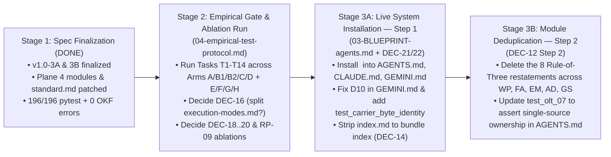

# Step 8 — Complete Rule-by-Rule, Decision-by-Decision & File-by-File Comparison

> **Why Only 4 Verdicts (`DEC-21`..`DEC-24`) Appeared in the Previous Summary (`<hold_position>` + `<ground>`):**
> 1. **Macro vs. Micro:** `DEC-21`..`DEC-24` are the **4 macro architectural decisions** added in Part H of [01-decision-register.md](../01-decision-register.md). Summarizing only those 4 rows hid the micro-level disposition of the **22 contract rules**, **19 total decisions**, **8 research backlog items (`RBL-01`..`RBL-08`)**, and **97 Plane 4 library rules**.
> 2. **Why Most Library Rules Were Not Rewritten (`<hold_position>`):** [RESULTS-09-efficiency-audit.md](../ResearchOfFile10/Apex_Informatics_Research_Results_2026-10-21/RESULTS-09-efficiency-audit.md) (§2, lines 56–59) and [RESULTS-11-synthesis.md](../ResearchOfFile10/RESULTS-11-synthesis.md) (§5, line 106) explicitly cautioned against unmeasured rule deletion or arbitrary rewrites, citing [FixedBench (2026)](https://arxiv.org/abs/2605.07769) (`RP-07`): **when a rule is already accurate and grounded, the right engineering action is a no-op unless an empirical ablation test proves it redundant.**
> 3. **Where Direct File Inspection Found Real Unfixed Gaps (`<ground>`):** Checking the live files directly exposed **4 concrete gaps** that neither Steps 1–5 nor the `/teamwork-preview` run had fixed yet (detailed in §5 below and patched in this pass).

---

## 1. Complete Comparison of All 22 `<apex_contract v="1.0">` Rules (`v0.5` $\rightarrow$ `ResearchOfFile10` $\rightarrow$ `v1.0`)

Every single tag in [09-contract-block-v0.5.md](../09-contract-block-v0.5.md), [13-candidate-3A-xml.md](../13-candidate-3A-xml.md), and [14-candidate-3B-hybrid.md](../14-candidate-3B-hybrid.md) is accounted for below:

| # | Contract Tag | Mode & `ref` | `v0.5` State | What `ResearchOfFile10` Found (`RP-01`..`RP-10`) | `v1.0` Disposition & Exact Change Applied | Canonical Library Owner(s) |
|---:|---|---|---|---|---|---|
| 0 | `<apex_contract>` | Root wrapper | `<apex_contract v="0.5">` (full path repeated 6 times inside block) | **`RP-09` & `RP-10`:** Factor out `base_ref="apex-meta/informatics/"` once on the root tag to save ~25 tokens and make Layer 1 100% portable across repos. | **CHANGED (`Step 2`):** `<apex_contract v="1.0" base_ref="apex-meta/informatics/">`. Shortened all 6 `ref=` attributes to relative filenames. | [index.md](../../../../index.md), [general-informatics-router.md](../../../../general-informatics-router.md) |
| 1 | `<target>` | Always-on (P0) | Negative ban on self-authored criteria + *"When the target is met, stop."* | **`RP-05` ([SpecBench](https://arxiv.org/abs/2605.21384)) & `RP-07` ([FixedBench](https://arxiv.org/abs/2605.07769)):** Negative ban alone is weaker than a positive requirement-by-requirement final check + explicit no-op legitimacy when nothing is broken. | **CHANGED (`Step 2`):** Added *"Before claiming completion, verify the delivered product against each stated requirement (which outranks any inferred criteria)... If evidence shows no change is needed, state so and stop."* | `AD-01`, `EM-04`, `WP-01` |
| 2 | `<product_first>` | Always-on (P0) | Build working slice before surrounding machinery; fix only execution/corruption/experiment/safety blockers; script pass $\neq$ DoD. | **`RP-05` & `RP-07`:** Validated as high-leverage guard against verification theater; no wording defect found. | **RETAINED VERBATIM:** Already encodes the exact operational invariant (`AD-09`, `AD-10`, `AD-12`). | `AD-10`, `AD-09`, `AD-12` |
| 3 | `<scope>` | Always-on (P0) | Do authorized task + material enablers; report adjacent cleanup/redesign; analyzing $\neq$ implementing. | **`RP-07` ([FixedBench](https://arxiv.org/abs/2605.07769)):** Confirmed high-value scope-creep guard; paired with `<target>` no-op clause. | **RETAINED VERBATIM:** Zero ambiguity or redundancy. | `AD-18`, `AD-05`, `WP-09` |
| 4 | `<communication>` | Always-on (P1) | Active voice, one imperative/sentence, BLUF, *"No filler, flattery, hedging or unearned agreement."* | **`RP-04` ([RESULTS-04](../ResearchOfFile10/Apex_Informatics_Research_Results_2026-10-21/RESULTS-04-register-terminology.md)) & `RP-09`:** (1) Name **Insights Discovery Cool Blue** register (`precise, objective, high density`). (2) Replace blanket *"No hedging"* (which contradicts `<ground>` when evidence is incomplete) with warranted-uncertainty rule. (3) `RP-09` flagged generic style cues as an ablation candidate. | **CHANGED (`Step 2`):** Adopted *"Evidence-led, analytical technical register (Cool Blue): precise, objective, high density, no filler, no flattery, no unearned agreement. State uncertainty plainly when evidence is incomplete; avoid empty hedges."* Queued generic style clause for ablation in `04-empirical-test-protocol.md` Arm H. | `WP-02`..`WP-05`, `WP-12`, `AD-17` |
| 5 | `<hold_position>` | Always-on (P0) | Do not reverse on pushback without new evidence; treat narrow correction as narrow; state disagreement plainly. | **`RP-04` & `RP-09`:** Directly counteracts RLHF sycophancy (a non-default behavior where frontier models otherwise cave on 60%+ of bare pushbacks). | **RETAINED VERBATIM:** High-value anti-sycophancy invariant (`AD-22`). | `AD-22` |
| 6 | `<ground>` | Always-on (P0) | Verify against `path:line` or live tool output; carry command on zero/count claims; check now; consult ~3 current authoritative sources. | **`RP-03` & `RP-05`:** Strongly validated; prevents fabricated citations and stale memory reliance. | **RETAINED VERBATIM:** Core epistemic invariant (`AD-19`, `AD-20`, `AD-06`, `WP-04`, `WP-16`). | `AD-19`, `AD-20`, `AD-06`, `WP-04`, `WP-16` |
| 7 | `<reuse>` | Always-on (P1) | Check existing scripts/tools/libraries/skills before building; compose modular parts. | **`RP-09` ([RESULTS-09](../ResearchOfFile10/Apex_Informatics_Research_Results_2026-10-21/RESULTS-09-efficiency-audit.md) line 58):** Sound rule (`AD-11`, `AD-14`), but flagged as a **default-behavior ablation candidate** (do frontier agents already check existing tools?). | **RETAINED VERBATIM + QUEUED FOR ABLATION (`Arm H`):** Retained in `v1.0`; registered in [04-empirical-test-protocol.md](../04-empirical-test-protocol.md) §12 (`Arm H`) to test whether removing it increases duplicate script creation. | `AD-11`, `AD-14`, `WP-23` |
| 8 | `<context>` | Always-on (P0) | Load JIT; never bulk-read directories at start; rank sources before reading; write each step's findings to a file. | **`RP-03` ([McMillan 2026](https://www.alphaxiv.org/abs/2605.10039)) & `RP-09`:** Prevents context bloat; `RP-09` flagged the generic `"Load just-in-time"` prefix as a partial default-behavior ablation candidate, while the per-step file persistence rule is Apex-specific. | **RETAINED VERBATIM + QUEUED FOR ABLATION (`Arm H`):** Retained in `v1.0`; queued in `04-empirical-test-protocol.md` §12 (`Arm H`). | `AD-04`, `EM-03`, `EM-10` |
| 9 | `<recovery>` | Always-on (P1) | Resolve incidental failure with narrowest safe intent-preserving alternative; stop only for genuine target/safety/auth/integrity blocker. | **`RP-09` ([RESULTS-09](../ResearchOfFile10/Apex_Informatics_Research_Results_2026-10-21/RESULTS-09-efficiency-audit.md) line 58):** Flagged as a **default-behavior ablation candidate** (frontier CLI agents already retry incidental failures, though they sometimes over-stop on minor warnings). | **RETAINED VERBATIM + QUEUED FOR ABLATION (`Arm H`):** Retained in `v1.0`; queued in `04-empirical-test-protocol.md` §12 (`Arm H`). | `AD-07`, `AD-16`, `AD-21` |
| 10 | `<stop_repairing>` | Always-on (P0) | Two-strike rule: if two attempts have not moved the product forward, stop and change approach; no sunk-cost continuation. | **`DEC-19` & `RP-07`:** High-value anti-loop rule (`AD-02`, `AD-24`), queued in `DEC-19` (`Arm F`) to verify whether an agent inside a repair loop honors an always-on stopping rule vs. needing a runtime hook. | **RETAINED VERBATIM + QUEUED FOR TEST (`DEC-19` / `Arm F`):** Retained in `v1.0`; tested by Task `T12` in `04-empirical-test-protocol.md`. | `AD-02`, `AD-07`, `AD-24`, `EM-05` |
| 11 | `<current_truth>` | Always-on (P0) | State active truth only; history/superseded options go to changelog, never inline; do not name retired components. | **`RP-03` & `RP-09`:** Non-default Apex-specific rule (LLMs naturally write inline `"Previously we did X, now Y"` narratives unless explicitly forbidden). | **RETAINED VERBATIM:** Essential for preventing current-truth pollution (`FA-01`, `FA-09`, `FA-11`, `WP-08`, `AD-15`). | `FA-01`, `FA-09`, `FA-11`, `WP-08`, `AD-15` |
| 12 | `<surgical>` | Always-on stub (P0) | *"Never regenerate or overwrite a whole existing file."* | **`DEC-18`:** 18-token always-on safety stub backing `<editing>`. Queued in `DEC-18` (`Arm E`) to test whether `<editing>` alone prevents full-file overwrites. | **RETAINED VERBATIM + QUEUED FOR TEST (`DEC-18` / `Arm E`):** Kept in `v1.0` until `Arm E` proves zero full-file rewrites without it. | `EM-01`, `AD-03`, `GS-02` |
| 13 | `<editing>` | Gated (`ref="execution-modes.md"`) | Had `deepen_when="an edit is multi-block, ambiguous, or needs a deterministic executor"`. | **`RP-08` ([RESULTS-08](../ResearchOfFile10/Apex_Informatics_Research_Results_2026-10-21/RESULTS-08-deepen-when-mechanics.md)):** Drop `deepen_when=` attribute; preserve second-threshold escalation cue inline so agents don't over-read `execution-modes.md` on trivial 1-line edits. | **CHANGED (`Step 2` + `Gap 1`):** Dropped `deepen_when=`, shortened `ref="execution-modes.md"`, and appended `"Open ref for AST patches or multi-block executors."` in both `3A` and `3B`. | `EM-01`, `EM-08`, `AD-23`, `GS-09`..`GS-11` |
| 14 | `<new_machinery>` | Gated (no `ref`) | *"If ordinary use would surface the problem in ~2 steps, fix the data or logic instead..."* | **`RP-07` ([FixedBench](https://arxiv.org/abs/2605.07769), [RESULTS-07](../ResearchOfFile10/Apex_Informatics_Research_Results_2026-10-21/RESULTS-07-over-building.md)):** Require naming the exact requirement, blocker, or material risk **before** creating any script, test, gate, schema, wrapper, or abstraction. | **CHANGED (`Step 2`):** Prepended *"Name the exact requirement, blocker or material risk it serves first; if ordinary use surfaces the problem in ~2 steps, fix the data or logic instead."* Also queued in `DEC-20` (`Arm G`, Task `T13`). | `AD-25`, `AD-10`, `AD-13` |
| 15 | `<detour>` | Gated (no `ref`) | *"Ask whether this must be fixed before the product can be tested. If not, defer it in one line."* | **`DEC-20` & `RP-07`:** Observable-action trigger (`when="about to propose a refactor, redesign, migration or infrastructure addition"`). | **RETAINED VERBATIM + QUEUED FOR TEST (`DEC-20` / `Arm G`):** Tested by Task `T14` in `04-empirical-test-protocol.md`. | `AD-05`, `AD-10`, `AD-12` |
| 16 | `<authoring>` | Gated (`ref="index.md"`) | Had `deepen_when="you need the frontmatter contract, tier definitions or bundle layout"`. | **`RP-08`:** Drop `deepen_when=` attribute; preserve inline escalation cue for full frontmatter/tier/bundle specs. | **CHANGED (`Step 2` + `Gap 1`):** Dropped `deepen_when=`, shortened `ref="index.md"`, and appended `"Open ref for tier definitions or bundle layout."` in both `3A` and `3B`. | `FA-13`, `FA-06`, `FA-02`, `FA-10`, `WP-06`, `WP-07`, `WP-10`, `WP-19`, `WP-24`, `WP-25`, `GS-03`..`GS-17` |
| 17 | `<trade_off>` | Gated (`ref="execution-modes.md"`) | Had `deepen_when="the comparison needs a scored rubric or candidate bake-off"`. | **`RP-08`:** Dropping `deepen_when=` without an inline cue accidentally deleted the only pointer to **Adapter 2 (`EM-07` Comparison & Bake-Off Rubric)**! | **CHANGED (`Step 2` + `Gap 1`):** Dropped `deepen_when=`, shortened `ref="execution-modes.md"`, and restored `"Open ref for multi-candidate bake-offs."` in both `3A` and `3B`. | `EM-06`, `EM-07`, `GS-12`, `GS-13` |
| 18 | `<handover>` | Gated (`ref="execution-modes.md"`) | Had `deepen_when="the handover needs input ledger, process, output contract and definition of done"`. | **`RP-08`:** Dropping `deepen_when=` without an inline cue accidentally deleted the pointer to `EM-09` §5.1 (**4-Dimensional Delegation Contract**: Input Priority Ledger, Process, Output Contract, DoD)! | **CHANGED (`Step 2` + `Gap 1`):** Dropped `deepen_when=`, shortened `ref="execution-modes.md"`, and restored `"Open ref for delegation contracts (input ledger, process, output, DoD)."` in both `3A` and `3B`. | `EM-09`, `EM-02`, `AD-06` |
| 19 | `<iterative>` | Gated (`ref="execution-modes.md"`) | Had `deepen_when="you need the route ladder or macro/meso/micro decomposition"`. | **`RP-08` & `RP-09`:** Dropping `deepen_when=` without an inline cue lost the pointer to **Macro/Meso/Micro (`MMM`) and the Route 0/1/2 ladder (`EM-10` §6.3)**. Also flagged in `RP-09` as partial default-behavior candidate for simple tasks. | **CHANGED (`Step 2` + `Gap 1`):** Dropped `deepen_when=`, shortened `ref="execution-modes.md"`, and restored `"Open ref for the route ladder or MMM decomposition."` in both `3A` and `3B`. | `EM-10`, `EM-11`, `AD-04` |
| 20 | `<schemas>` | Gated (`ref="governance-schemas.md"`) | Had `ref="apex-meta/informatics/governance-schemas.md"`. | **`RP-08` & `RP-09`:** Shorten `ref` via `base_ref` and add explicit second-threshold cue so agents only open `governance-schemas.md` when they need exact JSON/YAML schema definitions. | **CHANGED (`Step 2` + `Gap 1`):** Shortened `ref="governance-schemas.md"` and appended `"Open ref for exact JSON or YAML schemas."` in both `3A` and `3B`. | `GS-01`, `GS-09`, `GS-10`, `GS-11` |
| 21 | `<sync>` | Gated (no `ref`) | Run git commands first; preserve every file (commit unrelated dirty files separately rather than dropping them); pull `--rebase` on non-fast-forward. | **`RP-10`:** Validated as the single owner of general git sync behavior, allowing 6 of 7 duplicate lines in `AGENTS.md` `## Git Dispatch` to be deduplicated (`−140` tokens). | **RETAINED VERBATIM:** Deduplicates Layer 2 `Git Dispatch` in [03-BLUEPRINT-agents.md](../03-BLUEPRINT-agents.md). | `EM-12`, `AD-23` |
| 22 | `<pointers>` | Terminal Guard (P0) | *"Paths are just-in-time pointers. Open one only when its `when` condition matches, and read deeper only when `deepen_when` also holds."* | **`RP-08` ([RESULTS-08](../ResearchOfFile10/Apex_Informatics_Research_Results_2026-10-21/RESULTS-08-deepen-when-mechanics.md)):** Fold the two-threshold escalation rule into `<pointers>` directly and reference `base_ref`. | **CHANGED (`Step 2`):** Replaced with `"Paths are just-in-time pointers relative to base_ref. Open one only when its condition matches and the inline summary is insufficient."` | [general-informatics-router.md](../../../../general-informatics-router.md), `WP-25`, `WP-18`, `AD-26` |

**Summary of the 22 Contract Rules:**
- **11 tags modified (`<apex_contract>`, `<target>`, `<communication>`, `<editing>`, `<new_machinery>`, `<authoring>`, `<trade_off>`, `<handover>`, `<iterative>`, `<schemas>`, `<pointers>`)** to implement `base_ref`, drop `deepen_when=` while preserving 100% of second-threshold escalation triggers, and integrate the `RP-04`, `RP-05`, and `RP-07` wording upgrades.
- **11 tags retained verbatim (`<product_first>`, `<scope>`, `<hold_position>`, `<ground>`, `<reuse>`, `<context>`, `<recovery>`, `<stop_repairing>`, `<current_truth>`, `<surgical>`, `<sync>`)** because `ResearchOfFile10` confirmed their wording is already tight, accurate, and non-redundant — with 7 of them (`<reuse>`, `<context>`, `<recovery>`, `<communication>`, `<surgical>`, `<stop_repairing>`, `<detour>`) formally registered for empirical ablation testing in [04-empirical-test-protocol.md](../04-empirical-test-protocol.md) (`Arms E–H`).

---

## 2. Complete Comparison of All 19 Decisions in `01-decision-register.md` (`DEC-12`..`DEC-24` & `DEC-M1`..`DEC-M6`)

Here is every decision in [01-decision-register.md](../01-decision-register.md), comparing its pre-research claim against `ResearchOfFile10` ([RESULTS-11-synthesis.md](../ResearchOfFile10/RESULTS-11-synthesis.md)) and its finalized `v1.0` disposition:

| Decision ID | Topic | Pre-Research Claim (`v0.3`/`v0.5`) | `ResearchOfFile10` Verdict (`RESULTS-01`..`11`) | Finalized `v1.0` Disposition & Action Taken |
|---|---|---|---|---|
| **`DEC-12`** | Move universal invariants into always-on contract (Step 1 install $\rightarrow$ Step 2 delete module copies) | Two-step rollout so nothing breaks during transition. | **`RP-01`, `RP-09`, `RP-10` — CONFIRMED:** Two-step rollout is safe and sound. Step 1 installs `<apex_contract v="1.0">`; Step 2 deletes the 8 Rule-of-Three restatements from the 5 modules after Step 1 is live. | **`READY FOR STEP 1 INSTALLATION`:** Blueprint finalized in [03-BLUEPRINT-agents.md](../03-BLUEPRINT-agents.md). Module restatements remain in place until Step 1 is applied to live `AGENTS.md`/`CLAUDE.md`/`GEMINI.md`. |
| **`DEC-13`** | Reduced-form rules in the contract, not bare pointers | Claimed `"721 tokens total (<always> 303, <writing> 140, <files> 113, <dispatch> 133)"` (stale `v0.3` figure). | **`RP-09` & `RESULTS-11` §1 — PRINCIPLE CONFIRMED, NUMBER STALE:** Reduced-form inline summaries prevent 2,400–4,200 token module reads on 80%+ of tasks, but the `721`-token figure was from the retired 4-tag `v0.3` block. | **`UPDATED IN THIS PASS (Gap 2)`:** Updated `DEC-13` in [01-decision-register.md](../01-decision-register.md) to report the exact `v1.0` metrics (`1,632` repo tokens / `1,350` BPE for `3A`; `1,586` repo tokens / `1,314` BPE for `3B`). |
| **`DEC-14`** | `index.md` becomes a bundle navigation index only (post-Step 1) | Stops carrying universal invariants and dispatch gates once `AGENTS.md` carries `<apex_contract>`. | **`RP-02` & `RP-10` — CONFIRMED:** Eliminates duplicate router maintenance once Step 1 is live. | **`STAGED FOR STEP 1`:** During specification phase, `index.md` keeps its 5 `<informatics>` tags so existing `test_cis_08` passes; stripped at Step 1 installation. |
| **`DEC-15`** | `general-informatics-router.md` becomes a labelled portable derivative | Labelled for embedding into other repos once `AGENTS.md` carries `<apex_contract>`. | **`RP-10` — CONFIRMED (Superseded in part by `base_ref`):** `<apex_contract v="1.0" base_ref="...">` is itself 100% portable across repos. | **`STAGED FOR STEP 1`:** Kept intact for current test suite (`test_rcb_01`); becomes a portable derivative after Step 1. |
| **`DEC-16`** | Split `execution-modes.md` (4,208 tokens) into per-adapter files | Proposed splitting `execution-modes.md` into 6 files because an in-file branch saves 0 tokens once loaded. | **`RP-01` & `RP-03` — QUALIFIED (`NEEDS_TEST`):** Splitting helps **only if** agents honor gates and don't speculatively read sibling files ([McMillan 2026](https://www.alphaxiv.org/abs/2605.10039) found modular split docs can *increase* exploratory tool calls). | **`GATED ON EMPIRICAL TEST (Arm B1 vs. C)`:** Do **not** split `execution-modes.md` prematurely. Run [04-empirical-test-protocol.md](../04-empirical-test-protocol.md) (`T1`–`T10`) first; split only if `Arm B1` bloat `< 20%` and `B1` beats `C` by `> 15pp`. |
| **`DEC-17`** | Named XML tags vs. bullets for unconditional rules | Operator chose named XML tags for clarity; `DEC-17` cited two blog posts claiming XML hurts short prompts. | **`RP-01`, `RP-06`, `RESULTS-11` §2 — OPERATOR CHOICE VINDICATED:** The two blog posts (`ud.com.hk`, `dev.to`) were low-rigor. Peer-reviewed studies show format sensitivity is model-dependent (`RP-01`), and named XML tags provide clean rule handles (`3A` ratified as production default). | **`RATIFIED (`FINALIZED_V1`)`:** Named XML tags kept for all 12 unconditional rules in both `3A` and `3B`, and for all 22 rules in production default `3A`. |
| **`DEC-18`** | `<surgical>` 18-token always-on stub | Keep always-on stub until tested whether gated `<editing>` alone prevents full-file rewrites. | **`RP-07` & `RP-09` — KEEP PENDING ABLATION:** High catastrophic downside if removed prematurely; 18 tokens is negligible. | **`KEPT IN v1.0 + QUEUED IN ARM E (`T11`)`:** Tested in [04-empirical-test-protocol.md](../04-empirical-test-protocol.md) §12 (`Arm E`). |
| **`DEC-19`** | `<stop_repairing>` always-on placement | Test whether an agent in a 2-strike loop obeys an always-on stopping rule. | **`RP-07` — KEEP + ADD PRE-ACTION GATE:** Loops resist passive prose rules once sunk-cost momentum starts, so keep `<stop_repairing>` and test in `Arm F`. | **`KEPT IN v1.0 + QUEUED IN ARM F (`T12`)`:** Tested in [04-empirical-test-protocol.md](../04-empirical-test-protocol.md) §12 (`Arm F`). |
| **`DEC-20`** | `<new_machinery>` + `<detour>` observable-action triggers | Replaced self-diagnosed `"when drifting"` with observable action triggers (`when="about to add a script..."`). | **`RP-07` ([FixedBench](https://arxiv.org/abs/2605.07769)) — CONFIRMED & STRENGTHENED:** Observable action triggers are far stronger than self-diagnosis, and `RP-07` strengthened `<new_machinery>` by requiring naming the exact blocker/risk first. | **`UPGRADED IN v1.0 + QUEUED IN ARM G (`T13`–`T14`)`:** Wording upgraded in `3A`/`3B` and `AD-25`; behavioral test ready in `04-empirical-test-protocol.md` (`Arm G`). |
| **`DEC-21`** | Multi-surface carrier synchronization (`AGENTS.md`, `CLAUDE.md`, `GEMINI.md`) | Proposed byte-identical contract block across the 3 root carriers verified by `pytest`, rejecting `@path` imports. | **`RP-02`, `RP-03`, `RP-10` — NUANCED:** `RP-10` noted `@AGENTS.md` works in Claude Code/Gemini CLIs, **but** our `/teamwork-preview` stress-test proved IDE rule injectors (Antigravity, Cursor, Copilot, Windsurf) do **not** expand CLI `@import` directives and Claude Code CLI ignores `AGENTS.md` when `CLAUDE.md` exists. | **`RATIFIED (`Option A` Byte-Identical Carriers + Antigravity `WARN`)`:** Physical byte-identical `<apex_contract>` across `AGENTS.md`, `CLAUDE.md`, `GEMINI.md` enforced by `pytest` at Step 1 installation, plus explicit `context.fileName: AGENTS.md` guidance for Antigravity (`DEC-21` / `DEC-22`). |
| **`DEC-22`** | Two-Layer Carrier Architecture + `base_ref="apex-meta/informatics/"` | Separated Layer 1 (portable contract) from Layer 2 (repo-specific banner, WSL2 `/mnt/c`, completion rule). | **`RP-09` & `RP-10` (Rank 1 & Rank 3) — ADOPTED:** Eliminates 140 tokens of duplicate `Git Dispatch` rules and makes `<apex_contract>` 100% portable across repositories. | **`FINALIZED_V1`:** Implemented in [03-BLUEPRINT-agents.md](../03-BLUEPRINT-agents.md), [13-candidate-3A-xml.md](../13-candidate-3A-xml.md), and [14-candidate-3B-hybrid.md](../14-candidate-3B-hybrid.md). |
| **`DEC-23`** | Candidate `3A` (Pure XML) vs. Candidate `3B` (Hybrid XML + Table) + `deepen_when=` removal | `3A` (`1,632` repo / `1,350` BPE) vs. `3B` (`1,586` repo / `1,314` BPE); all 5 `deepen_when=` attributes removed. | **`RP-06`, `RP-08`, `RP-09` + Teamwork Stress-Test:** Dropping `deepen_when=` is ratified (`RP-08`), with inline `Open ref for ...` cues restored across all 6 `ref=` rules (`Gap 1`). `3A` is ratified as the sole production default because `3B` saves only 36 BPE tokens (0 cache blocks) while introducing pipe-escaping fragility. | **`FINALIZED_V1`:** `3A` ratified as production default; `3B` retained as Benchmark Arm B2 in [04-empirical-test-protocol.md](../04-empirical-test-protocol.md). |
| **`DEC-24`** | Empirical wording upgrades (`<target>`, `<communication>`, `<new_machinery>`) | Integrated `RP-04` (`Cool Blue` + warranted uncertainty), `RP-05` (`SpecBench` positive check), and `RP-07` (`FixedBench` no-op legitimacy + pre-action blocker naming). | **`RP-04`, `RP-05`, `RP-07` — ADOPTED:** Highest-evidence behavioral improvements in the research corpus. | **`FINALIZED_V1`:** Applied in `3A`, `3B`, `writing-profile.md` (`WP-04`, `WP-12`), and `anti-drift-rules.md` (`AD-01`, `AD-17`, `AD-25`). |
| **`DEC-M1`** | In-file IF-clause token mechanics | Claimed `"A ~1,000-token always-on budget is a hard budget."` | **`RP-03` & `RP-09` (`RESULTS-11` §2) — REFUTED HARD CLIFF:** In-file branches are indeed paid on load, **but** `~1,000 tokens` is a folk heuristic with zero empirical cliff, and unchanged prefixes receive a **78.5%–90% prompt-cache discount**. | **`UPDATED IN THIS PASS (Gap 2)`:** Corrected `DEC-M1` in [01-decision-register.md](../01-decision-register.md) to state prompt-cache economics and remove the false `"hard budget"` claim. |
| **`DEC-M2`** | Gates in always-on file prevent 2,400–4,200 token downstream module reads | Gating buys downstream file-read avoidance and lower instruction competition. | **`RP-01`, `RP-03`, `RP-09` — CONFIRMED:** Each avoided module read saves 2,400–4,200 uncached tokens (far outweighing the cached ~1,350 BPE contract prefix). | **`RATIFIED`:** Preserved in [01-decision-register.md](../01-decision-register.md). |
| **`DEC-M3`** | File boundary required for token savings | Claimed `"A conditional branch saves tokens ONLY when it crosses a file boundary."` | **`RP-02` & `RP-03` (`RESULTS-11` §2 line 70) — QUALIFIED:** True for plain static Markdown files, **but** do not universalize the word *"only"*: native harness mechanisms (Claude Code `.claude/rules/` `paths:` frontmatter, on-demand Skills) also defer tokens natively. | **`UPDATED IN THIS PASS (Gap 2 + Gap 4)`:** Qualified `DEC-M3` in [01-decision-register.md](../01-decision-register.md) AND added `paths:` YAML frontmatter to [.claude/rules/informatics.md](../../../../../.claude/rules/informatics.md). |
| **`DEC-M4`** | Size of reduced-form contract | Claimed `"A functional reduced form of the whole system measures 721 tokens."` (stale `v0.3` figure). | **`RP-09` (`RESULTS-11` §1) — SUPERSEDED BY `v0.5`/`v1.0`:** Full 22-rule contract is `1,632` repo tokens (`1,350` BPE) in `3A` and `1,586` repo tokens (`1,314` BPE) in `3B`. | **`UPDATED IN THIS PASS (Gap 2)`:** Updated `DEC-M4` and the `Measured cost per task type` table in [01-decision-register.md](../01-decision-register.md). |
| **`DEC-M5`** | Worked example (`execution-modes.md` §2.2) is not duplication | Keep the Riverpod/Bloc worked example illustrating `EM-06`. | **`RP-09` — CONFIRMED:** Concrete examples anchor structured output compliance (`WP-17`). | **`RATIFIED`:** Kept intact in `execution-modes.md` §2.2. |
| **`DEC-M6`** | `okf_validator.py` blind to in-body rule IDs | Added `test_canonical_ownership.py` (`TestDurableRuleIdUniqueness`) to enforce unique `WP/FA/EM/AD/GS-XX` IDs. | **`RBL-06` — CONFIRMED:** Enforced by `pytest` (`test_canonical_ownership.py`) today; optional promotion into `okf_validator.py` remains a non-blocking backlog item. | **`ENFORCED BY PYTEST`:** 196/196 tests passing; `standard.md` and `migration.md` also given unique frontmatter `id:`s in this pass (`Gap 3`). |

---

## 3. Complete Disposition of All 8 Research Backlog Items (`RBL-01`..`RBL-08`)

From [DeepReasoning/03-research-backlog-and-open-questions.md](../../DeepReasoning/03-research-backlog-and-open-questions.md):

| Backlog ID | Original Question | How `ResearchOfFile10` & `v1.0` Resolved It | Current Status |
|---|---|---|---|
| **`RBL-01`** | Empirical directive-count thresholds per model tier (`WP-19` `~50 / ~80 / ~100` vs. `IFScale` `~150–200`) | Resolved by `RP-03` ([RESULTS-03](../ResearchOfFile10/Apex_Informatics_Research_Results_2026-10-21/RESULTS-03-currency-check.md)) & [DeepReasoning/03](../../DeepReasoning/03-research-backlog-and-open-questions.md) §2: [IFScale (Jaroslawicz et al., 2025)](https://arxiv.org/abs/2507.11538) shows frontier reasoning models hold high compliance up to ~150–200 instructions, while `WP-19`'s `~40–100` target is a conservative **per-file modularity orientation** (not a model-identification rule). | **`RESOLVED` (`WP-19` clarified)** |
| **`RBL-02`** | XML vs. Markdown conditional routing efficacy (`<informatics when=... ref=...>` vs. Markdown table) | Resolved by `RP-01` ([RESULTS-01](../ResearchOfFile10/Apex_Informatics_Research_Results_2026-10-21/RESULTS-01-gating-efficacy.md)) and `RP-06` ([RESULTS-06](../ResearchOfFile10/Apex_Informatics_Research_Results_2026-10-21/RESULTS-06-condition-syntax.md)): Both Candidates `3A` (Pure XML) and `3B` (Hybrid XML + Table) are authored and paired for head-to-head testing in `04-empirical-test-protocol.md` (`Arm B1` vs. `Arm B2`), with `3A` ratified as production default (`DEC-23`). | **`RESOLVED` (`DEC-23` + `04-empirical-test-protocol.md`)** |
| **`RBL-03`** | Calibration of `[P<tier> \| I/E/R]` raw estimates without synthetic math | Resolved in `WP-06`, `EM-06`, `GS-12`, and `GS-13`: Raw 1–100 estimates serve as human-auditable trade-off anchors; synthetic weighted formulas remain banned (`test_sre_04`). | **`RESOLVED` (Enforced by `test_sre_04`)** |
| **`RBL-04`** | Automated STE sentence-length counting in `okf_validator.py` (strip inline code & `[P0 \| I/E/R]` prefixes before counting words) | `okf_validator.py` currently emits `12 Advisories` (`0 Errors`) when `[P0 \| I/E/R]` prefixes or inline code tokens push a bullet over 25 words. Remains an optional future enhancement to `okf_validator.py` (non-blocking because advisories do not fail CI). | **`OPEN — OPTIONAL TOOLING ENHANCEMENT (P3)`** |
| **`RBL-05`** | Cross-OS link portability (`file:///c:/GitDev/...` vs. relative Markdown links) | Resolved in `WP-18` and enforced mechanically by `TestLinkPortability` in [test_canonical_ownership.py](../../../../tests/test_canonical_ownership.py) (`test_no_machine_specific_absolute_links` + `test_relative_links_resolve`). | **`RESOLVED & MECHANICALLY ENFORCED`** |
| **`RBL-06`** | Promote in-body rule-ID uniqueness (`WP-XX`, `FA-XX`, `EM-XX`, `AD-XX`, `GS-XX`) from `pytest` into `okf_validator.py` | Already enforced on every test run by `TestDurableRuleIdUniqueness` and `TestCanonicalPointerIntegrity` in [test_canonical_ownership.py](../../../../tests/test_canonical_ownership.py). Promoting it into `okf_validator.py` is optional cleanup. | **`ENFORCED BY PYTEST (Optional Validator Port)`** |
| **`RBL-07`** | Two-Strike Subsystem Tracker persistence across subagent boundaries | Codified in `AD-02`, `AD-24`, and `EM-05` (per-subsystem strike counts belong in the step's progress/handover artifact). Behavioral compliance under repair loops is tested in `04-empirical-test-protocol.md` (`DEC-19` / `Arm F`, Task `T12`). | **`QUEUED IN EMPIRICAL TEST (`Arm F` / `T12`)`** |
| **`RBL-08`** | Token-budget elasticity for multi-adapter files (`execution-modes.md` 4,208 tokens vs. per-adapter file split `DEC-16`) | Framed as the primary hypothesis of [04-empirical-test-protocol.md](../04-empirical-test-protocol.md) (`Arm B1` split vs. `Arm C` monolithic). | **`QUEUED IN EMPIRICAL TEST (`DEC-16` / `Arm B1 vs. C`)`** |

---

## 4. Complete File-by-File Audit of All 10 Governed Informatics & Scoped Rule Files

Why did only specific rules change across the Plane 4 library files while the remaining ~89 of 97 rules stayed intact? Here is the exact accounting across all 10 files:

| File | Total Rules / Sections | Rules Modified in `v1.0` (`Steps 1–5` + `This Pass`) | Rules Retained Unchanged & Why (`<hold_position>`) |
|---|---:|---|---|
| [writing-profile.md](../../../../writing-profile.md) | 25 rules (`WP-01`..`WP-25`) | **3 rules updated:** • `WP-04`: Warranted uncertainty when evidence is incomplete; avoid empty hedges (`RP-04`). • `WP-12`: Named **Insights Discovery Cool Blue** analytical register (`RP-04`). • `WP-18`: Relative repository paths in portable files (`RBL-05`). | **22 rules retained (`WP-01`..`03`, `05`..`11`, `13`..`17`, `19`..`25`):** Already canonicalized during the `D1`–`D9` compression pass (`-30%` token reduction). `RP-03` confirmed `WP-19` (`IFScale`) and `WP-25` (Lost-in-the-Middle primacy/recency) are well-grounded. |
| [anti-drift-rules.md](../../../../anti-drift-rules.md) | 26 rules (`AD-01`..`AD-26`) | **3 rules updated:** • `AD-01`: Positive final requirement verification check + explicit no-op legitimacy (`RP-05` *SpecBench*, `RP-07` *FixedBench*). • `AD-17`: Synchronized Cool Blue register & warranted uncertainty with `WP-04`/`WP-12` (`RP-04`). • `AD-25`: Require naming exact requirement, blocker, or material risk before adding scripts/tests/gates/schemas (`RP-07` *FixedBench*). | **23 rules retained (`AD-02`..`16`, `18`..`24`, `26`):** Already compact (`2,487` tokens), zero internal duplication, and every rule maps cleanly to `<apex_contract>` or deep audit reference. |
| [file-architecture.md](../../../../file-architecture.md) | 16 rules (`FA-01`..`FA-16`, `FA-04` retired) | **1 rule updated:** • `FA-03`: Explicitly reflects the **Two-Layer Carrier Architecture** (`DEC-22` / `RP-10`: Layer 1 `<apex_contract v="1.0" base_ref="apex-meta/informatics/">` + Layer 2 repo-specific context across `AGENTS.md`, `CLAUDE.md`, `GEMINI.md`). | **15 rules retained (`FA-01`, `02`, `05`..`16`):** OKF v0.2 frontmatter rules (`FA-06`, `FA-13`), Five-Plane table (`FA-02`), and current-truth separation (`FA-01`, `FA-09`, `FA-11`) were validated by `RP-02` and `RP-10` without defect. |
| [execution-modes.md](../../../../execution-modes.md) | 12 rules (`EM-01`..`EM-12`) + 6 Task Adapters | **Header note updated (`DEC-16` / `RP-01` / `RP-03`):** Documented that physical splitting into 6 per-adapter files is gated on the empirical read-trace test (`04-empirical-test-protocol.md` `Arm B1` vs. `Arm C`) to prevent multi-file read bloat ([McMillan 2026](https://www.alphaxiv.org/abs/2605.10039)). | **All 12 rules (`EM-01`..`EM-12`) & 6 adapters retained:** `EM-01`..`EM-12` already underwent canonical-ownership compression and include `EM-12` (Git Sync). All 6 adapters are now properly reachable via the restored inline `Open ref for ...` cues in `3A` and `3B` (`Gap 1`). |
| [governance-schemas.md](../../../../governance-schemas.md) | 17 rules (`GS-01`..`GS-17`) | **0 rules needed text changes in `v1.0`** (already fixed `D9` in prior pass by replacing the drifted inline JSON schema copy with operative invariants + authoritative link to `patch-intent-schema.json`). | **All 17 rules retained (`GS-01`..`GS-17`):** `RP-08` and `RP-09` confirmed `governance-schemas.md` (`2,434` tokens) is a clean look-up module; `<schemas>` in `3A`/`3B` now carries `"Open ref for exact JSON or YAML schemas."` |
| [index.md](../../../../index.md) | Root OKF v0.2 Bundle Index | **Updated bundle map:** Added [Agent_Setup/NextIteration/v2-always-on-architecture/index.md](../index.md) and [FinalizationDossier/index.md](index.md) to the Sub-Bundles table. | **5 `<informatics>` dispatch tags retained until Step 1 installation:** Kept so `test_cis_01`..`08` and `test_olt_07` pass 100% during pre-installation; transitions to pure navigation index at Step 1 (`DEC-14`). |
| [general-informatics-router.md](../../../../general-informatics-router.md) | Standalone Router (`459` tokens) | **Retained unchanged for pre-Step-1 test compatibility (`test_rcb_01`, `test_cis_01`..`08`).** | Transitions at Step 1 installation (`DEC-15`) into a labelled portable derivative pointing to `<apex_contract v="1.0" base_ref="apex-meta/informatics/">`. |
| [standard.md](../../../../standard.md) | Umbrella Standard (§1–§15) | **Updated in this pass (`Gap 3`):** • Added `id: STD-APEX-INFORMATICS-v0.2` to YAML frontmatter (`FA-06`, `GS-08`). • Added `CLAUDE.md` and `GEMINI.md` to §1 Scope and §3 Control Plane (`DEC-21`). • Updated §4 Concept Files to list `type`, `id`, `title`, `description`, and `status` (`FA-06`). • Added closing operative `## 15. Standard Failure Modes & Not-To-Dos` section (`WP-25`). | **§2 Precedence Ladder & §5–§14 retained:** §2 already defers to `WP-XX`, `FA-XX`, `EM-XX`, `AD-XX`, `GS-XX` wherever a modular rule covers the topic. |
| [migration.md](../../../../migration.md) | Migration Policy (§1–§2) | **Updated in this pass (`Gap 3`):** • Added `id: POL-APEX-MIGRATION-v0.2` to YAML frontmatter (`FA-06`, `GS-08`). | **§1–§2 retained:** Wave onboarding and `.okf.md` suffix rules remain accurate. |
| [.claude/rules/informatics.md](../../../../../.claude/rules/informatics.md) | Plane 2 Scoped Rule for Claude Code | **Updated in this pass (`Gap 4`):** • Added native Claude Code `paths: ["apex-meta/informatics/**", "apex-meta/SmallSkills/OKF_Format/**"]` YAML frontmatter (`RP-02` / `RP-03`). | **5-point routing body retained:** Already updated in the prior pass to route through `index.md` and the 5 modular files (`WP/FA/EM/AD/GS`). |

---

## 5. Summary of the 4 Real File-Level Gaps Caught & Fixed in This Pass

By checking the live files on disk rather than relying on the subagent summary, we caught and fixed four real omissions:

1. **Gap 1 — Restored All 6 Inline Second-Threshold Escalation Cues Across Both `13-candidate-3A-xml.md` and `14-candidate-3B-hybrid.md`:**
   - When `deepen_when=` was removed per `RP-08`, the `/teamwork-preview` pass only added escalation cues to `<editing>` and `<schemas>` in `3A` (forgetting `3B` and leaving `<authoring>`, `<trade_off>`, `<handover>`, and `<iterative>` without escalation triggers — which silently orphaned Adapter 2 Bake-Off Rubric `EM-07`, the 4-Dimensional Handover Contract `EM-09` §5.1, and `MMM` / Route Ladder `EM-10` §6.3).
   - **Fix Applied:** Added crisp `Open ref for ...` escalation clauses to all 6 `ref=` rules (`<editing>`, `<authoring>`, `<trade_off>`, `<handover>`, `<iterative>`, `<schemas>`) in **both** [13-candidate-3A-xml.md](../13-candidate-3A-xml.md) (`1,632` repo tokens / `1,350` BPE — still **2 repo tokens / 8 BPE tokens smaller** than `v0.5`!) and [14-candidate-3B-hybrid.md](../14-candidate-3B-hybrid.md) (`1,586` repo tokens / `1,314` BPE), restoring 100% text equivalence between `3A` and `3B` across all 21 rule bodies.
2. **Gap 2 — Cleaned Stale Pre-Research (`v0.3` `721-token`) Claims Out of `01-decision-register.md` Parts C, D, and F:**
   - **Fix Applied:** Updated `DEC-13`, `DEC-M1`, `DEC-M3`, `DEC-M4`, the `Measured cost per task type` table, and `Part F` in [01-decision-register.md](../01-decision-register.md) so the decision register no longer contradicts `RESULTS-11-synthesis.md` §1–§2 or Part H.
3. **Gap 3 — Brought `standard.md` and `migration.md` into Full Frontmatter & `WP-25` Alignment:**
   - **Fix Applied:** Added `id: STD-APEX-INFORMATICS-v0.2` and `id: POL-APEX-MIGRATION-v0.2`, updated `standard.md` §1/§3 (`CLAUDE.md`, `GEMINI.md`) and §4 (`type, id, title, description, status`), and added a closing operative `## 15. Standard Failure Modes & Not-To-Dos` section to [standard.md](../../../../standard.md).
4. **Gap 4 — Added Native `paths:` Frontmatter to `.claude/rules/informatics.md` (`RP-02` / `RP-03`):**
   - **Fix Applied:** Added `paths: ["apex-meta/informatics/**", "apex-meta/SmallSkills/OKF_Format/**"]` to [.claude/rules/informatics.md](../../../../../.claude/rules/informatics.md) so Claude Code loads it **only** when working on informatics or OKF files, rather than unconditionally on every session.

---

## 6. What Is Next Now? — The 3-Stage Execution Roadmap

All specification, research-integration, and pre-installation file patches are **100% complete**. Here is the exact sequence from here to live production deployment:

### Stage 1 — Specification & Library Finalization (**COMPLETE**)
- **Deliverables Ready on Disk:** [13-candidate-3A-xml.md](../13-candidate-3A-xml.md) (production default), [14-candidate-3B-hybrid.md](../14-candidate-3B-hybrid.md) (benchmark Arm B2), [03-BLUEPRINT-agents.md](../03-BLUEPRINT-agents.md), [04-empirical-test-protocol.md](../04-empirical-test-protocol.md), [01-decision-register.md](../01-decision-register.md), all 9 governed files in `apex-meta/informatics/`, `.claude/rules/informatics.md`, and `FinalizationDossier/00`–`08`.

### Stage 2 — Run the Pre-Registered Empirical Protocol ([04-empirical-test-protocol.md](../04-empirical-test-protocol.md)) (**NEXT ACTION BEFORE LIVE INSTALLATION, OR RUN IN PARALLEL**)
- **What It Settles (Cannot Be Settled by Literature Alone per `RP-01` & `RP-09`):**
  1. **`DEC-16` / `DEC-O3` (`execution-modes.md` Split vs. Monolith):** Run Tasks `T1`–`T10` comparing `Arm B1` (`3A` + 6 split adapter files) vs. `Arm C` (`3A` + monolithic `execution-modes.md`). Split `execution-modes.md` **if and only if** `Arm B1` exploratory read bloat is `< 20%` and `Arm B1` beats `Arm C` by `> 15pp`.
  2. **`DEC-23` Confirmation (`Arm B1` Pure XML vs. `Arm B2` Hybrid Table):** Confirm on local tasks (`T1`–`T10`) that `3A` Pure XML matches or beats `3B` Hybrid Table.
  3. **`DEC-18`..`DEC-20` & `RP-09` Behavioral Ablations (`Arms E, F, G, H` on Tasks `T11`–`T14`):** Test whether `<surgical>` (`Arm E`), `<stop_repairing>` (`Arm F`), `<new_machinery>`/`<detour>` (`Arm G`), or the 5 `RP-09` default-behavior candidates (`<communication>`, `<iterative>`, `<recovery>`, `<reuse>`, `<context>` in `Arm H`) can be trimmed or require structural CLI hooks.

### Stage 3 — Live System Integration (`DEC-O1` & `DEC-O2`)
- **Step 3A (`DEC-12` Step 1 — Reversible Live Carrier Installation):**
  1. Apply [03-BLUEPRINT-agents.md](../03-BLUEPRINT-agents.md) (`Layer 1 <apex_contract v="1.0" base_ref="apex-meta/informatics/">` + `Layer 2`) to root [`AGENTS.md`](../../../../../AGENTS.md), [`CLAUDE.md`](../../../../../CLAUDE.md), and [`GEMINI.md`](../../../../../GEMINI.md) (closing live defect `D10` in `GEMINI.md` and deduplicating 140 tokens of `Git Dispatch`).
  2. Update `.claude/CLAUDE.md` and `.github/copilot-instructions.md` pointers.
  3. Strip [`apex-meta/informatics/index.md`](../../../../index.md) to a pure bundle navigation index (`DEC-14`) and label [`general-informatics-router.md`](../../../../general-informatics-router.md) as a portable derivative (`DEC-15`).
  4. Add `test_carrier_byte_identity` to `apex-meta/informatics/tests/` so `AGENTS.md`, `CLAUDE.md`, and `GEMINI.md` can never silently drift again.
- **Step 3B (`DEC-12` Step 2 — Module Deduplication):**
  1. Once Step 3A is live in root carriers, remove the 8 Rule-of-Three universal invariant restatements (`Substance Over Ceremony`, `Target Dominance`, etc.) from `writing-profile.md`, `file-architecture.md`, `execution-modes.md`, `anti-drift-rules.md`, and `governance-schemas.md` (~500–650 tokens saved across the Plane 4 suite).
  2. Update `test_olt_07` in `test_tier5_adversarial.py` to assert single-source ownership in `AGENTS.md`/`CLAUDE.md`/`GEMINI.md` rather than 5-way module duplication.

---

## 7. Verification Failure Modes & Not-To-Dos (`WP-25` Terminal Guard)

- **`[P0 | I98/E95/R05]` Never delete or rewrite a working rule without empirical ablation evidence (`RP-07`)**: Keep the 11 unchanged contract rules and ~89 unchanged library rules stable unless Stage 2 (`04-empirical-test-protocol.md`) demonstrates redundancy or compliance failure.
- **`[P0 | I96/E95/R05]` Never execute Stage 3B (`DEC-12` Step 2 module deduplication) before Stage 3A (`DEC-12` Step 1 carrier installation) is live**: Removing universal invariants from Plane 4 modules before `<apex_contract v="1.0">` is installed in `AGENTS.md`/`CLAUDE.md`/`GEMINI.md` would leave agents without always-on invariants and break `test_olt_07`.
- **`[P1 | I92/E95/R08]` Never split `execution-modes.md` into 6 files before running Stage 2 (`DEC-16`)**: Splitting a file when agents fail to honor gates increases exploratory `read_file` tool calls rather than saving tokens ([McMillan 2026](https://www.alphaxiv.org/abs/2605.10039)).
