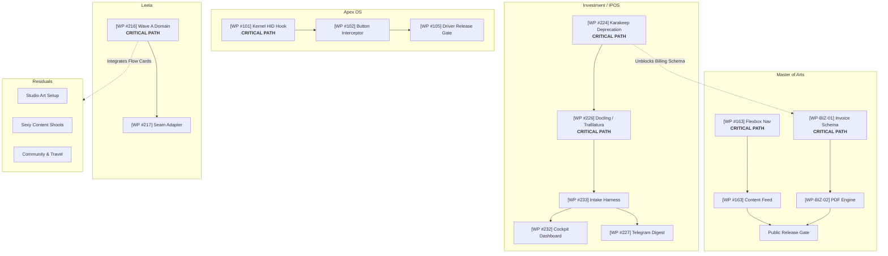

# Precap Week Iterations Specification — Operator Research, Ranked Information Architecture & Dual-Matrix Execution

## 1. Executive Summary & Core Architectural Invariants

This specification is the **canonical source of truth** for authoring, evaluating, and running the **Precap Week** iteration artifact (the *Weekly Command Brief*). It consolidates historical repository research, verified operator decisions (`D001`–`D017`, `Q01`–`Q14`), and the dual-matrix design architecture.

### Core Architectural Invariants

- [P0 | I98/E95/R05] **Three-Part Sequential Building**: Every Precap Week artifact must strictly follow a three-part sequential building structure:
  1. **Part 1: Operator Decision Brief**: Governance decisions, weekly intent, trade-offs, and critical path locks.
  2. **Part 2: Matrix 1 — Project Overview & Critical Path (Non-Temporal)**: High-level motivational project overviews, process flows, and critical path DAGs across the five defined repository boundaries.
  3. **Part 3: Matrix 2 — Calendar Snapshot & Visualization (Temporal)**: Hourly timeline mapping flows and sprints into the daily operating window (`08:00–24:00`, shutdown `21:00`) around live calendar commitments.
- [P0 | I97/E94/R06] **Five Repository Boundaries**: Matrix 1 organizes all portfolio initiatives into five distinct repository frontiers:
  1. **Master of Arts** (`MasterOfArts` / OP #14, #6, #7): Website experience, content production (essays, audio voiceover, reels), business operations (invoicing engine & PDF billing), studio fine art, and aesthetic creative assets.
  2. **Leela** (`Leela-Cloud-2026` / OP #3, #10, #9, #11): Skill Tree architecture, Path progression models, and Sequencing integration core.
  3. **Investment / IPOS** (`investment-ipos` / OP #16): Sovereign financial research intake, document ingestion adapters, Cockpit dashboard, and Telegram digest dispatch.
  4. **Apex OS** (`apexai-os-meta` / OP #8): Dedicated standalone systems project covering kernel HID polling, hardware button click interceptors, latency benchmarks, and driver release gates.
  5. **Residuals** (Housing auxiliary projects, overflow & personal life integration): System infrastructure maintenance (PM Infrastructure, Rhythm pilot, QMD indexing), community relations, travel logistics, and open life backlog.
- [P0 | I96/E94/R08] **OpenProject Default vs Operator Decision State**: OpenProject is the default scanning, prioritization, and proposal engine. When Precap Week is synthesized, candidate flows are extracted directly from OpenProject work packages. The operator exercises sovereign governance by overriding, reprioritizing, or restructuring flows for the specific week. These choices are explicitly recorded in Part 1 (Operator Decision Brief) as the active operator state.
- [P0 | I95/E95/R05] **Matrix 2 Operating Window & Shutdown Times**: Matrix 2 operates on a fixed daily time geometry:
  - **Operating Window:** `08:00 – 24:00` daily.
  - **Daily Shutdown:** `21:00` sharp (followed by evening wrap and overnight recovery from `21:00–24:00`).
- [P0 | I94/E92/R10] **First 10 Seconds Motivational Overview**: The initial view of each project must provide an immediate, motivating, high-level summary answering what this week will accomplish and why it matters, without requiring the operator to inspect technical task schemas.
- [P0 | I93/E90/R08] **Specification Invariant (No Hardcoded Session Data)**: This document is a **universal specification**. It defines schemas, rules, structural slots, and abstract templates (`{{PROJECT_NAME}}`, `[OP-WP#<id>]`). Concrete task names, specific calendar events, or momentary week assignments appear strictly as illustrative examples and must never be treated as immutable specification rules.

---

## 2. Linked Canonical Specifications & Authoritative Sources

This specification incorporates and links the following canonical system documents as the definitive authorities for weekly orchestration:

1. **Matrix 1 Architectural Specification:**
   [`HANDOVER-01-PROJECT-MATRIX-EPICS-CRITICAL-PATH.md`](file:///c:/GitDev/apexai-os-meta/apex-meta/tools/project-improvement-orchestration-weekly/01-weekly-command-brief/HANDOVER-01-PROJECT-MATRIX-EPICS-CRITICAL-PATH.md) (`HANDOVER-01-PROJECT-MATRIX-EPICS-CRITICAL-PATH-v1.0`). Defines project/epic decomposition, subtasks, 30-minute sprint units, and non-temporal critical path topological DAGs.
2. **Matrix 2 Architectural Specification:**
   [`HANDOVER-02-TIMELINE-CALENDAR-SEQUENCE-SPRINT-VIEW.md`](file:///c:/GitDev/apexai-os-meta/apex-meta/tools/project-improvement-orchestration-weekly/01-weekly-command-brief/HANDOVER-02-TIMELINE-CALENDAR-SEQUENCE-SPRINT-VIEW.md) (`HANDOVER-02-TIMELINE-CALENDAR-SEQUENCE-SPRINT-VIEW-v1.0`). Defines full-width responsive HTML calendar views, sprint slot depth (minimum 3 items per sprint), routine anchors, and calendar placement algorithms.
3. **Master Dual-Matrix Layout Specification:**
   [`SPEC-DUAL-VIEW-WEEKLY-PRECAP.md`](file:///c:/GitDev/apexai-os-meta/apex-meta/tools/project-improvement-orchestration-weekly/01-weekly-command-brief/SPEC-DUAL-VIEW-WEEKLY-PRECAP.md) (`SPEC-WEEKLY-COMMAND-BRIEF-DUAL-MATRIX-v1.0`). Governs the dual-matrix separation invariant and OpenProject tool integration protocols (`opCall.js`).
4. **Macro Orchestration Spine & Decision Gates:**
   [`02-MACRO-INTERFACES-AND-DECISION-GATES.md`](file:///c:/GitDev/apexai-os-meta/apex-meta/tools/project-improvement-orchestration-weekly/00-orchestration-spine/02-MACRO-INTERFACES-AND-DECISION-GATES.md). Governs producer/consumer contracts across PrecapWeek (G1), PrecapNextDay (G2), Execution (G3), FlowRecap (G4), and StatusMerge (G5).
5. **Master Information Flow Critical Path:**
   [`MASTER-INFORMATION-FLOW-AND-DESIGN-CRITICAL-PATH-20261106.okf.md`](file:///c:/GitDev/apexai-os-meta/apex-meta/tools/project-improvement-orchestration-weekly/MASTER-INFORMATION-FLOW-AND-DESIGN-CRITICAL-PATH-20261106.okf.md) (`WEEKLY-MASTER-MACRO-MESO-20261106`). Traces source truth from OpenProject, Git, and Calendar into weekly and daily execution.
6. **Governance Decisions Register:**
   [`DECISIONS.md`](file:///c:/GitDev/apexai-os-meta/apex-meta/tools/project-improvement-orchestration-weekly/DECISIONS.md). Canonical ledger of accepted operator decisions `D001`–`D017`.

---

## 3. Operator Research Synthesis: Pre-Week Comprehension & Motivational Framing

Grounding from [`01_RESEARCH_FINDINGS.md`](file:///c:/GitDev/apexai-os-meta/apex-meta/operator-output-design/step4-operator-template-system/01_RESEARCH_FINDINGS.md), [`01-operator-output-design-principles.okf.yaml`](file:///c:/GitDev/apexai-os-meta/apex-meta/operator-output-design/step3-output-design-system/01-operator-output-design-principles.okf.yaml), and [`PRECAP-WEEK-INPUT-PIPELINE-DECISION-HANDOVER.md`](file:///c:/GitDev/apexai-os-meta/apex-meta/tools/project-improvement-orchestration-weekly/01-weekly-command-brief/research/PRECAP-WEEK-INPUT-PIPELINE-DECISION-HANDOVER.md) establishes what the human operator requires before a week begins:

### 3.1 Primary Operator Mission
The operator needs **calm, grounded clarity** and **tangible momentum**. Rather than wading through database IDs, verbose validation logs, or abstract multi-agent chatter, the operator must see:
* Exactly where each project stands in reality.
* What meaningful progress will be achieved by Saturday close.
* What decisions or approvals require human intervention.
* How the week fits realistically into the physical calendar without burnout.

### 3.2 The First 10 Seconds Motivational Contract (Principle D2)
The top of the brief and the head of each repository section must immediately communicate:
1. **Strategic Leverage & Excitement:** A clear, inspiring headline stating the tangible outcome (e.g. *"This week Master of Arts launches public reading for creative essays and automates client PDF invoicing"*).
2. **Current Grounded Baseline:** One sentence stating verified truth from source commits and OpenProject.
3. **Weekly Direction:** The primary milestone to celebrate upon Saturday review.
4. **Immediate Human Action:** The single button or choice required from the operator to unlock execution.

### 3.3 Core Presentation Principles
- **Decision Before Detail (D1):** Governance decisions, trade-offs, and critical path gates are presented first. Deeper task decompositions are progressively disclosed.
- **Value Over Machinery (D3):** Focus on human, user-facing, and operational deliverables. Internal test suites and lint runs are background evidence, never primary headlines.
- **Planning Is Directional, Not Executable:** Precap Week establishes directional allocation and capacity balance. Detailed intra-day sprint cards, prompt packets, and executable micro-steps remain strictly with `PrecapNextDay` (`J3`/`J4`).
- **Open Design Decision on Matrix 1 Presentation:** Whether Matrix 1 presents as an interactive accordion, a progressive card drilldown, or an expandable bullet list is governed by Decision `NS-T01` and remains subject to operator evaluation.

---

## 4. Part 1 Specification: Operator Decision Brief

The Operator Decision Brief anchors the weekly artifact. It enforces human sovereignty over weekly scope, tradeoffs, and critical path locks.

### 4.1 Header & Metric Strap Standards
* **Visual Anchor:** Northstar brand strap (`<span class="brand">N</span>`), title `"Northstar"`, eyebrow `"Portfolio / Operator Decisions / Proposed Week"`, and gradient `northline`.
* **Hero Headline:** Executive summary of the portfolio direction in Georgia serif display typography.
* **Metrics Strap:** Three compact metric cards highlighting:
  1. Active Focus Repositories (`05`).
  2. Operating Flow Standard (e.g. `4 Focus Flows · 3x3 Standard`).
  3. Live Integration Status (e.g. `Google Calendar Reconciled` & `OpenProject Verified`).
* **Source Note:** Explicit timestamp, live tool read receipts, and authenticated account markers.

### 4.2 Decision Block Schema
Every decision must follow structured bullet nesting and carry informatics tagging `[P0–P3 | I<impact>/E<effort>/R<risk>]`:

```markdown
### Decision ID: [P# | I#/E#/R#] — {{DECISION_TITLE}}
- **Context:** The underlying architectural constraint, dependency join, or capacity tradeoff.
- **OpenProject Anchor:** Associated work package link (`[OP-WP#<id>]`) or repository container.
- **Action Required:** Explicit choice required from the operator (e.g. *"Approve proposal"*, *"Defer to next cycle"*, *"Select Option A vs B"*).
- **Status:** `[PROPOSED | APPROVED | REJECTED | DEFERRED]`
```

---

## 5. Part 2 Specification: Matrix 1 (Project Overview & Critical Path — Non-Temporal)

Matrix 1 visualizes *how* each project evolves mechanically from its current baseline to the target milestone, without calendar dates or clock hours.

### 5.1 Repository Grouping (Five Frontiers)

All initiatives must be grouped strictly under the five designated repository containers:

```text
1. Master of Arts (MasterOfArts)
   ├── moa-website: Responsive navigation, mobile drawer layout, dynamic reading experience.
   ├── moa-content: Intellectual essays, spoken audio narration voiceovers, social reels.
   ├── moa-business: Invoicing calculation engine, line-item schema, automated PDF billing.
   └── moa-art: Physical studio clean room, acoustic tuning, canvas stretching, painting.

2. Leela (Leela-Cloud-2026)
   ├── Skill Tree: Spatial node hierarchy, Chunk library identity, durable placement.
   ├── Path: Progression gates, evaluated state publishing, Path–Rhythm balance.
   └── Sequencing: Integration meta-system, Wave A domain, lifecycle stability.

3. Investment / IPOS (investment-ipos)
   ├── Ingestion Pipeline: Docling PDF extractor, Trafilatura article parser, legacy code retirement.
   ├── Test Harness: Ingestion latency benchmarks and fixture validation receipts.
   └── Operations: Multi-tier Cockpit dashboard and weekly Telegram research digest.

4. Apex OS (apexai-os-meta)
   ├── Hardware Drivers: Kernel HID polling hooks, raw input table parsers.
   ├── Event Pipeline: Button click/hold interceptors, userland IPC event dispatchers.
   └── Release Gate: Latency benchmarks, HUD overlay bindings, driver release candidate.

5. Residuals (Auxiliary Projects & Life Integration)
   ├── System Infrastructure: PM Infrastructure maintenance, Rhythm pilot, QMD local index.
   ├── Personal Creative: Sexy Content moodboarding, photoshoot lighting, color grading.
   └── Logistics: Community peer network outreach, travel route logistics, itinerary checks.
```

### 5.2 Mandatory Template per Repository

Each repository section must adhere to this structural standard:

```markdown
### Repository: {{REPO_NAME}} (Container: #{{ID}})

- **Strategic Outcome:** {{ONE_SENTENCE_MEASURABLE_WEEKLY_TARGET_AND_MOTIVATION}}
- **Baseline State:** {{VERIFIED_CURRENT_CODE_AND_OPENPROJECT_REALITY}}

- **Process Flow & Iterations:**
  - `Step 1: [OP-WP#<id>] {{NAME}}` ➔ `Step 2: [OP-WP#<id>] {{NAME}}` ↻ `Iteration: [OP-WP#<id>] {{NAME}}` ➔ `Step 3: [OP-WP#<id>] {{NAME}}`
  - *Evolution Narrative:*
    - "This is there now": {{CURRENT_STATE_OR_EXISTING_ASSET}}
    - "This goes where": {{DESTINATION_FILE_OR_PIPELINE_HANDOFF}}

- **Shortlist (Weekly Commitments):**
  - [ ] **[OP-WP#<id>] {{TASK_NAME}}** `({{I/E/R_SCORE}})` **[CRITICAL PATH]**
    - • Subtask 1: {{NAME}} — Expected Output: `{{ARTIFACT_PATH}}`
    - • Subtask 2: {{NAME}} — Dependency: `[OP-WP#<parent_id>]`
    - • **Sprint Units (30m each):**
      - ↳ Sprint Unit A: {{CONCRETE_ACTION_1}}
      - ↳ Sprint Unit B: {{CONCRETE_ACTION_2}}
      - ↳ Sprint Unit C: {{CONCRETE_ACTION_3}}

- **Longlist (Backlog / Staged / Deferred Work):**
  - [ ] **[OP-WP#<id>] {{STAGED_TASK_NAME}}:** Staged trigger or deferral rationale.
  - [ ] **[OP-WP#<id>] {{DORMANT_ITEM_NAME}}:** Preserved in repository records; unlinked from active weekly deliverables.
```

### 5.3 Topological Critical Path DAG (Mermaid Standard)

Matrix 1 must include a consolidated Mermaid diagram showing cross-repository and intra-project prerequisites:



---

## 6. Part 3 Specification: Matrix 2 (Calendar Snapshot & Visualization — Temporal)

Matrix 2 maps the selected work packages from Matrix 1 across the calendar days, respecting verified appointments, routine anchors, and focus capacity.

### 6.1 Daily Time Geometry & Operating Windows

* **Standard Operating Window:** `08:00 – 24:00` (16 hours total daily span).
* **Daily Shutdown:** `21:00` sharp.
* **Routine Anchors & Time Architecture:**
  - `08:00 – 09:00`: Morning Routine, Meditation, Daily Setup (60m).
  - `09:00 – 12:30`: Morning Focus Block (Flows 1 & 2).
  - `12:30 – 13:30`: Midday Reset, Healthy Lunch & Outdoor Walk (60m).
  - `13:30 – 17:45`: Afternoon Build & Residual Sprints (Flows 3 & 4).
  - `17:45 – 21:00`: Evening Work Window / Dinner / External Social Commitments.
  - `21:00 – 21:30`: Daily Shutdown & System Review (30m).
  - `21:30 – 24:00`: Evening Regeneration, Rest & Night Routine.

### 6.2 External Calendar Meeting Collision Handling
- Existing external Google Calendar events (`gehm77@gmail.com`) take absolute non-destructive priority.
- Schedulable focus flows flex around verified appointments. If a meeting intersects a focus block, the block is compressed, shifted into open buffers, or concluded early.

### 6.3 Full-Width Responsive HTML Calendar Specification

Matrix 2 is rendered using a full-width, horizontally scrollable HTML table spanning Monday through Saturday. Every sprint slot must display **at least three distinct actionable items**:

```html
<div class="calendar-viewport" style="width:100%; overflow-x:auto; margin:20px 0;">
  <table style="width:100%; min-width:1150px; border-collapse:collapse; font-size:12px; border:1px solid #dce4e8; background:#fffdf8;">
    <thead>
      <tr style="background:#162642; color:#fff;">
        <th style="width:12%; padding:10px; border:1px solid #2a3e5c;">Window / Flow</th>
        <th style="width:6%; padding:10px; border:1px solid #2a3e5c;">Sprint</th>
        <th style="width:13.6%; padding:10px; border:1px solid #2a3e5c;">Monday</th>
        <th style="width:13.6%; padding:10px; border:1px solid #2a3e5c;">Tuesday</th>
        <th style="width:13.6%; padding:10px; border:1px solid #2a3e5c;">Wednesday</th>
        <th style="width:13.6%; padding:10px; border:1px solid #2a3e5c;">Thursday</th>
        <th style="width:13.6%; padding:10px; border:1px solid #2a3e5c;">Friday</th>
        <th style="width:13.6%; padding:10px; border:1px solid #2a3e5c;">Saturday</th>
      </tr>
    </thead>
    <tbody>
      
      <!-- Protected Routine Anchor: Morning -->
      <tr style="background:#f4f1ea; color:#687b8b;">
        <td style="padding:6px; text-align:center; font-family:monospace;">08:00–09:00</td>
        <td colspan="7" style="padding:6px; text-align:center;">🔒 Protected Anchor: Morning Routine, Meditation & Setup</td>
      </tr>

      <!-- Focus Flow Block 1 -->
      <tr style="border-top:2px solid #507967;">
        <td rowspan="3" style="padding:10px; vertical-align:top; background:#f5f8f5;">
          <b style="color:#2a5035;">Flow 1 (2h)</b><br>
          <span style="font-size:10px; color:#687b8b;">09:00–11:00</span><br>
          <span style="font-size:11px; font-weight:700;">{{FLOW_1_TITLE}}</span>
        </td>
        <td style="padding:6px; text-align:center; font-weight:700; border-bottom:1px solid #eef1f4;">Sprint 1</td>
        <td style="padding:6px; vertical-align:top; border-bottom:1px solid #eef1f4;">
          <b>{{TASK_A_TITLE}}</b>
          <ul style="margin:2px 0 0 12px; padding:0; font-size:11px;">
            <li>1. {{ITEM_1}}</li>
            <li>2. {{ITEM_2}}</li>
            <li>3. {{ITEM_3}}</li>
          </ul>
        </td>
        <!-- Repeat for Tue–Sat -->
        <td colspan="5" style="padding:6px; vertical-align:top; border-bottom:1px solid #eef1f4;">
          <em>Sprint allocations dynamically populated per day</em>
        </td>
      </tr>
      <tr>
        <td style="padding:6px; text-align:center; font-weight:700; border-bottom:1px solid #eef1f4;">Sprint 2</td>
        <td colspan="6" style="padding:6px; vertical-align:top; border-bottom:1px solid #eef1f4;">
          <em>Sprint 2 items (minimum 3 actionable subtasks)</em>
        </td>
      </tr>
      <tr style="border-bottom:2px solid #507967;">
        <td style="padding:6px; text-align:center; font-weight:700;">Sprint 3</td>
        <td colspan="6" style="padding:6px; vertical-align:top;">
          <em>Sprint 3 items (minimum 3 actionable subtasks)</em>
        </td>
      </tr>

      <!-- Protected Routine Anchor: Lunch -->
      <tr style="background:#f4f1ea; color:#687b8b;">
        <td style="padding:6px; text-align:center; font-family:monospace;">12:30–13:30</td>
        <td colspan="7" style="padding:6px; text-align:center;">🔒 Protected Anchor: Midday Reset, Healthy Lunch & Fresh Air Walk</td>
      </tr>

      <!-- Protected Routine Anchor: Daily Shutdown -->
      <tr style="background:#eef2f7; color:#355570; font-weight:700; border-top:2px solid #304e86;">
        <td style="padding:6px; text-align:center; font-family:monospace;">21:00–21:30</td>
        <td colspan="7" style="padding:6px; text-align:center;">🔒 Daily Shutdown (21:00): Outro, Day Evidence Commit & Workspace Reset</td>
      </tr>

      <!-- Evening Regeneration Window -->
      <tr style="background:#f9f8f5; color:#788b99;">
        <td style="padding:6px; text-align:center; font-family:monospace;">21:30–24:00</td>
        <td colspan="7" style="padding:6px; text-align:center;">Evening Regeneration, Rest, Reading & Night Recovery</td>
      </tr>

    </tbody>
  </table>
</div>
```

---

## 7. Downstream Consumer Contract: PrecapNextDay Handshake

Precap Week concludes with an embedded YAML `presentation_handoff` block consumed with zero token waste by `PrecapNextDay`:

```yaml
```yaml
presentation_handoff:
  specification: "SPEC-PRECAP-WEEK-ITERATIONS-v1.1"
  produced_at: "2026-11-08T21:00:00Z"
  operator_governance_status: "APPROVED_FOR_EXECUTION"
  active_week: "{{ACTIVE_ISO_WEEK}}"
  timezone: "Europe/Berlin"
  
  repository_priorities:
    master_of_arts:
      weekly_outcome: "{{MOA_OUTCOME}}"
      active_workstreams: ["website", "content", "business", "studio_art"]
    leela:
      weekly_outcome: "{{LEELA_OUTCOME}}"
      active_workstreams: ["skill_tree", "path", "sequencing"]
    investment_ipos:
      weekly_outcome: "{{IPOS_OUTCOME}}"
      active_workstreams: ["ingest", "harness", "dashboard", "telegram"]
    apex_os:
      weekly_outcome: "{{APEX_OUTCOME}}"
      active_workstreams: ["driver_hooks", "interceptor", "benchmark"]
    residuals:
      weekly_outcome: "{{RESIDUAL_OUTCOME}}"
      active_workstreams: ["infrastructure", "sexy_content", "travel_community"]

  operating_geometry:
    daily_window: "08:00-24:00"
    daily_shutdown: "21:00"
    reconciled_calendar_events: []

  next_consumer: "PrecapNextDay"
  next_action: "Generate Flow Execution Cards for Monday F1–F4"
```
```

---

## 8. Failure Guards & Anti-Drift Gates

- [ ] **FG-01 (No Synthetic IDs):** All cited work packages must reference verified numeric OpenProject IDs (`[OP-WP#<id>]`). Unassigned or offline tasks use `[OP-UNRESOLVED: <label>]`.
- [ ] **FG-02 (De-sequencing Verification):** Matrix 1 headings contain zero references to calendar sequences or clock hours. All content is organized strictly under the five repositories.
- [ ] **FG-03 (Calendar Window Conformance):** Matrix 2 timeline spans `08:00–24:00` with daily shutdown at `21:00`. Verified meetings are explicitly displayed and protected.
- [ ] **FG-04 (Depth Containment):** Precap Week stops at 30-minute sprint allocations. It does not author executable prompts or Flow Execution Cards, preserving the `PrecapNextDay` boundary.
