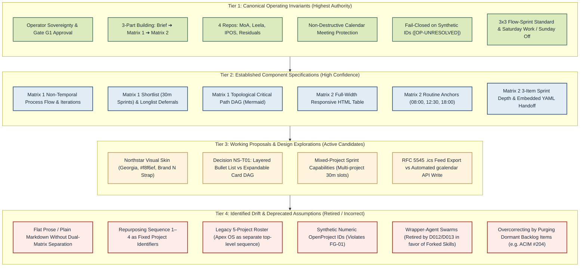
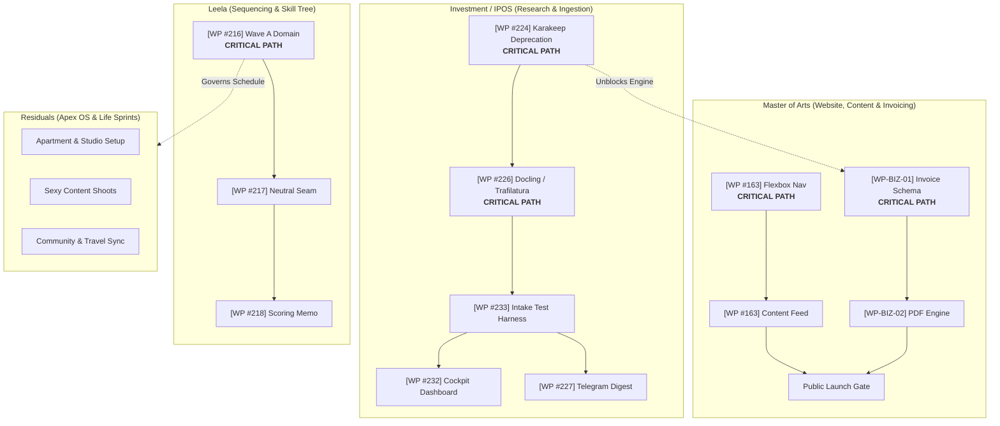

# Precap Week Iterations Specification — Operator Research, Ranked Information Architecture & Dual-Matrix Execution

## 1. Executive Summary & Core Architectural Invariants

This specification governs the authoring, structure, and lifecycle of the **Precap Week** iteration artifact (the *Weekly Command Brief*). It synthesizes historical repository research, verified operator decisions (`D001`–`D017`, `Q01`–`Q14`), and the canonical dual-matrix design system.

### Core Architectural Invariants

- [P0 | I98/E95/R05] **Three-Part Sequential Building**: Every Precap Week artifact must strictly follow a three-part sequential building structure:
  1. **Part 1:** Operator Decision Brief (governance, weekly intent, trade-offs, and critical path gates).
  2. **Part 2:** Matrix 1 — Non-temporal project architecture, process flows, and critical path DAGs across the four defined repository boundaries.
  3. **Part 3:** Matrix 2 — Temporal calendar sequence and flow-sprint allocation mapped around verified external calendar events.
- [P0 | I97/E94/R06] **Four Repository Boundaries**: Matrix 1 categorizes all portfolio initiatives into exactly four repository frontiers:
  1. **Master of Arts** (`MasterOfArts` / OP #14, #6, #7): Website modernization, content transformation, audio narration, and business invoicing.
  2. **Leela** (`Leela-Cloud-2026` / OP #3, #10, #9, #11): Skill Tree architecture, Path progression, and Sequencing integration core.
  3. **Investment / IPOS** (`investment-ipos` / OP #16): Sovereign financial research intake, Docling/Trafilatura adapters, Cockpit dashboard, and Telegram digest dispatch.
  4. **Residuals** (Housing all other projects & personal flows): Apex OS (OpenMouse driver hooks), Rhythm, PM Infrastructure, Studio Art & Apartment setup, Sexy Content creation, and Community/Travel logistics.
- [P0 | I96/E94/R08] **Strict Matrix Separation (De-sequencing Rule)**: Matrix 1 must **never** be organized by calendar sequences, days of the week, or clock hours. It visualizes non-temporal process mechanics (`Step 1 ➔ Step 2 ↻ Iteration ➔ Step 3`). Matrix 2 alone allocates selected work into temporal days, sequences, and sprints.
- [P0 | I95/E95/R05] **Non-Destructive Calendar Invariant**: Matrix 2 must actively respect and preserve existing external Google Calendar appointments (`gehm77@gmail.com`). Planning engines must never overwrite, compress, or delete verified commitments. Schedulable focus flows flex into open intervals.
- [P0 | I94/E92/R10] **Four Daily Focus Flows & 3x3 Standard**: Each standard operating day allocates up to four focus flows governed by the Sequencing integration system:
  - *Flows 1 & 2 (Two flows/day):* Master of Arts (Website, Content Production, and Business Invoicing).
  - *Flow 3 (One flow/day):* Investment / IPOS (Research intake and data pipeline).
  - *Flow 4 (One residual flow/day):* Residual life and creative sprints (Sprint 1: Apartment & Art; Sprint 2: Sexy Content; Sprint 3: Community & Traveling).
  - *Repetition Standard:* Each standard flow decomposes into a 3x3 structure (3 distinct 30-minute sprints, each containing up to 3 concrete actionable checklist items).
- [P0 | I92/E90/R08] **Downstream Handshake Integrity**: Precap Week terminates with an embedded YAML `presentation_handoff` block consumed with zero token duplication by `PrecapNextDay`.

---

## 2. Operator Research Synthesis: What the Operator Must Understand Before the Week Begins

The repository's foundational research ([`01_RESEARCH_FINDINGS.md`](file:///c:/GitDev/apexai-os-meta/apex-meta/operator-output-design/step4-operator-template-system/01_RESEARCH_FINDINGS.md), [`01-operator-output-design-principles.okf.yaml`](file:///c:/GitDev/apexai-os-meta/apex-meta/operator-output-design/step3-output-design-system/01-operator-output-design-principles.okf.yaml), and [`PRECAP-WEEK-INPUT-PIPELINE-DECISION-HANDOVER.md`](file:///c:/GitDev/apexai-os-meta/apex-meta/tools/project-improvement-orchestration-weekly/01-weekly-command-brief/research/PRECAP-WEEK-INPUT-PIPELINE-DECISION-HANDOVER.md)) defines the cognitive and decision requirements of the human operator prior to Monday morning execution:

### 2.1 The Primary Operator Question
> *"What should this week accomplish across all active projects, what stops us, what can wait, and what needs operator review before the week begins?"*

The operator is overwhelmed by technical jargon, abstract schema dumps, and conflicting status claims. Precap Week must bring calm, grounded, step-by-step clarity.

### 2.2 The "First 10 Seconds" Contract (D2 Principle)
Every primary brief must communicate the following four facts within ten seconds:
1. **Current Reality / What Changed:** The verified baseline grounded in live code commits and authenticated OpenProject records—not stale plans or agent aspirations.
2. **Direction / What Moves Forward:** The high-leverage outcomes that will tangibly advance the four repositories by Saturday close.
3. **Required Decisions:** The exact governance choices, scope trade-offs, or external interventions requiring operator approval.
4. **Blockers & Material Warnings:** Physical calendar conflicts, missing credentials, technical prerequisites, or critical path dependencies.

### 2.3 Core Human-Interface Principles
- **Decision Before Detail (D1):** Governance decisions and trade-offs must appear at the top. Technical schemas, detailed logs, and implementation traces belong downstream in progressive disclosure layers.
- **Value Over Internal Machinery (D3):** The brief reports product and life outcomes (e.g. *"Rendered PDF invoice engine deployed"*), not agent execution mechanics (e.g. *"Unit test script passed with exit code 0"*).
- **Planning Is Not Execution:** Precap Week establishes directional targets, weekly sequence allocations, and capacity budgets. It never drafts executable prompt files or micro-task checklists. Those remain strictly owned by `PrecapNextDay` (`J3`/`J4`).
- **Evidence Is Not Interpretation:** Observed facts (commits, database records, meeting times) are presented distinctly from candidate interpretations and planning proposals.
- **No Silent Mutations:** AI planners cannot invent synthetic IDs, silently mutate OpenProject statuses, or push events to Google Calendar without explicit operator authorization.

---

## 3. Comprehensive Information Aggregation & Epistemological Ranking

To prevent architectural drift and eliminate hallucinations, all information, rules, and design components used in Precap Week are aggregated and categorized into four ranked tiers:



### Detailed Epistemological Breakdown

| Tier | Classification | Authority Sources | Semantic Meaning & Enforcement |
|---|---|---|---|
| **Tier 1** | **Authoritative Invariants** | `DECISIONS.md` (`D012`, `D014`, `D017`), `Q01`–`Q14` delta, Operator directives | **Non-negotiable product law.** Operator decisions outrank inferred rules. The 3-part structure, 4-repo frontier, live meeting protection, fail-closed ID handling, and Sunday-off invariant must be maintained without exception. |
| **Tier 2** | **Established Component Specs** | `SPEC-DUAL-VIEW-WEEKLY-PRECAP.md`, `HANDOVER-01`, `HANDOVER-02` | **Validated structural contracts.** Matrix 1 process flows, Shortlist/Longlist, Mermaid DAGs, Matrix 2 full-width responsive HTML tables, 2-hour blocks, 30-minute sprints, and 3-item slot depth are binding execution standards. |
| **Tier 3** | **Working Design Proposals** | `NORTHSTAR-DECISIONS-AND-2DO-20261106.md`, `matrix1-design-showroom.html` | **Candidate implementations.** The Northstar visual system (Georgia serif, `#f8f6ef` canvas, green `N` badge, gradient `northline`) is the accepted design direction. Specific details (such as the bullet-list vs card DAG evaluation in `NS-T01`) remain subject to operator review. |
| **Tier 4** | **Deprecated Drift & Anti-Patterns** | `01_RESEARCH_FINDINGS.md`, `ORCHESTRATOR-DEFINITION.md` | **Strictly prohibited.** Agents must never emit unstructured text blobs, invent synthetic numeric IDs (`#999`), revive multi-agent wrapper swarms, treat "Sequence" as a project name, or permanently delete dormant backlog items. |

---

## 4. Part 1 Specification: Operator Decision Brief

The Operator Decision Brief anchors the weekly artifact. It gives the human operator immediate visibility and sovereign control over directional priorities, critical path locks, and governance choices.

### 4.1 Header & Metric Strap Standards
* **Visual Anchor:** Northstar brand strap (`<span class="brand">N</span>`), title `"Northstar"`, eyebrow `"Portfolio / Operator Decisions / Proposed Week"`, and gradient `northline`.
* **Hero Headline:** Concise executive summary of the week's strategic focus in Georgia serif display typography.
* **Metrics Strap:** Three compact metric cards highlighting:
  1. Active Focus Repositories (`04`).
  2. Operating Flow Standard (`3x3 Standard`).
  3. Live Integration Status (e.g. `Google Calendar Reconciled` & `OpenProject 17.8.0 Verified`).
* **First-Screen Source Note:** Explicit statement of live tool read receipts, timestamp, connected accounts (`gehm77@gmail.com`), and protected appointments.

### 4.2 Decision Block Schema
Every operator decision must be formatted with structured bullet nesting and tagged with informatics priority `[P0–P3 | I<impact>/E<effort>/R<risk>]`:

```markdown
### Decision ID: [P# | I#/E#/R#] — Decision Title
- **Context:** The underlying architectural blocker, dependency join, or capacity tradeoff.
- **OpenProject Anchor:** Associated work package link (`[OP-WP#<id>]`) or repository container.
- **Action Required:** Concrete operator choice (e.g. *"Approve Docling PDF adapter rollout and lock ADR-003"*).
- **Status:** `[PROPOSED | APPROVED | REJECTED | DEFERRED]`
```

---

## 5. Part 2 Specification: Matrix 1 (Non-Temporal Project Development & Critical Path)

Matrix 1 visualizes *how* each project develops mechanically from its current baseline to the next milestone, completely decoupled from calendar hours or day allocations.

### 5.1 Repository Frontiers & Domain Ownership

All initiatives must be grouped strictly under the four designated repository containers:

```text
1. Master of Arts (MasterOfArts)
   ├── moa-website (OP #14): Flexbox navigation, drawer layout, dynamic markdown feeds.
   ├── moa-content (OP #6): Thesis essays, narrative audio voiceovers, social reels.
   └── moa-business (OP #7): Invoicing schemas, calculation engines, automated PDF billing.

2. Leela (Leela-Cloud-2026)
   ├── Skill Tree (OP #10): Spatial node hierarchy, Chunk library, durable placement identity.
   ├── Path (OP #9): Progression gates, evaluated state publication, Path-Rhythm balance.
   └── Sequencing (OP #11): Integration meta-system, Wave A domain, lifecycle stability.

3. Investment / IPOS (investment-ipos)
   ├── Ingestion Pipeline (OP #16): Karakeep deprecation (ADR-003), Docling PDF & Trafilatura adapters.
   ├── Test Harness (OP #16): Multi-format fixture benchmarking and reality proof.
   └── Operations (OP #16): Multi-tier Cockpit dashboard and weekly Telegram research digest.

4. Residuals (Holding all other projects & personal flows)
   ├── Apex OS: OpenMouse kernel HID polling, button click interceptors, latency benchmarks.
   ├── System Infrastructure: Rhythm pilot, PM Infrastructure, QMD local indexing.
   └── Personal 3x3 Flow:
       ├── Sprint 1: Apartment & Art (workspace acoustics, studio setup, physical canvas).
       ├── Sprint 2: Sexy Content (aesthetic moodboards, lighting, photoshoots, color grading).
       └── Sprint 3: Community & Traveling (peer sync, travel logistics, flight/itinerary prep).
```

### 5.2 Mandatory Section Pattern per Repository

Each of the four repository entries must adhere to this exact structural template:

```markdown
### Repository: {{REPO_NAME}} (OP Container: #{{ID}})

- **Strategic Outcome:** {{ONE_SENTENCE_MEASURABLE_WEEKLY_DELIVERABLE}}
- **Baseline State:** {{VERIFIED_CURRENT_CODE_AND_STATUS_REALITY}}

- **Process Flow & Iterations:**
  - `Step 1: [OP-WP#<id>] {{NAME}}` ➔ `Step 2: [OP-WP#<id>] {{NAME}}` ↻ `Iteration: [OP-WP#<id>] {{NAME}}` ➔ `Step 3: [OP-WP#<id>] {{NAME}}`
  - *Evolution Narrative:*
    - "This is there now": {{CURRENT_STATE_OR_EXISTING_ASSET}}
    - "This goes where": {{DESTINATION_FILE_OR_PIPELINE_HANDOFF}}

- **Shortlist (Weekly Commitments):**
  - [ ] **[OP-WP#<id>] {{TASK_NAME}}** `({{I/E/R_SCORE}})` **[CRITICAL PATH]**
    - • Subtask 1: {{NAME}} — Expected Output: `{{ARTIFACT_PATH}}`
    - • Subtask 2: {{NAME}} — Dependency: `[OP-WP#<parent_id>]`
    - • **Sprint Units (30m each):**
      - ↳ Sprint Unit A: {{CONCRETE_ACTION_1}}
      - ↳ Sprint Unit B: {{CONCRETE_ACTION_2}}
      - ↳ Sprint Unit C: {{CONCRETE_ACTION_3}}

- **Longlist (Backlog / Staged / Deferred Work):**
  - [ ] **[OP-WP#<id>] {{STAGED_TASK_NAME}}:** Staged trigger or deferral rationale.
  - [ ] **[OP-WP#204] ACIM Dedicated Sources & Credits Page:** Preserved in OpenProject records; cleanly unlinked from active Week 45 focus.
```

### 5.3 Topological Critical Path DAG (Mermaid Standard)

Matrix 1 must conclude with a consolidated Mermaid DAG modeling dependencies across the four repositories:



---

## 6. Part 3 Specification: Matrix 2 (Temporal Timeline, Calendar Sequences & Flows)

Matrix 2 is the temporal allocation view. It maps the selected work packages from Matrix 1 across the calendar days, respecting verified appointments, routine anchors, and focus capacity.

### 6.1 Daily Time Geometry & Protected Routine Anchors

* **Operating Window:** `08:00 – 18:30` (10.5 hours daily ceiling).
* **Protected Routine Anchors:**
  - `08:00 – 09:00`: Morning Routine, Meditation, Daily Setup (60m).
  - `12:30 – 13:30`: Lunch, Midday Reset, Environmental Walk (60m).
  - `18:00 – 18:30`: Daily Shutdown, Outro, Evidence Commit (30m).
* **Net Available Focus Capacity:** Up to 8.0 hours across four focus flows on unconstrained days.
* **External Meeting Collision Invariant:**
  - When a verified calendar appointment occurs, the intersecting focus flow is compressed, shifted into open buffers, or concluded early.
  - *Example (Thursday):* `10:00–11:00 Alex & Chris` compresses Flow 1 to `09:00–10:00`. Flow 2 resumes at `11:15`. Evening shutdown concludes by `18:15` to accommodate `18:45 München Tanz`.
  - *Example (Wednesday & Friday):* Evening shutdown concludes by `17:45` ahead of `18:00–20:00 WC Meister`.

### 6.2 The Four Focus Flows & 3x3 Sprint Architecture

Every working day is budgeted into four focus flows:
* **Flow 1 (09:00 – 11:00):** Master of Arts — Creative Content Production (Essays, Audio Voiceover, Reels).
* **Flow 2 (11:15 – 12:30):** Master of Arts — Website Modernization or Business Invoicing Engine.
* **Flow 3 (13:30 – 15:30):** Investment / IPOS — Research Ingestion Pipeline & Architecture.
* **Flow 4 (16:00 – 17:45):** Residual Flow — Personal Life & Creative Sprints:
  - *Sprint 1 (30m):* Apartment Organization & Fine Art Painting.
  - *Sprint 2 (30m):* Sexy Content Moodboarding & Photoshoots.
  - *Sprint 3 (30m):* Community Relations & Travel Logistics.

### 6.3 Full-Width Responsive HTML Calendar Specification

Matrix 2 must be rendered using a full-width, horizontally scrollable HTML table. Every sprint cell must display **at least three distinct actionable items**:

```html
<div class="calendar-viewport" style="width:100%; overflow-x:auto; margin:20px 0;">
  <table style="width:100%; min-width:1150px; border-collapse:collapse; font-size:12px; border:1px solid #dce4e8; background:#fffdf8;">
    <thead>
      <tr style="background:#162642; color:#fff;">
        <th style="width:10%; padding:10px; border:1px solid #2a3e5c;">Flow / Time</th>
        <th style="width:6%; padding:10px; border:1px solid #2a3e5c;">Sprint</th>
        <th style="width:14%; padding:10px; border:1px solid #2a3e5c;">Monday (09 Nov)</th>
        <th style="width:14%; padding:10px; border:1px solid #2a3e5c;">Tuesday (10 Nov)</th>
        <th style="width:14%; padding:10px; border:1px solid #2a3e5c;">Wednesday (11 Nov)</th>
        <th style="width:14%; padding:10px; border:1px solid #2a3e5c;">Thursday (12 Nov)</th>
        <th style="width:14%; padding:10px; border:1px solid #2a3e5c;">Friday (13 Nov)</th>
        <th style="width:14%; padding:10px; border:1px solid #2a3e5c;">Saturday (14 Nov)</th>
      </tr>
    </thead>
    <tbody>
      
      <!-- Protected Anchor -->
      <tr style="background:#f4f1ea; color:#687b8b;">
        <td style="padding:6px; text-align:center; font-family:monospace;">08:00–09:00</td>
        <td colspan="7" style="padding:6px; text-align:center;">🔒 Protected Anchor: Morning Routine, Meditation & System Setup</td>
      </tr>

      <!-- Flow 1: MoA Creative Content -->
      <tr style="border-top:2px solid #507967;">
        <td rowspan="3" style="padding:10px; vertical-align:top; background:#f5f8f5;">
          <b style="color:#2a5035;">Flow 1 (2h)</b><br>
          <span style="font-size:10px; color:#687b8b;">09:00–11:00</span><br>
          <span style="font-size:11px; font-weight:700;">MoA: Content</span>
        </td>
        <td style="padding:6px; text-align:center; font-weight:700; border-bottom:1px solid #eef1f4;">Sp 1 (30m)</td>
        <td style="padding:6px; vertical-align:top; border-bottom:1px solid #eef1f4;">
          <b>[OP-WP#163] Essay Thesis</b>
          <ul style="margin:2px 0 0 12px; padding:0; font-size:11px;">
            <li>1. Outline core thesis claims</li>
            <li>2. Cross-link source references</li>
            <li>3. Draft opening hook section</li>
          </ul>
        </td>
        <td style="padding:6px; vertical-align:top; border-bottom:1px solid #eef1f4;">
          <b>[OP-WP#163] Audio Voiceover</b>
          <ul style="margin:2px 0 0 12px; padding:0; font-size:11px;">
            <li>1. Mic setup & acoustic check</li>
            <li>2. Record spoken narration</li>
            <li>3. Cut rough audio vocal takes</li>
          </ul>
        </td>
        <td style="padding:6px; vertical-align:top; border-bottom:1px solid #eef1f4;">
          <b>[OP-WP#163] Visual Cards</b>
          <ul style="margin:2px 0 0 12px; padding:0; font-size:11px;">
            <li>1. Diagram SVG key concept</li>
            <li>2. Export slide illustrations</li>
            <li>3. Review contrast on mobile</li>
          </ul>
        </td>
        <td style="padding:6px; vertical-align:top; border-bottom:1px solid #eef1f4; background:#edf4fd;">
          <span style="font-size:9px; color:#25548c; font-weight:700;">COMPRESSED (09:00–10:00)</span><br>
          <b>[OP-WP#163] Audio Pass</b>
          <ul style="margin:2px 0 0 12px; padding:0; font-size:11px;">
            <li>1. Frequency de-ess pass</li>
            <li>2. Normalize dialogue master</li>
            <li>3. Export final MP3 master</li>
          </ul>
        </td>
        <td style="padding:6px; vertical-align:top; border-bottom:1px solid #eef1f4;">
          <b>[OP-WP#163] Synthesis Post</b>
          <ul style="margin:2px 0 0 12px; padding:0; font-size:11px;">
            <li>1. Format Substack draft</li>
            <li>2. Embed audio player link</li>
            <li>3. Queue release broadcast</li>
          </ul>
        </td>
        <td rowspan="3" style="padding:8px; vertical-align:top; background:#f9f8f5;">
          <b style="color:#856434;">Precap Retrospective</b><br>
          <span style="font-size:10px; color:#7d8c97;">09:00–11:00</span>
          <p style="font-size:11px; margin:4px 0;">PrecapWeek review & OpenProject sync (D017).</p>
        </td>
      </tr>

      <tr>
        <td style="padding:6px; text-align:center; font-weight:700; border-bottom:1px solid #eef1f4;">Sp 2 (30m)</td>
        <td style="padding:6px; vertical-align:top; border-bottom:1px solid #eef1f4;">
          <b>Paragraph Structuring</b>
          <ul style="margin:2px 0 0 12px; padding:0; font-size:11px;">
            <li>1. Polish section transitions</li>
            <li>2. Verify philosophical terms</li>
            <li>3. Generate pullquote blocks</li>
          </ul>
        </td>
        <td style="padding:6px; vertical-align:top; border-bottom:1px solid #eef1f4;">
          <b>Reel Video Slicing</b>
          <ul style="margin:2px 0 0 12px; padding:0; font-size:11px;">
            <li>1. Extract 30s highlight reel</li>
            <li>2. Sync dynamic captions</li>
            <li>3. Render 9:16 vertical crop</li>
          </ul>
        </td>
        <td style="padding:6px; vertical-align:top; border-bottom:1px solid #eef1f4;">
          <b>Asset Organization</b>
          <ul style="margin:2px 0 0 12px; padding:0; font-size:11px;">
            <li>1. Tag CDN media URLs</li>
            <li>2. Verify file sizes < 2MB</li>
            <li>3. Place in staging folder</li>
          </ul>
        </td>
        <td style="padding:6px; vertical-align:top; border-bottom:1px solid #eef1f4; background:#edf4fd;">
          <b style="color:#1d4273;">10:00–11:00 Meeting</b><br>
          <span style="font-size:11px;">🔒 Alex & Chris (C. Sgarz)</span>
        </td>
        <td style="padding:6px; vertical-align:top; border-bottom:1px solid #eef1f4;">
          <b>Weekly Review</b>
          <ul style="margin:2px 0 0 12px; padding:0; font-size:11px;">
            <li>1. Verify publication links</li>
            <li>2. Check RSS validation</li>
            <li>3. Archive draft revisions</li>
          </ul>
        </td>
      </tr>

      <tr style="border-bottom:2px solid #507967;">
        <td style="padding:6px; text-align:center; font-weight:700;">Sp 3 (30m)</td>
        <td style="padding:6px; vertical-align:top;">
          <b>Editorial Signoff</b>
          <ul style="margin:2px 0 0 12px; padding:0; font-size:11px;">
            <li>1. Final readthrough check</li>
            <li>2. Title & metadata lock</li>
            <li>3. Commit essay Markdown</li>
          </ul>
        </td>
        <td style="padding:6px; vertical-align:top;">
          <b>Social Packaging</b>
          <ul style="margin:2px 0 0 12px; padding:0; font-size:11px;">
            <li>1. Draft caption copy</li>
            <li>2. Select cover thumbnail</li>
            <li>3. Schedule distribution</li>
          </ul>
        </td>
        <td style="padding:6px; vertical-align:top;">
          <b>Preview Staging</b>
          <ul style="margin:2px 0 0 12px; padding:0; font-size:11px;">
            <li>1. Deploy to staging build</li>
            <li>2. Test responsive layout</li>
            <li>3. Operator reading pass</li>
          </ul>
        </td>
        <td style="padding:6px; vertical-align:top; background:#edf4fd;">
          <span style="font-size:11px; color:#5b6e82;">Meeting wrap & notes</span>
        </td>
        <td style="padding:6px; vertical-align:top;">
          <b>Channel Broadcast</b>
          <ul style="margin:2px 0 0 12px; padding:0; font-size:11px;">
            <li>1. Dispatch newsletter</li>
            <li>2. Post social highlight</li>
            <li>3. Log engagement receipt</li>
          </ul>
        </td>
      </tr>

      <!-- Routine Anchor: Lunch -->
      <tr style="background:#f4f1ea; color:#687b8b;">
        <td style="padding:6px; text-align:center; font-family:monospace;">12:30–13:30</td>
        <td colspan="7" style="padding:6px; text-align:center;">🔒 Protected Anchor: Midday Reset, Healthy Lunch & Fresh Air Walk</td>
      </tr>

      <!-- Flow 4: Residual Life & Creative Sprints -->
      <tr style="border-top:2px solid #a37237;">
        <td rowspan="3" style="padding:10px; vertical-align:top; background:#fdf9f2;">
          <b style="color:#784f1e;">Flow 4 (1.75h)</b><br>
          <span style="font-size:10px; color:#687b8b;">16:00–17:45</span><br>
          <span style="font-size:11px; font-weight:700;">Residual Flow</span>
        </td>
        <td style="padding:6px; text-align:center; font-weight:700; border-bottom:1px solid #eef1f4;">Sprint 1</td>
        <td colspan="5" style="padding:6px; vertical-align:top; border-bottom:1px solid #eef1f4;">
          <b>Apartment & Art:</b> Physical studio clean room, acoustic tuning, canvas stretching, and fine art painting sessions.
        </td>
        <td rowspan="3" style="padding:8px; vertical-align:top; background:#f0eee6; color:#788691;">
          <b>Saturday Afternoon OFF</b><br>
          <span style="font-size:10px;">Rest & recovery</span>
        </td>
      </tr>

      <tr>
        <td style="padding:6px; text-align:center; font-weight:700; border-bottom:1px solid #eef1f4;">Sprint 2</td>
        <td colspan="5" style="padding:6px; vertical-align:top; border-bottom:1px solid #eef1f4;">
          <b>Sexy Content:</b> Aesthetic moodboarding, photoshoot lighting arrangements, high-resolution portrait capture, and color grading.
        </td>
      </tr>

      <tr style="border-bottom:2px solid #a37237;">
        <td style="padding:6px; text-align:center; font-weight:700;">Sprint 3</td>
        <td colspan="5" style="padding:6px; vertical-align:top;">
          <b>Community & Traveling:</b> Peer network outreach, community dinner logistics, travel route planning, and accommodation verification.
        </td>
      </tr>

      <!-- Routine Anchor: Shutdown -->
      <tr style="background:#f4f1ea; color:#687b8b;">
        <td style="padding:6px; text-align:center; font-family:monospace;">18:00–18:30</td>
        <td colspan="7" style="padding:6px; text-align:center;">🔒 Protected Anchor: Daily Outro, Workspace Reset & Evening Shutdown</td>
      </tr>

    </tbody>
  </table>
</div>
```

---

## 7. Downstream Consumer Contract: PrecapNextDay Handshake

Precap Week must conclude with an embedded YAML `presentation_handoff` block. This block serves as the machine interface consumed by `PrecapNextDay` without leaking duplicate tokens or triggering re-parsing of prose:

```yaml
```yaml
presentation_handoff:
  artifact_id: "SPEC-PRECAP-WEEK-ITERATIONS-v1.0"
  produced_at: "2026-11-08T20:30:00Z"
  operator_approval_status: "APPROVED_FOR_EXECUTION"
  active_week: "2026-W45"
  timezone: "Europe/Berlin"
  
  repositories:
    master_of_arts:
      active_workstreams: ["website_flexbox_nav", "creative_content_production", "business_invoicing_engine"]
      weekly_milestone: "Public reading experience and validated PDF invoice receipt"
    leela:
      active_workstreams: ["wave_a_domain_sequencing", "skill_tree_identity"]
      weekly_milestone: "Sequencing Wave A domain and spatial node contracts"
    investment_ipos:
      active_workstreams: ["karakeep_retirement_adr003", "docling_trafilatura_adapter"]
      weekly_milestone: "Docling PDF ingestion harness passing fixture tests"
    residuals:
      active_workstreams: ["apex_os_hid_hooks", "apartment_studio_art", "sexy_content", "travel_community"]
      weekly_milestone: "Workspace acoustic harmony and creative photoshoot catalog"

  calendar_commitments_reconciled:
    - title: "Alex & Chris"
      start: "2026-11-12T10:00:00+01:00"
      end: "2026-11-12T11:00:00+01:00"
      rule: "PROTECTED_MEETING_COMPRESS_F1"
    - title: "München Tanz"
      start: "2026-11-12T18:45:00+01:00"
      end: "2026-11-12T21:00:00+01:00"
      rule: "PROTECTED_EVENT_SHUTDOWN_BY_1815"
    - title: "WC Meister"
      days: ["2026-11-11", "2026-11-13"]
      start: "18:00:00+01:00"
      end: "20:00:00+01:00"
      rule: "PROTECTED_EVENT_SHUTDOWN_BY_1745"

  next_consumer: "PrecapNextDay"
  next_action: "Generate Flow Execution Cards for Monday F1–F4"
```
```

---

## 8. Failure Guards & Anti-Drift Checklist

Before any AI agent presents or commits a Precap Week iteration, it must verify conformance against these four hard gates:

- [ ] **FG-01 (No Synthetic IDs):** Every cited work package references a verified numeric OpenProject ID (`[OP-WP#<id>]`). If OpenProject is offline or the task is unassigned, use `[OP-UNRESOLVED: <label>]`; never invent numeric IDs.
- [ ] **FG-02 (De-sequencing Verification):** Matrix 1 contains zero headings titled "Sequence 1", "Sequence 2", or hourly clock times. All Matrix 1 content is categorized strictly under the four repositories.
- [ ] **FG-03 (Calendar Integrity):** Verified appointments (`Alex & Chris`, `München Tanz`, `WC Meister`) appear explicitly in Matrix 2. No focus flow is scheduled in conflict with an external meeting.
- [ ] **FG-04 (Depth Containment):** Precap Week stops at 30-minute sprint allocations. It does not draft prompt files or detailed Flow Execution Cards, preserving the `PrecapNextDay` execution boundary.
