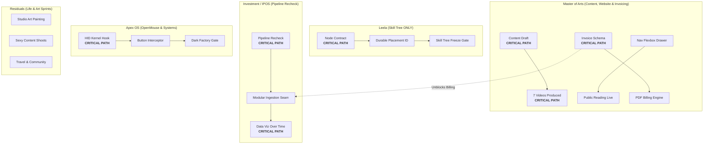

# Precap Week Iterations Specification — Three-Level Process Flow, Critical Path & Calendar Execution

## 1. Executive Summary & Core Architectural Invariants

This specification is the **canonical source of truth** for authoring, evaluating, and running the **Precap Week** iteration artifact (the *Weekly Command Brief*). It consolidates historical repository research, verified operator decisions (`D001`–`D017`, `Q01`–`Q14`), and the dual-matrix design architecture.

### Core Architectural Invariants

- [P0 | I98/E95/R05] **Header Framing & Identity**: The artifact title is strictly **Precap Week** followed by the specific calendar date range (e.g. `Precap Week · 09 – 15 November 2026`). Abstract slogans are prohibited. The header features high-density portfolio statistics: total planned focus hours, total flow blocks, sprint units, and target key deliverables.
- [P0 | I97/E94/R06] **Three-Part Sequential Building**: Every Precap Week artifact strictly follows a three-part sequential building structure:
  1. **Part 1: Operator Decision Brief**: Governance decisions, sequence and flow allocation choices, meeting decisions, and critical path gates.
  2. **Part 2: Matrix 1 — Project Overview & Critical Path (Non-Temporal)**: Full-width stacked project views (one underneath the other, never multi-column) structured into **three distinct levels**: High-Level Strategic Intent, Mid-Level Process & Output Pipeline, and Detail-Level Tasks & Deliverables. **Matrix 1 contains zero sprint allocations**.
  3. **Part 3: Matrix 2 — Calendar Snapshot & Visualization (Temporal)**: Hourly timeline mapping all four daily focus flows and their 30-minute sprint units across Monday through Saturday, within the `08:00–24:00` operating window, anchoring daily shutdown at `21:00`.
- [P0 | I96/E94/R08] **Five Repository Boundaries**: All portfolio initiatives are organized into five distinct repository frontiers:
  1. **Master of Arts** (`MasterOfArts` / OP #14, #6, #7): Website content draft, content production week (7 videos), and business operations (invoicing engine & automated PDF billing).
  2. **Leela** (`Leela-Cloud-2026` / OP #10): Focused **strictly on the Skill Tree** (spatial node contracts, Chunk library, and durable placement identity). Path and Sequencing are explicitly paused for this weekly iteration.
  3. **Investment / IPOS** (`investment-ipos` / OP #16): Complete recheck of the whole pipeline and external possibilities, modularizing and establishing sovereign data visualization over time.
  4. **Apex OS** (`apexai-os-meta` / OP #8): Dedicated standalone systems repo covering OpenMouse kernel bindings, mindful repo orchestration, and dark factory integration.
  5. **Residuals** (Holding personal creative sprints & auxiliary infrastructure): Studio fine art & apartment setup (Sprint 1), Sexy Content creation (Sprint 2), Community & Travel logistics (Sprint 3), and PM Infrastructure.
- [P0 | I95/E95/R05] **OpenProject Default vs Operator Decision State**: OpenProject provides the default intake and priority proposals. The operator exercises sovereign governance by overriding, reprioritizing, or restructuring flows for the specific week. These choices are explicitly recorded in Part 1 as the active operator state.
- [P0 | I94/E92/R10] **Matrix 2 Operating Window & Shutdown Times**: Matrix 2 operates on a fixed daily time geometry:
  - **Operating Window:** `08:00 – 24:00` daily.
  - **Daily Shutdown:** `21:00` sharp.
- [P0 | I93/E90/R08] **Universal Specification Invariant**: This document is a **universal specification**. It defines schemas, rules, structural slots, and abstract templates (`{{PROJECT_NAME}}`, `[OP-WP#<id>]`). Concrete task names, specific calendar events, or momentary week assignments appear strictly as illustrative examples and must never be treated as immutable specification rules.

---

## 2. Linked Canonical Specifications & Authoritative Sources

This specification incorporates and links the following canonical system documents as the definitive authorities for weekly orchestration:

1. **Matrix 1 Architectural Specification:**
   [`HANDOVER-01-PROJECT-MATRIX-EPICS-CRITICAL-PATH.md`](file:///c:/GitDev/apexai-os-meta/apex-meta/tools/project-improvement-orchestration-weekly/01-weekly-command-brief/HANDOVER-01-PROJECT-MATRIX-EPICS-CRITICAL-PATH.md) (`HANDOVER-01-PROJECT-MATRIX-EPICS-CRITICAL-PATH-v1.0`). Defines project/epic decomposition, subtasks, and non-temporal critical path topological DAGs.
2. **Matrix 2 Architectural Specification:**
   [`HANDOVER-02-TIMELINE-CALENDAR-SEQUENCE-SPRINT-VIEW.md`](file:///c:/GitDev/apexai-os-meta/apex-meta/tools/project-improvement-orchestration-weekly/01-weekly-command-brief/HANDOVER-02-TIMELINE-CALENDAR-SEQUENCE-SPRINT-VIEW.md) (`HANDOVER-02-TIMELINE-CALENDAR-SEQUENCE-SPRINT-VIEW-v1.0`). Defines full-width responsive HTML calendar views, sprint slot depth (minimum 3 items per sprint), routine anchors, and calendar placement algorithms.
3. **Master Dual-Matrix Layout Specification:**
   [`SPEC-DUAL-VIEW-WEEKLY-PRECAP.md`](file:///c:/GitDev/apexai-os-meta/apex-meta/tools/project-improvement-orchestration-weekly/01-weekly-command-brief/SPEC-DUAL-VIEW-WEEKLY-PRECAP.md) (`SPEC-WEEKLY-COMMAND-BRIEF-DUAL-MATRIX-v1.0`). Governs the dual-matrix separation invariant and OpenProject tool integration protocols (`opCall.js`).
4. **Macro Orchestration Spine & Decision Gates:**
   [`02-MACRO-INTERFACES-AND-DECISION-GATES.md`](file:///c:/GitDev/apexai-os-meta/apex-meta/tools/project-improvement-orchestration-weekly/00-orchestration-spine/02-MACRO-INTERFACES-AND-DECISION-GATES.md). Governs producer/consumer contracts across PrecapWeek (G1), PrecapNextDay (G2), Execution (G3), FlowRecap (G4), and StatusMerge (G5).
5. **Master Information Flow Critical Path:**
   [`MASTER-INFORMATION-FLOW-AND-DESIGN-CRITICAL-PATH-20261106.okf.md`](file:///c:/GitDev/apexai-os-meta/apex-meta/tools/project-improvement-orchestration-weekly/MASTER-INFORMATION-FLOW-AND-DESIGN-CRITICAL-PATH-20261106.okf.md) (`WEEKLY-MASTER-MACRO-MESO-20261106`). Traces source truth from OpenProject, Git, and Calendar into weekly and daily execution.
6. **Governance Decisions Register:**
   [`DECISIONS.md`](file:///c:/GitDev/apexai-os-meta/apex-meta/tools/project-improvement-orchestration-weekly/DECISIONS.md). Canonical ledger of accepted operator decisions `D001`–`D017`.

---

## 3. Operator Research Synthesis: Pre-Week Comprehension & Motivational Framing

Grounding from [`01_RESEARCH_FINDINGS.md`](file:///c:/GitDev/apexai-os-meta/apex-meta/operator-output-design/step4-operator-template-system/01_RESEARCH_FINDINGS.md), [`01-operator-output-design-principles.okf.yaml`](file:///c:/GitDev/apexai-os-meta/apex-meta/operator-output-design/step3-output-design-system/01-operator-output-design-principles.okf.yaml), and [`PRECAP-WEEK-INPUT-PIPELINE-DECISION-HANDOVER.md`](file:///c:/GitDev/apexai-os-meta/apex-meta/tools/project-improvement-orchestration-weekly/01-weekly-command-brief/research/PRECAP-WEEK-INPUT-PIPELINE-DECISION-HANDOVER.md) establishes what the human operator requires before a week begins:

### 3.1 Primary Operator Mission
The operator needs **calm, grounded clarity** and **tangible momentum**. Rather than wading through database IDs, verbose validation logs, or abstract multi-agent chatter, the operator must see:
* Exactly where each project stands in reality.
* What meaningful progress will be achieved by Saturday close.
* What decisions or approvals require human intervention.
* How the week fits realistically into the physical calendar without burnout.

### 3.2 The First 10 Seconds Motivational Contract (Principle D2)
The head of the brief must immediately communicate:
1. **Strategic Leverage & Excitement:** Clear, inspiring headlines stating what the week will accomplish.
2. **Current Grounded Baseline:** Verified truth from source commits and OpenProject.
3. **Weekly Direction:** The primary milestones to celebrate upon Saturday review.
4. **Immediate Human Action:** The single choice or confirmation required to unlock execution.

### 3.3 Core Presentation Principles
- **Decision Before Detail (D1):** Governance decisions, trade-offs, and critical path gates are presented first. Deeper task decompositions are progressively disclosed.
- **Value Over Machinery (D3):** Focus on human, user-facing, and operational deliverables. Internal test suites and lint runs are background evidence, never primary headlines.
- **Planning Is Directional, Not Executable:** Precap Week establishes directional allocation and capacity balance. Detailed intra-day sprint cards, prompt packets, and executable micro-steps remain strictly with `PrecapNextDay` (`J3`/`J4`).
- **Matrix 1 Contains No Sprints:** Sprints belong strictly in Matrix 2. Matrix 1 visualizes project mechanics, outputs, and dependencies.

---

## 4. Part 1 Specification: Operator Decision Brief

The Operator Decision Brief anchors the weekly artifact. It enforces human sovereignty over weekly scope, tradeoffs, meeting participations, and critical path locks.

### 4.1 Header & Metric Strap Standards
* **Visual Anchor:** Clean title `"Precap Week"` followed by the exact date span (e.g. `09 – 15 November 2026`).
* **Portfolio Metrics Strap:** Four high-density metric cards:
  1. Total Planned Focus Working Time (e.g. `38.5h Focus`).
  2. Total Focus Flows (e.g. `24 Flows`).
  3. Planned Sprint Units (e.g. `72 Sprints · 3x3 Standard`).
  4. Major Milestone Outputs (e.g. `7 Videos · Invoicing · Skill Tree`).
* **Source Note:** Explicit timestamp, live tool read receipts, and authenticated account markers.

### 4.2 Decision Block Schema
Every decision must follow structured bullet nesting and carry informatics tagging `[P0–P3 | I<impact>/E<effort>/R<risk>]`:

```markdown
### Decision ID: [P# | I#/E#/R#] — {{DECISION_TITLE}}
- **Context:** The underlying architectural constraint, dependency join, capacity tradeoff, or calendar collision.
- **OpenProject Anchor:** Associated work package link (`[OP-WP#<id>]`) or repository container.
- **Action Required:** Explicit choice required from the operator (e.g. *"Approve 4-flow structure"*, *"Decline external meeting"*, *"Lock critical path"*).
- **Status:** `[PROPOSED | APPROVED | REJECTED | DEFERRED]`
```

---

## 5. Part 2 Specification: Matrix 1 (Project Overview & Critical Path — Non-Temporal)

Matrix 1 visualizes *how* each project evolves mechanically from its current baseline to the target milestone, without calendar dates or clock hours.

### 5.1 Presentation Layout: Stacked Full-Width Containers
All project sections must render in a **single full-width stacked column** (one project underneath the other). Multi-column grid layouts (such as two projects side-by-side) are strictly prohibited.

### 5.2 The Three-Level Project Decomposition Standard

Every repository container in Matrix 1 must present three distinct, progressive levels of detail:

1. **Level 1: High Level — Strategic Intent & Milestone Output**
   - A bold, motivating headline summarizing the project's primary deliverable for the week.
   - The verified baseline state and the core problem being solved.
2. **Level 2: Mid Level — Process & Output Pipeline Flow**
   - A visual milestone sequence / process pipeline of concrete outputs:
     `[Current Baseline]` ➔ `[Intermediate Output A]` ➔ `[Intermediate Output B]` ➔ `[Final Milestone Deliverable]`
   - Clearly flags which output is on the **CRITICAL PATH** and which outputs can proceed in parallel.
   - Identifies the handshakes between outputs ("Output A unblocks Output B").
3. **Level 3: Detail Level — Tasks, Deliverables & Evidence (NO SPRINTS)**
   - Concrete work packages producing each output in the pipeline.
   - OpenProject identifiers, dependencies ("Depends on", "Unblocks"), expected artifact paths, and definition of done.
   - Shortlist (Weekly Commitments) vs. Longlist (Backlog / Deferred Work with explicit triggers).

### 5.3 Repository Scope Mapping (Five Frontiers)

```text
1. Master of Arts (MasterOfArts)
   ├── Level 1: Launch public reading experience, produce 7 thesis videos, automate PDF invoicing.
   ├── Level 2: [Static Layout] ➔ [Flexbox & Drawer Output] ➔ [7 Mastered Videos] ➔ [Validated PDF Engine].
   └── Level 3:
       ├── moa-website: Content draft, responsive navigation, dynamic reading routes.
       ├── moa-content: Content production week (7 videos scripted, voiced, edited, captioned).
       └── moa-business: Invoicing calculation engine, line-item JSON schema, automated PDF billing.

2. Leela (Leela-Cloud-2026)
   ├── Level 1: Solidify Skill Tree node contracts and durable placement identities (Path & Sequencing PAUSED).
   ├── Level 2: [Pure Projection Node] ➔ [Durable Placement ID] ➔ [Chunk Library Schema Freeze].
   └── Level 3:
       └── Skill Tree: Spatial node hierarchy, Chunk library identity, durable placement contracts.

3. Investment / IPOS (investment-ipos)
   ├── Level 1: Complete pipeline recheck & sovereign data visualization over time.
   ├── Level 2: [Legacy Karakeep Audit] ➔ [Modular Ingestion Seam] ➔ [Time-Series Charting Engine].
   └── Level 3:
       ├── Ingestion Pipeline: Trafilatura cleaner, Docling extractor, modular adapter recheck.
       └── Data Operations: Financial research intake, multi-tier dashboard, telegram export.

4. Apex OS (apexai-os-meta)
   ├── Level 1: Establish low-latency OpenMouse kernel input interception and mindful repo orchestration.
   ├── Level 2: [Raw HID Parser] ➔ [Kernel Interrupt Hook] ➔ [Userland IPC Dispatcher] ➔ [Dark Factory Gate].
   └── Level 3:
       ├── Hardware Drivers: USB HID polling hooks, raw input table parsers, debounce filters.
       └── Systems Architecture: Mindful repo orchestration, dark factory automated integration.

5. Residuals (Personal Creative Sprints & Auxiliary Infrastructure)
   ├── Level 1: Maintain environmental harmony, fine art creation, aesthetic assets, and network sync.
   ├── Level 2: [Studio Acoustics] ➔ [Stretched Canvas / Paintings] ➔ [Aesthetic Visuals] ➔ [Travel Logistics].
   └── Level 3:
       ├── Apartment & Studio Art: Workspace acoustic tuning, organization, canvas stretching, painting.
       ├── Sexy Content: Moodboarding, lighting setup, photoshoots, color grading.
       ├── Community & Traveling: Peer sync, community dinners, travel routes, accommodation verification.
       └── System Infrastructure: PM Infrastructure maintenance, Rhythm pilot, QMD indexing.
```

### 5.4 Topological Critical Path Representation

Matrix 1 must conclude with a Mermaid topological diagram highlighting the critical paths across all five repositories:



---

## 6. Part 3 Specification: Matrix 2 (Calendar Snapshot & Visualization — Temporal)

Matrix 2 maps the selected work packages from Matrix 1 across the calendar days, respecting verified appointments, routine anchors, and focus capacity.

### 6.1 Daily Time Geometry & Operating Windows

* **Standard Operating Window:** `08:00 – 24:00` (16 hours total daily span).
* **Daily Shutdown:** `21:00` sharp.
* **Routine Anchors & Time Architecture:**
  - `08:00 – 09:00`: Morning Routine, Meditation, Daily Setup (60m).
  - `09:00 – 11:00`: **Flow 1** — Master of Arts: Creative Content Production (7 videos production pass).
  - `11:15 – 12:30`: **Flow 2** — Master of Arts: Website Content Draft & Invoicing Engine.
  - `12:30 – 13:30`: Protected Anchor: Midday Reset, Healthy Lunch & Outdoor Walk (60m).
  - `13:30 – 15:30`: **Flow 3** — Investment / IPOS: Pipeline Recheck & Data Visualization Over Time.
  - `16:00 – 17:45`: **Flow 4** — Residual Flow: Personal Sprints (Apartment & Art, Sexy Content, Community & Travel).
  - `17:45 – 21:00`: Evening Work Window / Dinner / External Personal Commitments.
  - `21:00 – 21:30`: **Daily Shutdown (21:00)**: Outro, Day Evidence Commit & Workspace Reset.
  - `21:30 – 24:00`: Evening Regeneration, Rest, Reading & Night Recovery.

### 6.2 External Calendar Meeting Collision Handling
- Existing external Google Calendar events take absolute non-destructive priority unless explicitly overridden by an operator decision.
- **Operator Decision Override:** The operator may explicitly elect to ignore or decline specific meetings (e.g. Meister meetings ignored for Week 45), freeing up evening focus blocks.
- Schedulable focus flows flex around active verified appointments (e.g. `Alex & Chris` Thursday 10:00–11:00 compresses Flow 1 to `09:00–10:00`; `München Tanz` Thursday 18:45–21:00 wraps evening flow before `18:15`).

### 6.3 Full-Width Responsive HTML Calendar Specification

Matrix 2 is rendered using a full-width, horizontally scrollable HTML table spanning Monday through Saturday. All four flows are explicitly displayed, with sprint slots containing **at least three distinct actionable items**:

```html
<div class="calendar-viewport" style="width:100%; overflow-x:auto; margin:20px 0;">
  <table style="width:100%; min-width:1150px; border-collapse:collapse; font-size:12px; border:1px solid #dce4e8; background:#fffdf8;">
    <thead>
      <tr style="background:#162642; color:#fff;">
        <th style="width:12%; padding:10px; border:1px solid #2a3e5c;">Window / Flow</th>
        <th style="width:6%; padding:10px; border:1px solid #2a3e5c;">Sprint</th>
        <th style="width:13.6%; padding:10px; border:1px solid #2a3e5c;">Monday</th>
        <th style="width:13.6%; padding:10px; border:1px solid #2a3e5c;">Tuesday</th>
        <th style="width:13.6%; padding:10px; border:1px solid #2a3e5c;">Wednesday</th>
        <th style="width:13.6%; padding:10px; border:1px solid #2a3e5c;">Thursday</th>
        <th style="width:13.6%; padding:10px; border:1px solid #2a3e5c;">Friday</th>
        <th style="width:13.6%; padding:10px; border:1px solid #2a3e5c;">Saturday</th>
      </tr>
    </thead>
    <tbody>
      
      <!-- Protected Routine Anchor: Morning -->
      <tr style="background:#f4f1ea; color:#687b8b;">
        <td style="padding:6px; text-align:center; font-family:monospace;">08:00–09:00</td>
        <td colspan="7" style="padding:6px; text-align:center;">🔒 Protected Anchor: Morning Routine, Meditation & Setup</td>
      </tr>

      <!-- Focus Flow Block 1 -->
      <tr style="border-top:2px solid #507967;">
        <td rowspan="3" style="padding:10px; vertical-align:top; background:#f5f8f5;">
          <b style="color:#2a5035;">Flow 1 (2h)</b><br>
          <span style="font-size:10px; color:#687b8b;">09:00–11:00</span><br>
          <span style="font-size:11px; font-weight:700;">MoA: Content (Videos)</span>
        </td>
        <td style="padding:6px; text-align:center; font-weight:700; border-bottom:1px solid #eef1f4;">Sprint 1</td>
        <td style="padding:6px; vertical-align:top; border-bottom:1px solid #eef1f4;">
          <b>{{TASK_A_TITLE}}</b>
          <ul style="margin:2px 0 0 12px; padding:0; font-size:11px;">
            <li>1. {{ITEM_1}}</li>
            <li>2. {{ITEM_2}}</li>
            <li>3. {{ITEM_3}}</li>
          </ul>
        </td>
        <td colspan="5" style="padding:6px; vertical-align:top; border-bottom:1px solid #eef1f4;">
          <em>Sprint allocations dynamically populated per day</em>
        </td>
      </tr>
      <tr>
        <td style="padding:6px; text-align:center; font-weight:700; border-bottom:1px solid #eef1f4;">Sprint 2</td>
        <td colspan="6" style="padding:6px; vertical-align:top; border-bottom:1px solid #eef1f4;">
          <em>Sprint 2 items (minimum 3 actionable subtasks)</em>
        </td>
      </tr>
      <tr style="border-bottom:2px solid #507967;">
        <td style="padding:6px; text-align:center; font-weight:700;">Sprint 3</td>
        <td colspan="6" style="padding:6px; vertical-align:top;">
          <em>Sprint 3 items (minimum 3 actionable subtasks)</em>
        </td>
      </tr>

      <!-- Flow 2: MoA Website & Invoicing -->
      <tr style="border-top:2px solid #355570;">
        <td rowspan="3" style="padding:10px; vertical-align:top; background:#f0f5fa;">
          <b style="color:#1d3859;">Flow 2 (1.25h)</b><br>
          <span style="font-size:10px; color:#687b8b;">11:15–12:30</span><br>
          <span style="font-size:11px; font-weight:700;">MoA: Website/Invoicing</span>
        </td>
        <td style="padding:6px; text-align:center; font-weight:700; border-bottom:1px solid #eef1f4;">Sprint 1</td>
        <td colspan="6" style="padding:6px; vertical-align:top; border-bottom:1px solid #eef1f4;">
          <em>Website content draft & invoicing schema sprints</em>
        </td>
      </tr>
      <tr>
        <td style="padding:6px; text-align:center; font-weight:700; border-bottom:1px solid #eef1f4;">Sprint 2</td>
        <td colspan="6" style="padding:6px; vertical-align:top; border-bottom:1px solid #eef1f4;">
          <em>PDF template & tax calculation unit tests</em>
        </td>
      </tr>
      <tr style="border-bottom:2px solid #355570;">
        <td style="padding:6px; text-align:center; font-weight:700;">Sprint 3</td>
        <td colspan="6" style="padding:6px; vertical-align:top;">
          <em>Staging validation & client billing test run</em>
        </td>
      </tr>

      <!-- Protected Routine Anchor: Lunch -->
      <tr style="background:#f4f1ea; color:#687b8b;">
        <td style="padding:6px; text-align:center; font-family:monospace;">12:30–13:30</td>
        <td colspan="7" style="padding:6px; text-align:center;">🔒 Protected Anchor: Midday Reset, Healthy Lunch & Fresh Air Walk</td>
      </tr>

      <!-- Flow 3: IPOS Pipeline Recheck -->
      <tr style="border-top:2px solid #b08445;">
        <td rowspan="3" style="padding:10px; vertical-align:top; background:#fdf9f2;">
          <b style="color:#784f1e;">Flow 3 (2h)</b><br>
          <span style="font-size:10px; color:#687b8b;">13:30–15:30</span><br>
          <span style="font-size:11px; font-weight:700;">IPOS: Pipeline Recheck</span>
        </td>
        <td style="padding:6px; text-align:center; font-weight:700; border-bottom:1px solid #eef1f4;">Sprint 1</td>
        <td colspan="6" style="padding:6px; vertical-align:top; border-bottom:1px solid #eef1f4;">
          <em>Pipeline architecture audit & external ingestion possibilities</em>
        </td>
      </tr>
      <tr>
        <td style="padding:6px; text-align:center; font-weight:700; border-bottom:1px solid #eef1f4;">Sprint 2</td>
        <td colspan="6" style="padding:6px; vertical-align:top; border-bottom:1px solid #eef1f4;">
          <em>Data visualization over time modularization</em>
        </td>
      </tr>
      <tr style="border-bottom:2px solid #b08445;">
        <td style="padding:6px; text-align:center; font-weight:700;">Sprint 3</td>
        <td colspan="6" style="padding:6px; vertical-align:top;">
          <em>Test harness & sovereign JSON schema benchmarks</em>
        </td>
      </tr>

      <!-- Flow 4: Residual Life & Creative Sprints -->
      <tr style="border-top:2px solid #806655;">
        <td rowspan="3" style="padding:10px; vertical-align:top; background:#f9f5f0;">
          <b style="color:#684f3e;">Flow 4 (1.75h)</b><br>
          <span style="font-size:10px; color:#687b8b;">16:00–17:45</span><br>
          <span style="font-size:11px; font-weight:700;">Residual Life Flows</span>
        </td>
        <td style="padding:6px; text-align:center; font-weight:700; border-bottom:1px solid #eef1f4;">Sprint 1</td>
        <td colspan="6" style="padding:6px; vertical-align:top; border-bottom:1px solid #eef1f4;">
          <b>Apartment & Studio Art:</b> Workspace acoustic tuning, studio clean room, canvas stretching, painting.
        </td>
      </tr>
      <tr>
        <td style="padding:6px; text-align:center; font-weight:700; border-bottom:1px solid #eef1f4;">Sprint 2</td>
        <td colspan="6" style="padding:6px; vertical-align:top; border-bottom:1px solid #eef1f4;">
          <b>Sexy Content:</b> Aesthetic moodboards, photoshoot lighting, high-resolution portrait capture, color grading.
        </td>
      </tr>
      <tr style="border-bottom:2px solid #806655;">
        <td style="padding:6px; text-align:center; font-weight:700;">Sprint 3</td>
        <td colspan="6" style="padding:6px; vertical-align:top;">
          <b>Community & Traveling:</b> Peer network outreach, community dinner sync, travel route planning, logistics.
        </td>
      </tr>

      <!-- Protected Routine Anchor: Daily Shutdown at 21:00 -->
      <tr style="background:#eef2f7; color:#355570; font-weight:700; border-top:2px solid #304e86;">
        <td style="padding:8px; text-align:center; font-family:monospace;">21:00–21:30</td>
        <td colspan="7" style="padding:8px; text-align:center;">🔒 Daily Shutdown (21:00): Outro, Day Evidence Commit & Workspace Reset</td>
      </tr>

      <!-- Evening Regeneration Window: 21:30 to 24:00 -->
      <tr style="background:#f9f8f5; color:#788b99;">
        <td style="padding:8px; text-align:center; font-family:monospace;">21:30–24:00</td>
        <td colspan="7" style="padding:8px; text-align:center;">Evening Regeneration, Rest, Reading & Night Recovery</td>
      </tr>

    </tbody>
  </table>
</div>
```

---

## 7. Downstream Consumer Contract: PrecapNextDay Handshake

Precap Week concludes with an embedded YAML `presentation_handoff` block consumed with zero token waste by `PrecapNextDay`:

```yaml
```yaml
presentation_handoff:
  specification: "SPEC-PRECAP-WEEK-ITERATIONS-v1.2"
  produced_at: "2026-11-08T21:00:00Z"
  operator_governance_status: "APPROVED_FOR_EXECUTION"
  active_week: "{{ACTIVE_ISO_WEEK}}"
  timezone: "Europe/Berlin"
  
  repository_priorities:
    master_of_arts:
      weekly_outcome: "7 videos produced, website content draft complete, PDF invoicing engine deployed"
      active_workstreams: ["website_content", "content_week_7_videos", "business_invoicing"]
    leela:
      weekly_outcome: "Skill tree spatial node contracts and durable placement frozen (Path/Seq paused)"
      active_workstreams: ["skill_tree_contracts"]
    investment_ipos:
      weekly_outcome: "Full pipeline recheck and data visualization over time modularized"
      active_workstreams: ["pipeline_recheck", "data_viz_over_time"]
    apex_os:
      weekly_outcome: "Kernel HID polling hook bound and dark factory pipeline verified"
      active_workstreams: ["openmouse_integration", "mindful_repo_orchestration", "dark_factory"]
    residuals:
      weekly_outcome: "Acoustic studio setup, physical art painting, sexy content photoshoots, travel sync"
      active_workstreams: ["apartment_studio_art", "sexy_content", "community_travel"]

  operating_geometry:
    daily_window: "08:00-24:00"
    daily_shutdown: "21:00"
    reconciled_calendar_events: []

  next_consumer: "PrecapNextDay"
  next_action: "Generate Flow Execution Cards for Monday F1–F4"
```
```

---

## 8. Failure Guards & Anti-Drift Gates

- [ ] **FG-01 (No Sprints in Matrix 1):** Matrix 1 must **never** contain sprint allocations or 30-minute breakdown units. Sprints belong strictly in Matrix 2.
- [ ] **FG-02 (Stacked Layout Conformance):** Matrix 1 repositories render in a single full-width column, one underneath the other. Multi-column grids are prohibited.
- [ ] **FG-03 (Three-Level Decomposition):** Every repository in Matrix 1 must present Level 1 Strategic Intent, Level 2 Process & Output Pipeline, and Level 3 Actionable Tasks.
- [ ] **FG-04 (Calendar Operating Window):** Matrix 2 timeline spans `08:00–24:00` with daily shutdown at `21:00`. Schedulable focus flows explicitly display all four daily flows.
- [ ] **FG-05 (No Synthetic IDs):** All cited work packages must reference verified numeric OpenProject IDs (`[OP-WP#<id>]`). Unassigned or offline tasks use `[OP-UNRESOLVED: <label>]`.
