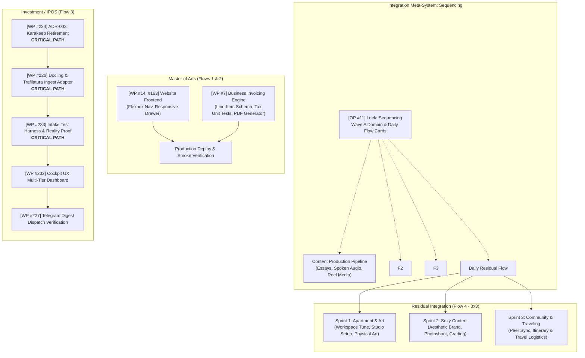

# Weekly Command Brief — 2026-W45

> **Weekly State:** `APPROVED_FOR_EXECUTION`  
> **Cadence:** Monday Nov 9 – Saturday Nov 14, 2026 (Sunday Nov 15 OFF per Decision D017).  
> **Design Pattern:** Design 01 — *Northstar* (Portfolio Strategy Canvas & Progressive Cards).  
> **Domain Distribution:** 2 Flows Master of Arts (Website, Content Production, Invoicing), 1 Flow Investment / IPOS, 1 Residual Flow (Apartment & Art, Sexy Content, Community & Traveling).  
> **Integration Engine:** Sequencing system (holistic life/work, habits, daily cadence, flow cards).  
> **Calendar Synchronization:** Deterministic Google Calendar `.ics` generated under `calendar-export/2026-W45-flows.ics`.  
> **OpenProject Connectivity:** Live instance `http://127.0.0.1:8083` reconciled.

---

## 1. Portfolio Compass & Operator Decisions

```
╔═══════════════════════════════════════════════════════════════════════════════════════╗
║                                   PORTFOLIO COMPASS                                   ║
╠══════════════════════════════╦══════════════════════════════╦═════════════════════════╣
║ 04 Active Fronts             ║ 04 Flows / Day (3x3 Standard)║ 38 Net Focus Hours      ║
║ • Master of Arts (Web/Biz)   ║ • F1: MoA Content Production ║ • Mon–Fri Core Build    ║
║ • Investment / IPOS          ║ • F2: MoA Website & Invoicing║ • Sat Precap & Buffer   ║
║ • Sequencing Meta-System     ║ • F3: Investment / IPOS      ║ • Sun Rest (D017)       ║
║ • Residual Life & Art Flow   ║ • F4: Residual (Art/Sex/Com) ║                         ║
╚══════════════════════════════╩══════════════════════════════╩═════════════════════════╝
```

### Locked Operator Governance Decisions:
- **DEC-014 [P0 | I98/E15/R10] Live OpenProject Intake Precedence**
  - • Context: Replaced all offline placeholder IDs with live work packages verified on `http://127.0.0.1:8083`.
  - • Live Anchors: `moa-website` (#14, WP #163), `moa-content` (#6), `investment-ipos` (#16, WPs #223–#233), `leela-sequencing` (#11, WPs #215–#216).
  - • Status: `ACTIVE_TRUTH`

- **DEC-016 / OP-01 [P1 | I95/E30/R15] Sequencing as the Holistic Integration System**
  - • Context: Sequencing is the meta-level integration system that organizes the operator's entire week—including health, meditation, living space, and daily flow cards.
  - • Flow Standard: 3x3 repetition (3 sprints per flow, 3 distinct checklist items per sprint; flexes to 3x1 or 3x2 as capacity warrants).
  - • Daily Flow Budget: Exactly 4 flows per day.
  - • Status: `ACTIVE_TRUTH`

- **DEC-017 [P1 | I90/E20/R10] Saturday Precap Cadence & Sunday Off**
  - • Context: Weekly Precap operates on Saturday morning (`09:00 – 11:00`).
  - • Sunday Rule: Off by default for deep rest and regeneration.
  - • Status: `ACTIVE_TRUTH`

- **DEC-018 / OP-02 [P1 | I92/E20/R10] Master of Arts Weekly Scope Focus**
  - • Context: Operator instruction restricts Master of Arts this week strictly to **Website**, **Content Production**, and **Business (Invoicing)**. ACIM (WP #204) remains intact in OpenProject but is unlinked from this week's active deliverables.
  - • Status: `ACTIVE_TRUTH`

---

## 2. Matrix 1: Project Architecture & Process Flow (North Star Canvas)



---

### Project 1: Master of Arts (Website, Content & Invoicing)
- **Live OpenProject References:** Project 14 (`moa-website`), Project 6 (`moa-content`), Project 7 (`moa-business`).
- **Strategic Outcome:** Deploy modernized flexbox navigation and mobile drawer on the website; establish systematic creative essay and spoken narration publishing pipelines; implement automated line-item invoicing engine with tax calculation tests and PDF generation.
- **Baseline State:** Website layout is outdated; content drafting lacks a structured multi-channel distribution pipeline; invoicing and billing are handled manually without schema validation.
- **Process Flow & Iterations:**
  `Website Flexbox Nav & Mobile Drawer` ➔ `Content Publishing Pipeline` ➔ `Invoicing Schema & Tax Unit Tests` ➔ `Automated PDF Generator Release`
- **Evolution Commentary:**
  - *"This is there now":* Fragmented markdown notes, manual invoice math, and static navbar styles.
  - *"This goes where":* Live production website, published audio/written media assets, and compliant PDF billing records.

#### Shortlist (This Week's High Leverage Commitments):
- [ ] **[OP-WP#14] Responsive Navigation Flexbox & Mobile Drawer** `(I90/E80/R15: 75)`
  - • Subtask 1: Refactor header styles with modern CSS flexbox and responsive breakpoints.
  - • Subtask 2: Implement slide-out navigation drawer with smooth mobile animation.
  - • Subtask 3: Cross-browser responsive audit and Lighthouse performance verification.
  - • Expected Evidence: Staging build receipt and mobile layout screenshot.
- [ ] **[OP-WP#6] Creative Content Production & Narration Media Pipeline** `(I88/E75/R10: 78)`
  - • Subtask 1: Script longform intellectual essays and creative field notes.
  - • Subtask 2: Record spoken-word narration, balance audio frequencies, and master output.
  - • Subtask 3: Format short video reels and social distribution copy.
  - • Expected Evidence: Exported audio master files and scheduled distribution batch.
- [ ] **[OP-WP#7] Invoicing Calculation Engine & Automated PDF Generator** `(I94/E85/R15: 80)` **[CRITICAL PATH]**
  - • Subtask 1: Define line-item JSON schema with currency and line-item formatting.
  - • Subtask 2: Implement tax and subtotal recalculation unit tests covering zero-discount edge cases.
  - • Subtask 3: Build HTML-to-PDF invoice template with print stylesheet and accounting export path.
  - • Expected Evidence: Passing unit test suite and sample PDF invoice receipt.

#### Longlist (Staged / Backlog):
- [ ] **[OP #14: WP #204] ACIM Secular: Dedicated Sources & Commentary Credits Page**: Retained in OpenProject project record; unlinked from this week's active focus per operator instruction.
- [ ] **[OP-WP#7] Bank Reconciliation & Stripe Payment Webhook Integration**: Staged for Month 2.
- [ ] **[OP-WP#14] Automated Dark/Light Theme Switching**: Deferred behind core navigation lock.

---

### Project 2: Investment / IPOS (Research Intake & Evidence Pipeline)
- **Live OpenProject References:** Project 16 (`investment-ipos`).
- **Strategic Outcome:** Formalize ADR-003 retiring Karakeep code debt; build IBM Docling and Trafilatura ingestion adapters; verify ingestion reliability via end-to-end reality validation test harness.
- **Baseline State:** Legacy Karakeep references remain in codebase; upstream ingestion is vulnerable to timeouts; research intake lacks unified JSON evidence receipts.
- **Process Flow & Iterations:**
  `[WP#224] ADR-003 Karakeep Deprecation` ➔ `[WP#226] Docling & Trafilatura Ingestion` ➔ `[WP#233] Intake Test Harness` ➔ `[WP#232] Cockpit Dashboard`
- **Evolution Commentary:**
  - *"This is there now":* Unstable scraper scripts and legacy import mocks.
  - *"This goes where":* Sovereign JSON research schema feeding quantitative databases and weekly digest dispatchers.

#### Shortlist (This Week's High Leverage Commitments):
- [ ] **[OP #16: WP #224] ADR-003: Formalize Karakeep Retirement & Deprecation** `(I95/E40/R10: 85)` **[CRITICAL PATH]**
  - • Subtask 1: Audit and purge legacy Karakeep import references across `ipos/ingest/`.
  - • Subtask 2: Lock ADR-003 architectural decision record in repository.
  - • Subtask 3: Verify clean test pass with legacy mocks eliminated.
  - • Unblocks: WP #226 (Docling & Trafilatura Ingestion Adapter).
- [ ] **[OP #16: WP #226] RI-11: Implement IBM Docling & Trafilatura Ingestion Adapter** `(I94/E85/R20: 76)` **[CRITICAL PATH]**
  - • Subtask 1: Implement Docling PDF extraction pipeline for financial research memos.
  - • Subtask 2: Wire Trafilatura adapter for web article text extraction and HTML cleansing.
  - • Subtask 3: Harmonize output payloads into sovereign research JSON schema.
  - • Unblocks: WP #233 (End-to-End Test Harness).
- [ ] **[OP #16: WP #233] RI-15: End-to-End Intake Pipeline Test Harness & Reality Proof** `(I90/E80/R15: 78)` **[CRITICAL PATH]**
  - • Subtask 1: Run sample document extraction benchmark across complex PDFs.
  - • Subtask 2: Verify exponential backoff and persistent retry queue under network dropouts.
  - • Subtask 3: Emit verifiable intake execution receipts.

#### Longlist (Staged / Backlog):
- [ ] **[OP #16: WP #232] Cockpit UX Multi-Tier Dashboard View**: Staged for Thursday afternoon.
- [ ] **[OP #16: WP #227] Hermes Telegram Digest Dispatch Verification**: Staged for Friday afternoon.

---

### Project 3: Sequencing (Integration Meta-System)
- **Live OpenProject References:** Project 11 (`leela-sequencing`).
- **Strategic Outcome:** Govern the holistic integration of operator focus, habits, morning meditation, workspace environmental harmony, and daily flow cards.
- **Shortlist:**
  - [ ] **[OP-WP#215 / #216] Wave A Sequencing Domain & Daily Flow Card Architecture**
    - • Subtask 1: Maintain daily 4-flow operating budget and protected routine anchors.
    - • Subtask 2: Emit 3x3 sprint checklists with verified execution evidence for each flow.

---

### Project 4: Residual Integration Flow (Life, Art & Community)
- **Strategic Outcome:** Maintain life-art equilibrium through structured daily focus on physical living space, aesthetic brand imagery, and social/travel logistics.
- **Flow Granularity:** 3 sprints per day, 3 items per sprint (3x3 standard).
- **Shortlist:**
  - [ ] **Sprint 1: Apartment & Art** (Living space acoustic tune, physical studio organization, canvas prep).
  - [ ] **Sprint 2: Sexy Content** (Aesthetic lighting setup, photoshoot capture, high-tier photo grading).
  - [ ] **Sprint 3: Community & Traveling** (Peer connection outreach, travel logistics and itinerary planning).

---

## 3. Matrix 2: Timeline & Real Calendar Schedule (4 Flows Daily, 3x3 Sprints)

The table below maps the 4 daily flows into the operating schedule between protected routine anchors. All flows conform to the 3x3 sprint standard (3 sprints, 3 actionable items each).

| Time Window | Block Type | Monday (Nov 9) | Tuesday (Nov 10) | Wednesday (Nov 11) | Thursday (Nov 12) | Friday (Nov 13) | Saturday (Nov 14) |
| :--- | :--- | :--- | :--- | :--- | :--- | :--- | :--- |
| **08:00 – 09:00** | 🔒 **Protected Anchor** | **Morning Setup**<br>• Meditation & breathwork<br>• Calendar verify<br>• Day kickoff | **Morning Setup**<br>• Meditation & breathwork<br>• Calendar verify<br>• Day kickoff | **Morning Setup**<br>• Meditation & breathwork<br>• Calendar verify<br>• Day kickoff | **Morning Setup**<br>• Meditation & breathwork<br>• Calendar verify<br>• Day kickoff | **Morning Setup**<br>• Meditation & breathwork<br>• Calendar verify<br>• Day kickoff | **Morning Setup**<br>• Reflection<br>• Week review prep |
| **09:00 – 10:45** | ⚡ **Flow 1 (1h45m)**<br>*MoA: Content Production* | **MoA: Content Essays**<br>**S1 (09:00–09:30):**<br>1. Outline thesis essay<br>2. Reconcile key concepts<br>3. Draft core argument<br>**S2 (09:30–10:00):**<br>1. Record spoken-word<br>2. Edit audio hooks<br>3. Master voice track<br>**S3 (10:00–10:30):**<br>1. Format distribution copy<br>2. Schedule draft<br>3. Archive raw takes<br>• Buffer (10:30–10:45) | **MoA: Media Slicing**<br>**S1 (09:00–09:30):**<br>1. Cut short reel clips<br>2. Sync audio waveforms<br>3. Burn in subtitles<br>**S2 (09:30–10:00):**<br>1. Visual card generation<br>2. Asset export pass<br>3. Caption copywriting<br>**S3 (10:00–10:30):**<br>1. Multi-channel queue<br>2. Tagging & metadata<br>3. Proof review pass<br>• Buffer (10:30–10:45) | **MoA: Longform Writing**<br>**S1 (09:00–09:30):**<br>1. Deep dive essay draft<br>2. Structure sections<br>3. Source citations check<br>**S2 (09:30–10:00):**<br>1. Diagram card build<br>2. Visual graphic export<br>3. Layout inspection<br>**S3 (10:00–10:30):**<br>1. Editorial polish<br>2. Proofreading pass<br>3. Publish staging<br>• Buffer (10:30–10:45) | **MoA: Audio Narration**<br>**S1 (09:00–09:30):**<br>1. Narrative voiceover cut<br>2. Noise reduction pass<br>3. Pacing alignment<br>**S2 (09:30–10:00):**<br>1. Background score mix<br>2. Master stereo export<br>3. Waveform preview<br>**S3 (10:00–10:30):**<br>1. Podcast feed bundle<br>2. Episode notes format<br>3. Asset queue lock<br>• Buffer (10:30–10:45) | **MoA: Weekly Newsletter**<br>**S1 (09:00–09:30):**<br>1. Synthesis newsletter<br>2. Digest top insights<br>3. Link curations<br>**S2 (09:30–10:00):**<br>1. Email draft build<br>2. Test send pass<br>3. Mobile layout check<br>**S3 (10:00–10:30):**<br>1. Broadcast dispatch<br>2. Social broadcast<br>3. Community monitor<br>• Buffer (10:30–10:45) | **Weekly Precap (D017)**<br>**S1 (09:00–09:40):**<br>1. Audit week evidence<br>2. Check flow recaps<br>3. Rate completion metrics<br>**S2 (09:40–10:20):**<br>1. Query OpenProject<br>2. Update WP progress<br>3. Check blockers<br>**S3 (10:20–11:00):**<br>1. Draft W46 brief<br>2. Schedule calendar<br>3. Lock weekly plan |
| **10:45 – 11:15** | ☕ **Buffer / External** | ☕ Break & walk | ☕ Break & walk | ☕ Break & walk | ☕ Break & walk | ☕ Break & walk | ☕ Transition break |
| **11:15 – 12:30** | ⚡ **Flow 2 (1h15m)**<br>*MoA: Website & Invoicing* | **MoA: Website Nav Bar**<br>**S1 (11:15–11:40):**<br>1. Refactor CSS flexbox<br>2. Nav link list styling<br>3. Active state selector<br>**S2 (11:40–12:05):**<br>1. Tablet breakpoint<br>2. Mobile drawer layout<br>3. Hamburger animation<br>**S3 (12:05–12:30):**<br>1. Asset minification<br>2. Cross-browser check<br>3. Staging deploy pass | **MoA: Content Engine**<br>**S1 (11:15–11:40):**<br>1. Markdown adapter stub<br>2. Frontmatter schema<br>3. Unit test parser<br>**S2 (11:40–12:05):**<br>1. Connect content feed<br>2. Dynamic page route<br>3. Image aspect check<br>**S3 (12:05–12:30):**<br>1. Build static output<br>2. Internal link scan<br>3. PR draft review | **MoA: Invoicing Schema**<br>**S1 (11:15–11:40):**<br>1. Invoice JSON schema<br>2. Line-item fields<br>3. Currency formatting<br>**S2 (11:40–12:05):**<br>1. Subtotal calculation<br>2. Tax formula unit test<br>3. Zero discount edge<br>**S3 (12:05–12:30):**<br>1. Schema test pass<br>2. Accounting path wire<br>3. Commit schema branch | **MoA: PDF Billing Engine**<br>**S1 (11:15–11:40):**<br>1. HTML invoice template<br>2. CSS print stylesheet<br>3. Dynamic data bind<br>**S2 (11:40–12:05):**<br>1. HTML-to-PDF engine<br>2. Page break logic<br>3. PDF metadata inject<br>**S3 (12:05–12:30):**<br>1. Batch invoice run<br>2. Visual diff check<br>3. Export CLI wrapper | **MoA: Billing & Release**<br>**S1 (11:15–11:40):**<br>1. E2E invoice run<br>2. Test email send<br>3. PDF receipt verify<br>**S2 (11:40–12:05):**<br>1. Export ledger match<br>2. Production build pass<br>3. Cache headers check<br>**S3 (12:05–12:30):**<br>1. Production smoke run<br>2. Tag release v1.0<br>3. Deploy signoff | **Clean Room & Buffer**<br>• Workspace reset<br>• Documentation sync<br>• System maintenance<br>*(11:30–13:00)* |
| **12:30 – 13:30** | 🔒 **Protected Anchor** | **Midday Reset & Lunch** | **Midday Reset & Lunch** | **Midday Reset & Lunch** | **Midday Reset & Lunch** | **Midday Reset & Lunch** | Lunch break |
| **13:30 – 15:30** | ⚡ **Flow 3 (2h)**<br>*Investment / IPOS* | **IPOS: Karakeep & Docling**<br>**S1 (13:30–14:05):**<br>1. Audit Karakeep refs<br>2. ADR-003 record lock<br>3. Purge legacy mocks<br>**S2 (14:05–14:45):**<br>1. Docling PDF extractor<br>2. Trafilatura web parser<br>3. Output JSON schema<br>**S3 (14:45–15:20):**<br>1. Ingest test harness<br>2. Error retry verify<br>3. Evidence receipt log<br>• Buffer (15:20–15:30) | **IPOS: Ingest Pipeline**<br>**S1 (13:30–14:05):**<br>1. Trafilatura text clean<br>2. Boilerplate removal<br>3. Character encoding<br>**S2 (14:05–14:45):**<br>1. FRED schema mapping<br>2. Macro indicator cast<br>3. Time-series format<br>**S3 (14:45–15:20):**<br>1. Batch runner script<br>2. DB transaction safety<br>3. Log verification<br>• Buffer (15:20–15:30) | **IPOS: Reality Validation**<br>**S1 (13:30–14:05):**<br>1. Sample memo ingest<br>2. Benchmark latency<br>3. Check memory profile<br>**S2 (14:05–14:45):**<br>1. Timeout recovery run<br>2. Backoff retry check<br>3. Network drop test<br>**S3 (14:45–15:20):**<br>1. Write WP #233 proof<br>2. Validate JSON schema<br>3. Sign off pipeline<br>• Buffer (15:20–15:30) | **IPOS: Cockpit Dashboard**<br>**S1 (13:30–14:05):**<br>1. Cockpit UX wireframe<br>2. Metric card layout<br>3. Multi-tier visual hierarchy<br>**S2 (14:05–14:45):**<br>1. Live query view wire<br>2. DB aggregate adapter<br>3. Data table render<br>**S3 (14:45–15:20):**<br>1. Sorting/filter hooks<br>2. Status indicator component<br>3. Dashboard test pass<br>• Buffer (15:20–15:30) | **IPOS: Telegram Digest**<br>**S1 (13:30–14:05):**<br>1. Telegram export script<br>2. Bot API token auth<br>3. Digest template build<br>**S2 (14:05–14:45):**<br>1. Weekly research payload<br>2. Format markdown post<br>3. Dry-run test dispatch<br>**S3 (14:45–15:20):**<br>1. Verify channel delivery<br>2. Delivery receipt log<br>3. Mission 2 signoff<br>• Buffer (15:20–15:30) | **Afternoon OFF**<br>• Free personal time<br>• Restoration |
| **15:30 – 16:00** | ☕ **Buffer / Transition** | ☕ Break & fresh air | ☕ Break & fresh air | ☕ Break & fresh air | ☕ Break & fresh air | ☕ Break & fresh air | Rest |
| **16:00 – 17:45** | ⚡ **Flow 4 (1h45m)**<br>*Residual Flow (3x3)* | **Residual Flow**<br>**S1: Apartment & Art**<br>1. Acoustic workspace tune<br>2. Studio material sort<br>3. Living space reset<br>**S2: Sexy Content**<br>1. Lighting & moodboard<br>2. Visual photoshoot<br>3. Photo color grading<br>**S3: Community & Travel**<br>1. Outreach message check<br>2. Travel route logistics<br>3. Event sync review | **Residual Flow**<br>**S1: Apartment & Art**<br>1. Studio refinement<br>2. Canvas stretch/prime<br>3. Tool maintenance<br>**S2: Sexy Content**<br>1. Color palette review<br>2. Visual narrative edit<br>3. Catalog high-res assets<br>**S3: Community & Travel**<br>1. Packing checklist review<br>2. Itinerary sync pass<br>3. Travel gear check | **Residual Flow**<br>**S1: Apartment & Art**<br>1. Physical art session<br>2. Frame mounting<br>3. Studio visual cleanup<br>**S2: Sexy Content**<br>1. Portrait editing pass<br>2. Creative brand draft<br>3. Social aesthetic preview<br>**S3: Community & Travel**<br>1. Creative peer outreach<br>2. Community responses<br>3. Shared project sync | **Residual Flow**<br>**S1: Apartment & Art**<br>1. Artwork varnish/finish<br>2. Lighting angle adjust<br>3. Workspace declutter<br>**S2: Sexy Content**<br>1. Brand lookbook update<br>2. Asset tagging<br>3. Portfolio export<br>**S3: Community & Travel**<br>1. Destination research<br>2. Accommodation review<br>3. Travel schedule lock | **Residual Flow**<br>**S1: Apartment & Art**<br>1. Studio clean room reset<br>2. Material inventory<br>3. Restock order list<br>**S2: Sexy Content**<br>1. Weekly asset archive<br>2. Best-of selection<br>3. Brand deck sync<br>**S3: Community & Travel**<br>1. Weekend plans confirm<br>2. Departure logistics<br>3. Community catch-up | **OFF** |
| **17:45 – 18:00** | ☕ **Buffer** | Daily recap notes | Daily recap notes | Daily recap notes | Daily recap notes | Weekly recap notes | Rest |
| **18:00 – 18:30** | 🔒 **Protected Anchor** | **Evening Shutdown**<br>• FlowRecap run<br>• Git commit sync<br>• Day outro | **Evening Shutdown**<br>• FlowRecap run<br>• Git commit sync<br>• Day outro | **Evening Shutdown**<br>• FlowRecap run<br>• Git commit sync<br>• Day outro | **Evening Shutdown**<br>• FlowRecap run<br>• Git commit sync<br>• Day outro | **Evening Shutdown**<br>• Weekly wrap<br>• Git commit sync<br>• Saturday prep | **OFF** |

---

## 4. Google Calendar Integration & Artifacts

- **Deterministic Export File:** [`2026-W45-flows.ics`](file:///c:/GitDev/apexai-os-meta/apex-meta/tools/project-improvement-orchestration-weekly/01-weekly-command-brief/calendar-export/2026-W45-flows.ics)
- **Generator Script:** [`generate_ics.py`](file:///c:/GitDev/apexai-os-meta/apex-meta/tools/project-improvement-orchestration-weekly/01-weekly-command-brief/calendar-export/generate_ics.py)
- **Features:** 22 scheduled flow events, Europe/Berlin timezone, 10-minute popup reminders, full 3x3 checklist descriptions.
- **Safety Invariant:** Discretionary flow events only; no modifications to existing personal or external events.

---

## 5. Downstream Execution Handoff (PrecapNextDay Intake)

```yaml
presentation_handoff:
  artifact_type: "Weekly_Command_Brief"
  artifact_ref: "apex-meta/tools/project-improvement-orchestration-weekly/01-weekly-command-brief/WEEKLY_COMMAND_BRIEF_2026_W45.md"
  calendar_export_ref: "apex-meta/tools/project-improvement-orchestration-weekly/01-weekly-command-brief/calendar-export/2026-W45-flows.ics"
  week: "2026-W45"
  result_state: "APPROVED_FOR_EXECUTION"
  weekly_intent: "Execute MoA website flexbox and invoice generation engine, retire Karakeep in IPOS and build Docling/Trafilatura intake pipeline, and maintain daily 3x3 residual life/art flows."
  integration_system: "Sequencing"
  daily_flow_budget: 4
  flow_repetition_standard: "3x3"
  active_streams:
    stream_1_moa_content:
      flows_daily: 1
      openproject_id: 6
    stream_2_moa_website_and_biz:
      flows_daily: 1
      openproject_id: 14
      priority_wps: [163]
    stream_3_ipos:
      flows_daily: 1
      openproject_id: 16
      priority_wps: [224, 226, 233, 232, 227]
    stream_4_residual:
      flows_daily: 1
      sprints:
        s1: "Apartment & Art"
        s2: "Sexy Content"
        s3: "Community & Traveling"
  next_consumer: "PrecapNextDay"
  next_target_day: "Monday"
  monday_hourly_schedule:
    08_00_09_00: "Protected Anchor: Morning Setup & Meditation"
    09_00_10_45:
      flow: "F1 (Master of Arts: Content Production & Essay Pipeline)"
      sprints:
        s1: ["1. Outline thesis essay", "2. Reconcile key concepts", "3. Draft core argument"]
        s2: ["1. Record spoken-word", "2. Edit audio hooks", "3. Master voice track"]
        s3: ["1. Format distribution copy", "2. Schedule draft", "3. Archive raw takes"]
    11_15_12_30:
      flow: "F2 (Master of Arts: Website Flexbox Navigation)"
      sprints:
        s1: ["1. Refactor CSS flexbox", "2. Nav link list styling", "3. Active state selector"]
        s2: ["1. Tablet breakpoint", "2. Mobile drawer layout", "3. Hamburger animation"]
        s3: ["1. Asset minification", "2. Cross-browser check", "3. Staging deploy pass"]
    12_30_13_30: "Protected Anchor: Midday Reset & Lunch"
    13_30_15_30:
      flow: "F3 (Investment / IPOS: WP #224 Karakeep & #226 Docling Adapter)"
      sprints:
        s1: ["1. Audit Karakeep refs", "2. ADR-003 record lock", "3. Purge legacy mocks"]
        s2: ["1. Docling PDF extractor", "2. Trafilatura web parser", "3. Output JSON schema"]
        s3: ["1. Ingest test harness", "2. Error retry verify", "3. Evidence receipt log"]
    16_00_17_45:
      flow: "F4 (Residual Flow: Apartment, Sexy Content & Community)"
      sprints:
        s1: ["1. Acoustic workspace tune", "2. Studio material sort", "3. Living space reset"]
        s2: ["1. Lighting & moodboard", "2. Visual photoshoot", "3. Photo color grading"]
        s3: ["1. Outreach message check", "2. Travel route logistics", "3. Event sync review"]
    18_00_18_30: "Protected Anchor: Evening Shutdown & FlowRecap"
```
