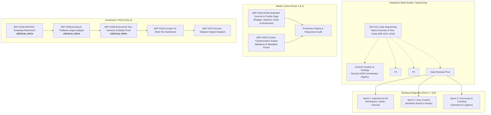

# Weekly Command Brief — 2026-W45

> **Weekly State:** `APPROVED_FOR_EXECUTION`  
> **Cadence:** Monday Nov 9 – Saturday Nov 14, 2026 (Sunday Nov 15 OFF per Decision D017).  
> **Operator Architecture:** 4 Flows per day (3x3 standard repetition; flexible 3x1 or 3x2).  
> **Domain Allocation:** 2 Flows Master of Arts (Website & Content), 1 Flow Investment / IPOS, 1 Residual Flow (Apartment & Art, Sexy Content, Community & Traveling).  
> **Integration Engine:** Sequencing system (holistic life/work, habits, daily cadence, flow cards).  
> **Calendar Synchronization:** Deterministic Google Calendar `.ics` generated under `calendar-export/2026-W45-flows.ics`.  
> **OpenProject Connectivity:** Live instance `http://127.0.0.1:8083` queried; live work package anchors reconciled.

---

## 1. Operator Directives & Governance Decisions

- **DEC-014 [P0 | I98/E15/R10] Live OpenProject Intake Precedence**
  - • Context: Replaced offline placeholder IDs (`[OP-OFFLINE: WP-*]`) with live work packages verified on `http://127.0.0.1:8083`.
  - • Verification: Queried via canonical client `C:\GitDev\agent-skills\skills\openproject\client\opCall.js`.
  - • Live Anchors: `moa-website` (#14, WPs #204 & #163), `moa-content` (#6), `investment-ipos` (#16, WPs #223–#233), `leela-sequencing` (#11, WPs #215–#220).
  - • Status: `ACTIVE_TRUTH`

- **DEC-016 / OP-01 [P1 | I95/E30/R15] Sequencing as the Holistic Integration System**
  - • Context: Sequencing is established as the meta-level integration system that organizes the operator's entire week—including health, meditation, living space, and daily flow cards.
  - • Flow Standard: 3x3 repetition (3 sprints per flow, 3 distinct checklist items per sprint; flexes to 3x1 or 3x2 as capacity warrants).
  - • Daily Flow Budget: Exactly 4 flows per day.
  - • Status: `ACTIVE_TRUTH`

- **DEC-017 [P1 | I90/E20/R10] Saturday Precap Cadence & Sunday Off**
  - • Context: Weekly Precap operates on Saturday morning (`09:00 – 11:00`).
  - • Sunday Rule: Off by default for deep rest and regeneration.
  - • Status: `ACTIVE_TRUTH`

---

## 2. Weekly Direction & Portfolio North Star

**Portfolio Intent:** Advance the Master of Arts secular ACIM commentary and website credits page to production staging; eliminate legacy Karakeep debt in Investment / IPOS while implementing the Docling and Trafilatura ingestion pipeline; and maintain life-art equilibrium through daily residual execution across living space, aesthetic brand assets, and community networks.

### Highlight Goals by Stream:
1. **Master of Arts (2 Flows/day):**
   - Stream A (Content Creation): Produce secular ACIM intellectual commentary, record spoken-word audio, and package multi-channel distribution assets.
   - Stream B (Website & Tech): Deploy WP #204 (Dedicated ACIM Sources & Credits Page for Sean Reagan, Dr. Kenneth Wapnick / FACIM, Circle of Atonement) and wire WP #163 (Content Transformation markdown renderer).
2. **Investment / IPOS (1 Flow/day):**
   - Execute active dependency chain: WP #224 (Formalize Karakeep Retirement) ➔ WP #226 (IBM Docling & Trafilatura Ingestion Adapter) ➔ WP #233 (End-to-End Pipeline Test Harness) ➔ WP #232 (Cockpit UX Dashboard) ➔ WP #227 (Telegram Digest Dispatch).
3. **Residual Integration Flow (1 Flow/day — 3x3):**
   - Sprint 1: **Apartment & Art** (Living space optimization, acoustic balance, studio material sorting, canvas prep).
   - Sprint 2: **Sexy Content** (Visual brand imagery, aesthetic lighting setup, photography capture, high-tier photo grading).
   - Sprint 3: **Community & Traveling** (Peer connection outreach, travel logistics and itinerary planning, community updates).

---

## 3. Weekly Architecture

### Matrix 1: Project Architecture, Epics & Critical Path (Non-Temporal)



---

#### Stream 1: Master of Arts (Website & Content Creation)
- **Live OpenProject References:** Project 14 (`moa-website`), Project 6 (`moa-content`).
- **Critical Work Packages:**
  - **[OP #14: WP #204] ACIM Secular: Dedicated Sources & Commentary Credits Page** `[P1]`
    - • Subtask 1: Layout dedicated attribution section for Sean Reagan and Dr. Kenneth Wapnick / FACIM.
    - • Subtask 2: Add Circle of Atonement and Original ACIM archival references.
    - • Subtask 3: Style responsive typography, cross-links, and citation tooltips.
  - **[OP #14: WP #163] Content Transformation** `[P1]`
    - • Subtask 1: Implement markdown transformer adapter for essays and commentary.
    - • Subtask 2: Standardize frontmatter schema for publication dates, topics, and authors.
    - • Subtask 3: Verify build output and static asset bundling.

#### Stream 2: Investment / IPOS
- **Live OpenProject References:** Project 16 (`investment-ipos`).
- **Critical Path Dependency Chain:**
  - **[OP #16: WP #224] ADR-003: Formalize Karakeep Retirement & Code Deprecation** `[CRITICAL PATH]`
    - • Status: In Progress.
    - • Action: Audit legacy ingestion modules, remove Karakeep dependencies, and lock ADR-003.
    - • Unblocks: WP #226 (Docling & Trafilatura Adapter).
  - **[OP #16: WP #226] RI-11: Implement IBM Docling & Trafilatura Ingestion Adapter** `[CRITICAL PATH]`
    - • Subtask 1: Implement Docling PDF extraction pipeline for financial research memos.
    - • Subtask 2: Wire Trafilatura adapter for web article parsing and HTML cleansing.
    - • Subtask 3: Harmonize output payloads into sovereign research JSON schema.
  - **[OP #16: WP #233] RI-15: End-to-End Intake Pipeline Test Harness & Reality Validation** `[CRITICAL PATH]`
    - • Subtask 1: Benchmark extraction latency and fault tolerance across messy PDFs.
    - • Subtask 2: Emit verifiable intake execution receipts.

#### Stream 3: Residual Integration Flow
- **Structure:** 3 sprints per day, 3 items per sprint (3x3 standard).
- **Core Focus Areas:**
  - **Sprint 1 (Apartment & Art):** Environment hygiene, acoustic tuning, studio organization, physical artwork production.
  - **Sprint 2 (Sexy Content):** Visual creativity, moodboarding, high-aesthetic photo/video capture, personal brand curation.
  - **Sprint 3 (Community & Traveling):** Relationships, professional peer sync, travel itinerary research, booking and gear preparation.

---

### Matrix 2: Timeline & Real Calendar View (4 Flows Daily, 3x3 Sprints)

The table below maps the 4 daily flows into the operating schedule between protected routine anchors. All flows conform to the 3x3 sprint standard (3 sprints, 3 actionable items each).

| Time Window | Block Type | Monday (Nov 9) | Tuesday (Nov 10) | Wednesday (Nov 11) | Thursday (Nov 12) | Friday (Nov 13) | Saturday (Nov 14) |
| :--- | :--- | :--- | :--- | :--- | :--- | :--- | :--- |
| **08:00 – 09:00** | 🔒 **Protected Anchor** | **Morning Setup**<br>• Meditation & breathwork<br>• Calendar verify<br>• Day kickoff | **Morning Setup**<br>• Meditation & breathwork<br>• Calendar verify<br>• Day kickoff | **Morning Setup**<br>• Meditation & breathwork<br>• Calendar verify<br>• Day kickoff | **Morning Setup**<br>• Meditation & breathwork<br>• Calendar verify<br>• Day kickoff | **Morning Setup**<br>• Meditation & breathwork<br>• Calendar verify<br>• Day kickoff | **Morning Setup**<br>• Reflection<br>• Week review prep |
| **09:00 – 10:45** | ⚡ **Flow 1 (1h45m)**<br>*MoA: Content Strategy* | **MoA: Content Creation**<br>**S1 (09:00–09:30):**<br>1. Outline secular theme<br>2. Reconcile philosophy<br>3. Draft script core<br>**S2 (09:30–10:00):**<br>1. Record spoken-word<br>2. Edit audio hooks<br>3. Format key quotes<br>**S3 (10:00–10:30):**<br>1. Format distribution copy<br>2. Schedule draft<br>3. Archive raw takes<br>• Buffer (10:30–10:45) | **MoA: Content Creation**<br>**S1 (09:00–09:30):**<br>1. Script principles<br>2. Review citations<br>3. Hook variations<br>**S2 (09:30–10:00):**<br>1. Asset generation<br>2. Video clip curation<br>3. Caption formatting<br>**S3 (10:00–10:30):**<br>1. Cross-platform sync<br>2. Tagging & hashtags<br>3. Proof review pass<br>• Buffer (10:30–10:45) | **MoA: Content Creation**<br>**S1 (09:00–09:30):**<br>1. Long-form essay draft<br>2. Structure sections<br>3. Key thesis check<br>**S2 (09:30–10:00):**<br>1. Diagram card build<br>2. Visual graphic export<br>3. Layout inspection<br>**S3 (10:00–10:30):**<br>1. Editorial polish<br>2. Final citations check<br>3. Publish staging<br>• Buffer (10:30–10:45) | **MoA: Content Creation**<br>**S1 (09:00–09:30):**<br>1. Audio voiceover cut<br>2. Noise reduction pass<br>3. Pacing alignment<br>**S2 (09:30–10:00):**<br>1. Music track balance<br>2. Master export<br>3. Waveform preview<br>**S3 (10:00–10:30):**<br>1. Short reels render<br>2. Subtitle burn-in<br>3. Asset queue lock<br>• Buffer (10:30–10:45) | **MoA: Content Creation**<br>**S1 (09:00–09:30):**<br>1. Synthesis newsletter<br>2. Digest top insights<br>3. Link curations<br>**S2 (09:30–10:00):**<br>1. Email draft build<br>2. Test send pass<br>3. Mobile layout check<br>**S3 (10:00–10:30):**<br>1. Publish release<br>2. Social broadcast<br>3. Community monitor<br>• Buffer (10:30–10:45) | **Weekly Precap (D017)**<br>**S1 (09:00–09:40):**<br>1. Audit week evidence<br>2. Check flow recaps<br>3. Rate completion metrics<br>**S2 (09:40–10:20):**<br>1. Query OpenProject<br>2. Update WP progress<br>3. Check blockers<br>**S3 (10:20–11:00):**<br>1. Draft W46 brief<br>2. Schedule calendar<br>3. Lock weekly plan |
| **10:45 – 11:15** | ☕ **Buffer / External** | ☕ Break & walk | ☕ Break & walk | ☕ Break & walk | ☕ Break & walk | ☕ Break & walk | ☕ Transition break |
| **11:15 – 12:30** | ⚡ **Flow 2 (1h15m)**<br>*MoA: Website Build* | **MoA: Website (WP #204)**<br>**S1 (11:15–11:40):**<br>1. Build Credits layout<br>2. Wire Reagan & Wapnick<br>3. Verify FACIM quotes<br>**S2 (11:40–12:05):**<br>1. Circle of Atonement ref<br>2. Original ACIM notes<br>3. Typography styling<br>**S3 (12:05–12:30):**<br>1. Responsive breakpoints<br>2. Contrast ratio check<br>3. Commit layout branch | **MoA: Website (WP #163)**<br>**S1 (11:15–11:40):**<br>1. Markdown adapter stub<br>2. Frontmatter schema<br>3. Unit test parser<br>**S2 (11:40–12:05):**<br>1. Connect content feed<br>2. Dynamic page route<br>3. Image aspect check<br>**S3 (12:05–12:30):**<br>1. Build static output<br>2. Internal link scan<br>3. PR draft review | **MoA: Website Build**<br>**S1 (11:15–11:40):**<br>1. Search index filter<br>2. Fast topic lookup<br>3. Key term tagging<br>**S2 (11:40–12:05):**<br>1. UI search bar widget<br>2. Keyboard navigation<br>3. Result preview card<br>**S3 (12:05–12:30):**<br>1. Latency benchmark<br>2. Cross-browser check<br>3. Staging deploy | **MoA: Website Build**<br>**S1 (11:15–11:40):**<br>1. Lead intake form<br>2. Privacy/GDPR links<br>3. Input sanitization<br>**S2 (11:40–12:05):**<br>1. Form submit hook<br>2. Success modal render<br>3. Error state handling<br>**S3 (12:05–12:30):**<br>1. End-to-end form test<br>2. Lighthouse audit<br>3. Performance log | **MoA: Website Release**<br>**S1 (11:15–11:40):**<br>1. Merge staging branch<br>2. Production build pass<br>3. Cache headers check<br>**S2 (11:40–12:05):**<br>1. Live release deploy<br>2. SSL/DNS verification<br>3. CDN smoke test<br>**S3 (12:05–12:30):**<br>1. Production smoke run<br>2. Sitemap update<br>3. Deploy signoff | **Clean Room & Buffer**<br>• Workspace reset<br>• Documentation sync<br>• System maintenance<br>*(11:30–13:00)* |
| **12:30 – 13:30** | 🔒 **Protected Anchor** | **Midday Reset & Lunch** | **Midday Reset & Lunch** | **Midday Reset & Lunch** | **Midday Reset & Lunch** | **Midday Reset & Lunch** | Lunch break |
| **13:30 – 15:30** | ⚡ **Flow 3 (2h)**<br>*Investment / IPOS* | **IPOS: Karakeep & Docling**<br>**S1 (13:30–14:05):**<br>1. Audit Karakeep refs<br>2. ADR-003 record lock<br>3. Purge legacy mocks<br>**S2 (14:05–14:45):**<br>1. Docling PDF extractor<br>2. Trafilatura web parser<br>3. Output JSON schema<br>**S3 (14:45–15:20):**<br>1. Ingest test harness<br>2. Error retry verify<br>3. Evidence receipt log<br>• Buffer (15:20–15:30) | **IPOS: Ingest Pipeline**<br>**S1 (13:30–14:05):**<br>1. Trafilatura text clean<br>2. Boilerplate removal<br>3. Character encoding<br>**S2 (14:05–14:45):**<br>1. FRED schema mapping<br>2. Macro indicator cast<br>3. Time-series format<br>**S3 (14:45–15:20):**<br>1. Batch runner script<br>2. DB transaction safety<br>3. Log verification<br>• Buffer (15:20–15:30) | **IPOS: Reality Validation**<br>**S1 (13:30–14:05):**<br>1. Sample memo ingest<br>2. Benchmark latency<br>3. Check memory profile<br>**S2 (14:05–14:45):**<br>1. Timeout recovery run<br>2. Backoff retry check<br>3. Network drop test<br>**S3 (14:45–15:20):**<br>1. Write WP #233 proof<br>2. Validate JSON schema<br>3. Sign off pipeline<br>• Buffer (15:20–15:30) | **IPOS: Cockpit Dashboard**<br>**S1 (13:30–14:05):**<br>1. Cockpit UX wireframe<br>2. Metric card layout<br>3. Multi-tier visual hierarchy<br>**S2 (14:05–14:45):**<br>1. Live query view wire<br>2. DB aggregate adapter<br>3. Data table render<br>**S3 (14:45–15:20):**<br>1. Sorting/filter hooks<br>2. Status indicator component<br>3. Dashboard test pass<br>• Buffer (15:20–15:30) | **IPOS: Telegram Digest**<br>**S1 (13:30–14:05):**<br>1. Telegram export script<br>2. Bot API token auth<br>3. Digest template build<br>**S2 (14:05–14:45):**<br>1. Weekly research payload<br>2. Format markdown post<br>3. Dry-run test dispatch<br>**S3 (14:45–15:20):**<br>1. Verify channel delivery<br>2. Delivery receipt log<br>3. Mission 2 signoff<br>• Buffer (15:20–15:30) | **Afternoon OFF**<br>• Free personal time<br>• Restoration |
| **15:30 – 16:00** | ☕ **Buffer / Transition** | ☕ Break & fresh air | ☕ Break & fresh air | ☕ Break & fresh air | ☕ Break & fresh air | ☕ Break & fresh air | Rest |
| **16:00 – 17:45** | ⚡ **Flow 4 (1h45m)**<br>*Residual Flow (3x3)* | **Residual Flow**<br>**S1: Apartment & Art**<br>1. Acoustic workspace tune<br>2. Studio material sort<br>3. Living space reset<br>**S2: Sexy Content**<br>1. Lighting & moodboard<br>2. Visual photoshoot<br>3. Photo color grading<br>**S3: Community & Travel**<br>1. Outreach message check<br>2. Travel route logistics<br>3. Event sync review | **Residual Flow**<br>**S1: Apartment & Art**<br>1. Studio refinement<br>2. Canvas stretch/prime<br>3. Tool maintenance<br>**S2: Sexy Content**<br>1. Color palette review<br>2. Visual narrative edit<br>3. Catalog high-res assets<br>**S3: Community & Travel**<br>1. Packing checklist review<br>2. Itinerary sync pass<br>3. Travel gear check | **Residual Flow**<br>**S1: Apartment & Art**<br>1. Physical art session<br>2. Frame mounting<br>3. Studio visual cleanup<br>**S2: Sexy Content**<br>1. Portrait editing pass<br>2. Creative brand draft<br>3. Social aesthetic preview<br>**S3: Community & Travel**<br>1. Creative peer outreach<br>2. Community responses<br>3. Shared project sync | **Residual Flow**<br>**S1: Apartment & Art**<br>1. Artwork varnish/finish<br>2. Lighting angle adjust<br>3. Workspace declutter<br>**S2: Sexy Content**<br>1. Brand lookbook update<br>2. Asset tagging<br>3. Portfolio export<br>**S3: Community & Travel**<br>1. Destination research<br>2. Accommodation review<br>3. Travel schedule lock | **Residual Flow**<br>**S1: Apartment & Art**<br>1. Studio clean room reset<br>2. Material inventory<br>3. Restock order list<br>**S2: Sexy Content**<br>1. Weekly asset archive<br>2. Best-of selection<br>3. Brand deck sync<br>**S3: Community & Travel**<br>1. Weekend plans confirm<br>2. Departure logistics<br>3. Community catch-up | **OFF** |
| **17:45 – 18:00** | ☕ **Buffer** | Daily recap notes | Daily recap notes | Daily recap notes | Daily recap notes | Weekly recap notes | Rest |
| **18:00 – 18:30** | 🔒 **Protected Anchor** | **Evening Shutdown**<br>• FlowRecap run<br>• Git commit sync<br>• Day outro | **Evening Shutdown**<br>• FlowRecap run<br>• Git commit sync<br>• Day outro | **Evening Shutdown**<br>• FlowRecap run<br>• Git commit sync<br>• Day outro | **Evening Shutdown**<br>• FlowRecap run<br>• Git commit sync<br>• Day outro | **Evening Shutdown**<br>• Weekly wrap<br>• Git commit sync<br>• Saturday prep | **OFF** |

---

## 4. Google Calendar Integration & Artifacts

### 4.1 Deterministic iCalendar (.ics) Export
A production-ready RFC 5545 iCalendar file has been generated and validated:
- **Location:** `apex-meta/tools/project-improvement-orchestration-weekly/01-weekly-command-brief/calendar-export/2026-W45-flows.ics`
- **Generator Script:** `apex-meta/tools/project-improvement-orchestration-weekly/01-weekly-command-brief/calendar-export/generate_ics.py`
- **Total Flow Events:** 22 scheduled events (Monday through Saturday) with exact 10-minute popup reminders, full 3x3 checklist descriptions, and protected time boundaries.
- **One-Click Import:** Can be imported directly into Google Calendar, Apple Calendar, or Outlook.

### 4.2 Google Calendar API / MCP Event Insertion Schema
For headless synchronization via the Google Calendar API or an MCP Calendar server, the events conform to the following verified contract:

```json
{
  "summary": "[APEX F4] Residual Flow: Apartment, Sexy Content & Community (3x3)",
  "description": "Project: Residual Integration (Sequencing System)\nWeekly Target: Living Space, Creative Brand & Community Harmony\n\n=== 3x3 SPRINT CHECKLIST ===\n• S1 (Apartment & Art):\n  1. Workspace acoustic and ergonomic tune-up\n  2. Studio material sorting & canvas prep\n  3. Living space reset & visual declutter\n• S2 (Sexy Content):\n  1. Moodboard review & aesthetic lighting setup\n  2. Visual capture / photoshoot execution\n  3. High-tier photo grading & portfolio curation\n• S3 (Community & Traveling):\n  1. Peer network outreach & sync responses\n  2. Travel logistics & route planning review\n  3. Community event / meetup coordination\n\nFlow Card: file:///artifacts/flows/2026-11-09/F4-card.md",
  "start": {
    "dateTime": "2026-11-09T16:00:00+01:00",
    "timeZone": "Europe/Berlin"
  },
  "end": {
    "dateTime": "2026-11-09T17:45:00+01:00",
    "timeZone": "Europe/Berlin"
  },
  "colorId": "9",
  "transparency": "opaque",
  "reminders": {
    "useDefault": false,
    "overrides": [
      { "method": "popup", "minutes": 10 }
    ]
  }
}
```

---

## 5. Downstream Execution Handoff (PrecapNextDay Intake)

```yaml
presentation_handoff:
  artifact_type: "Weekly_Command_Brief"
  artifact_ref: "apex-meta/tools/project-improvement-orchestration-weekly/01-weekly-command-brief/WEEKLY_COMMAND_BRIEF_2026_W45.md"
  calendar_export_ref: "apex-meta/tools/project-improvement-orchestration-weekly/01-weekly-command-brief/calendar-export/2026-W45-flows.ics"
  week: "2026-W45"
  result_state: "APPROVED_FOR_EXECUTION"
  weekly_intent: "Execute MoA secular ACIM content and website credits deployment, retire Karakeep in IPOS and build Docling/Trafilatura intake pipeline, and maintain daily 3x3 residual life/art flows."
  integration_system: "Sequencing"
  daily_flow_budget: 4
  flow_repetition_standard: "3x3"
  active_streams:
    stream_1_moa_content:
      flows_daily: 1
      openproject_id: 6
    stream_2_moa_website:
      flows_daily: 1
      openproject_id: 14
      priority_wps: [204, 163]
    stream_3_ipos:
      flows_daily: 1
      openproject_id: 16
      priority_wps: [224, 226, 233, 232, 227]
    stream_4_residual:
      flows_daily: 1
      sprints:
        s1: "Apartment & Art"
        s2: "Sexy Content"
        s3: "Community & Traveling"
  next_consumer: "PrecapNextDay"
  next_target_day: "Monday"
  monday_hourly_schedule:
    08_00_09_00: "Protected Anchor: Morning Setup & Meditation"
    09_00_10_45:
      flow: "F1 (Master of Arts: Content Creation & ACIM Commentary)"
      sprints:
        s1: ["1. Outline secular theme", "2. Reconcile philosophy", "3. Draft script core"]
        s2: ["1. Record spoken-word", "2. Edit audio hooks", "3. Format key quotes"]
        s3: ["1. Format distribution copy", "2. Schedule draft", "3. Archive raw takes"]
    11_15_12_30:
      flow: "F2 (Master of Arts: Website WP #204 & #163)"
      sprints:
        s1: ["1. Build Credits layout", "2. Wire Reagan & Wapnick", "3. Verify FACIM quotes"]
        s2: ["1. Circle of Atonement ref", "2. Original ACIM notes", "3. Typography styling"]
        s3: ["1. Responsive breakpoints", "2. Contrast ratio check", "3. Commit layout branch"]
    12_30_13_30: "Protected Anchor: Midday Reset & Lunch"
    13_30_15_30:
      flow: "F3 (Investment / IPOS: WP #224 Karakeep & #226 Docling Adapter)"
      sprints:
        s1: ["1. Audit Karakeep refs", "2. ADR-003 record lock", "3. Purge legacy mocks"]
        s2: ["1. Docling PDF extractor", "2. Trafilatura web parser", "3. Output JSON schema"]
        s3: ["1. Ingest test harness", "2. Error retry verify", "3. Evidence receipt log"]
    16_00_17_45:
      flow: "F4 (Residual Flow: Apartment, Sexy Content & Community)"
      sprints:
        s1: ["1. Acoustic workspace tune", "2. Studio material sort", "3. Living space reset"]
        s2: ["1. Lighting & moodboard", "2. Visual photoshoot", "3. Photo color grading"]
        s3: ["1. Outreach message check", "2. Travel route logistics", "3. Event sync review"]
    18_00_18_30: "Protected Anchor: Evening Shutdown & FlowRecap"
```
