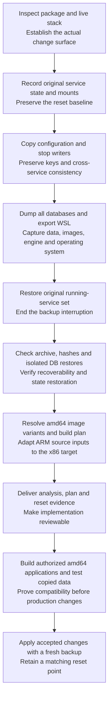

# ki-basis x86-64 change analysis and reset backup

The x86-64 private tools are deployed on the existing WSL Docker engine and shared PG16 cluster. See the [deployment result](05-deployment-result.md) for access, preserved state, verified outcomes and limits. WSL import/reset is excluded.

| Artifact | Value |
|---|---|
| [Deployment result](05-deployment-result.md) | Current service access, operating commands, acceptance evidence and verification limits. |
| [Change analysis](01-change-analysis.md) | Compares existing infrastructure with the supplied package and identifies data/configuration impacts. |
| [x86-64 integration plan](04-wsl-integration-plan.md) | Defines native amd64 builds, isolated compatibility tests, deployment sequence and reset conditions. |
| [amd64 image lock](images.amd64.lock) | Records registry-verified amd64 variants of the package's ten image indexes. |
| [Backup and reset evidence](03-backup-and-reset.md) | Records backup coverage, verification results, limits and recovery steps. |
| [Preflight](00-preflight.md) | Records scope, input priorities and authorization. |
| [Artifact log](log.md) | Records creation of the analysis bundle. |

## Process and purpose

Failure guard: A registry manifest, readable archive, or successful SQL restore does not prove that the new application builds work. Use the product acceptance cases in the integration plan before deployment.
