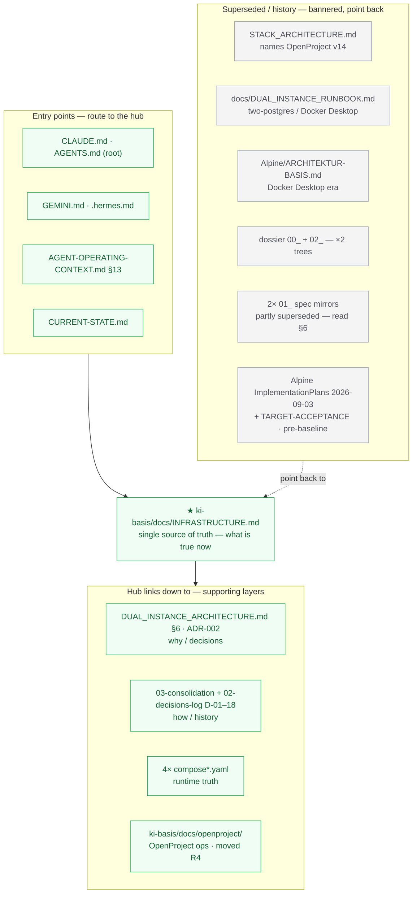

# ki-basis Infrastructure — current state

> **How to keep this current:** re-run `apex-meta/orchestration/architecture-improvements/05-program-closeout/tests/infra-health-test.sh`
> (read-only). If it disagrees with this file, **the live system wins** — update this file, not your mental model.
> Do not ground current architecture in older docs; superseded ones carry a banner pointing back here.

## 1. At a glance
- **One engine:** a single WSL2-native "Apex" Docker daemon (Ubuntu distro). **Docker Desktop is retired/uninstalled.** Compose v2.40.3.
- **One shared database:** a single PostgreSQL 16 cluster (`ki-basis-shared-postgres`) with per-tenant `priv_*`/`comm_*` databases + roles; cross-tenant `CONNECT` revoked.
- **Four compose stacks** (separate projects on the one engine):

| Stack | Compose project | Repo / compose file | Mode | Role |
|---|---|---|---|---|
| Private ki-basis | `ki-basis` | `apexai-os-meta/ki-basis/compose.shared-db.yaml` | **Core (2 — Hermes, Valkey):** Always-on (`unless-stopped`) **Peripheral (3 — Paperless, Firefly, Nginx):** On-demand (`restart: "no"`, default stopped) | private ops: valkey, **Hermes** (24/7); firefly, paperless, nginx (on-demand) |
| Community | `community` | `lika-community/compose.wsl.yaml` | **On-demand (`restart: "no"`, default stopped)** | community ops: valkey, firefly, paperless, openproject, nginx, **Hermes** |
| Private OpenProject | `leela-op178` | `leela-op178/compose.shared-db.yaml` | Always-on (`unless-stopped`) | private PM authority — **OpenProject 17.8** |
| Shared PostgreSQL | `ki-basis-infra` | `ki-basis-shared/compose.yaml` | Always-on (`unless-stopped`) | the one shared DB cluster |

## 1.1 Documentation map — where the architecture is described

## 2. Engine (WSL2 "Apex")
- Runs as the `Ubuntu` distro's native `dockerd`. Invoke: `wsl -d Ubuntu -u root -- docker …`.
- Docker Desktop uninstalled (ADR-002); `docker.exe` is not on the Windows PATH.
- Host memory cap: `C:\Users\gehma\.wslconfig` → `memory=16GB`, `swap=4GB` (changing it needs `wsl --shutdown` = stops ALL stacks → operator-gated).
- **Keepalive (cold-boot avoidance):** WSL2 idle-sleeps its VM (~80 s cold boot). Only a **Windows-held `wsl.exe` session** resets the idle timer. Held by `%APPDATA%\…\Startup\wsl-keepalive.vbs` (hidden, no admin, self-healing: relaunches a `sleep infinity` session within 5 s if it dies). A secondary in-VM systemd service `openproject-keepalive` pings OpenProject warm. To disable: delete the `.vbs`.

## 3. Shared data layer
- **Cluster:** `ki-basis-shared-postgres` (image `pgvector/pgvector:pg16`), compose project `ki-basis-infra`, repo `ki-basis-shared`. **Internal only** on the external `shared-db-net` bridge at `postgres:5432` — no host port. Volume `ki-basis-infra_shared_pgdata` (compose key `shared_pgdata`, project-prefixed). Secrets in `ki-basis-shared/.env` (never commit/print).
- **Databases / roles:** `priv_firefly|openproject|paperless`, `comm_firefly|openproject|paperless`, each with a matching `*_app` role.
- **Isolation:** cross-tenant `REVOKE CONNECT` — a tenant's app role cannot connect to the other tenant's DB (verified live). Role connection limits: firefly 20, paperless 30, openproject 40 (live usage ≤18%).
- **Network:** `shared-db-net` is `external: true` — a manually-created network owned by **no** compose project — create it once (`docker network create shared-db-net`) before any stack that joins it comes up.

## 4. The four stacks (live detail)

### 4.1 Private ki-basis — project `ki-basis`
- File: `apexai-os-meta/ki-basis/compose.shared-db.yaml` · env `.env.shared-db` · `-p ki-basis`.
  (`compose.yaml` in the same dir is a **superseded rollback file** — do not `up` it; see D-16/T10.)
- **Lifecycle policy (Lean 24/7 Baseline):**
  - **Always-on (`restart: unless-stopped`):** `ki-basis-hermes` (gateway `8642` + dashboard `9119`) and `ki-basis-valkey` (internal). Hermes has **no `depends_on`** coupling to peripheral tools (`FINDINGS-hermes-decoupling-and-on-demand-tools-2026-10-08.md`).
  - **On-demand sleep (`restart: "no"`, default stopped):** `ki-basis-paperless` (`8010`), `ki-basis-firefly` (`8086`), and `ki-basis-nginx` (`8084`). Sleeping saves ~840 MB WSL2 RAM; wake/sleep via `ki-basis/scripts/{wake,sleep}-tools.sh` (§7).
- Networks: hermes/nginx/valkey on `ki-basis-net`; firefly/paperless also on `shared-db-net`.
- **Hermes storage = BIND mounts** (T10): `/root/.hermes → /opt/data` (~4.4 GB), `/root/workspaces → /root/workspaces` (~3.5 GB) on WSL2 ext4. Other services use named volumes.
- Private OpenProject is **not** in this stack — Hermes points at `leela-op178-openproject` (§4.3).

### 4.2 Community — project `community` (On-Demand)
- File: `lika-community/compose.wsl.yaml` · env `.env.wsl` · `-p community` (separate repo). (`compose.yaml` is a **superseded rollback file** — do not `up` it.)
- **Lifecycle policy:** **On-demand only (`restart: "no"`).** Stopped by default (`exited`) to save ~2.45 GB WSL2 RAM; never auto-starts on host boot. Start/stop via `lika-community/scripts/{start,stop}-community-wsl.sh` (§7).
- **OpenProject memory bounds:** `community-openproject` is configured with `OPENPROJECT_WEB_WORKERS=0` (Puma single-mode), `OPENPROJECT_BACKGROUND_WORKERS=1`, `MALLOC_ARENA_MAX=2`, `USE_JEMALLOC=true`, `MALLOC_CONF="narenas:2,dirty_decay_ms:1000,muzzy_decay_ms:0,background_thread:true"`, and `mem_limit: 1792M` (Option 2B: keeps all community features intact while eliminating the duplicate Puma master process, leaving ~950 MiB spike headroom when active; 0 MiB when stopped).
- Services & host ports (loopback): firefly `9086`, paperless `9010`, openproject `9082`, nginx `9084`, **Hermes gateway `9642` + dashboard `9219`**. valkey internal.
- Networks: `community_internal`; firefly/paperless/openproject also on `shared-db-net`.
- **Hermes storage = named volumes** `community_hermes_data`/`community_hermes_workspaces` (+ `community_call_agenda`) plus read-only config binds from the `lika-community` repo (`SOUL.md`, `scripts/`, `skills/*`, `docker/hermes/run.py`). This asymmetry vs private is deliberate (community migrated fresh; private preserved its bind state — D-14/D-16). Do not "harmonize."

### 4.3 Private OpenProject — project `leela-op178`
- File: `leela-op178/compose.shared-db.yaml` · `--env-file .env.shared-db` · `-p leela-op178` · Compose service key `leela-openproject` (container `leela-op178-openproject`). Image **OpenProject 17.8.0**; DB `priv_openproject` on the shared cluster.
- **Memory, allocator & service bounds (Option 2A):** Capped with `OPENPROJECT_WEB_WORKERS=0` (Puma single-mode), `OPENPROJECT_WEB__MAX__THREADS=4`, `OPENPROJECT_GOOD__JOB__MAX__THREADS=2`, `MALLOC_ARENA_MAX=2`, `USE_JEMALLOC=true`, `MALLOC_CONF="narenas:2,dirty_decay_ms:1000,muzzy_decay_ms:0,background_thread:true"`, unused `hocuspocus` collaborative server disabled (`OPENPROJECT_COLLABORATIVE__EDITING__HOCUSPOCUS__URL=""` + `disable-hocuspocus.sh` mount saving ~215 MiB PSS), and `mem_limit: 1536M` (reducing non-reclaimable anonymous heap to **1.13 GiB** [`590 MiB` Puma PSS + `553 MiB` GoodJob PSS] with ~380 MiB spike headroom and 0 MiB swap; see `FINDINGS-openproject-memory-and-178-inefficiencies-2026-10-08.md`). All 7 existing work-package types have `is_default: true` in DB, and in-container `memcached` (`127.0.0.1:11211`) is retained for cross-process (`puma` + `good_job`) cache coherence and 0s TCP cache flushes.
- Host port `0.0.0.0:8083 → 80` (browse **`http://127.0.0.1:8083`**, not `localhost`, due to the host-check).
- Networks: `ki-basis-net` (so private Hermes reaches `leela-op178-openproject` by name) + `leela-op178_default` + `shared-db-net` (DNS aliases `leela-op178-openproject`, `leela-openproject` — distinct from `community-openproject`'s `openproject` alias).
- Named "leela" but it is **shared PM infrastructure** (hosts the org-wide project tree; private Hermes → `OPENPROJECT_API_URL=http://leela-op178-openproject:80`). The old v14 `ki-basis-openproject` was deleted (D-18).

### 4.4 Shared PostgreSQL — project `ki-basis-infra`
See §3.

## 5. Sibling-repo map (where infra lives on disk)
| Repo | Holds |
|---|---|
| `apexai-os-meta/ki-basis/` | private stack compose + env + scripts + **this file** + the ADR |
| `apexai-os-meta/apex-meta/orchestration/architecture-improvements/` | consolidation bundle (03), close-out (05), tests |
| `lika-community/` | community stack (own repo: `compose.wsl.yaml`, `.env.wsl`, on-demand scripts, persona, skills) |
| `leela-op178/` | private OpenProject 17.8 (compose, `op.env`, backups) |
| `ki-basis-shared/` | the shared PostgreSQL cluster (compose + `.env`) |

## 6. Ports (host, all loopback except where noted)
| Service | Private (`ki-basis`) | Community (`community`, on-demand) | Shared / other |
|---|---|---|---|
| Firefly | 8086 | 9086 | — |
| Paperless | 8010 | 9010 | — |
| OpenProject | via leela-op178 → **8083** | 9082 | — |
| Nginx | 8084 | 9084 | — |
| Hermes gateway / dashboard | 8642 / 9119 | 9642 / 9219 | — |
| PostgreSQL | — | — | 5432 (internal only, no host port) |

## 7. Start / stop / health (Lifecycle Command Index)

| Target Stack | Default State | Start Command | Stop Command |
|---|---|---|---|
| **Shared PostgreSQL** (`ki-basis-infra`) | Always-on | `wsl -d Ubuntu -u root -- sh -lc 'cd /mnt/c/GitDev/ki-basis-shared && docker compose up -d'` | `wsl -d Ubuntu -u root -- sh -lc 'cd /mnt/c/GitDev/ki-basis-shared && docker compose stop'` |
| **Private Core** (`ki-basis` Hermes/Valkey) | Always-on | `ki-basis/scripts/start-ki-basis-shared-db.ps1` | `ki-basis/scripts/stop-ki-basis-shared-db.ps1` |
| **Private Peripheral Tools** (Paperless/Firefly/Nginx) | **STOPPED (`restart: "no"`)** | `wsl -d Ubuntu -u root -- /mnt/c/GitDev/apexai-os-meta/ki-basis/scripts/wake-tools.sh` | `wsl -d Ubuntu -u root -- /mnt/c/GitDev/apexai-os-meta/ki-basis/scripts/sleep-tools.sh` |
| **Private OpenProject** (`leela-op178`) | Always-on | `wsl -d Ubuntu -u root -- sh -lc 'cd /mnt/c/GitDev/leela-op178 && docker compose -f compose.shared-db.yaml --env-file .env.shared-db -p leela-op178 up -d'` | `wsl -d Ubuntu -u root -- sh -lc 'cd /mnt/c/GitDev/leela-op178 && docker compose -f compose.shared-db.yaml --env-file .env.shared-db -p leela-op178 stop'` |
| **Community Stack** (`community`) | **STOPPED (`restart: "no"`)** | **WSL:** `/mnt/c/GitDev/lika-community/scripts/start-community-wsl.sh` **Win:** `C:\GitDev\lika-community\scripts\start.ps1` | **WSL:** `/mnt/c/GitDev/lika-community/scripts/stop-community-wsl.sh` **Win:** `C:\GitDev\lika-community\scripts\stop.ps1` |
| **Health Oracle** (read-only) | — | `wsl -d Ubuntu -u root -- bash -c "tr -d '\r' < /mnt/c/GitDev/apexai-os-meta/apex-meta/orchestration/architecture-improvements/05-program-closeout/tests/infra-health-test.sh \| bash"` | — |

- **Prerequisite:** `ki-basis-shared-postgres` (`shared-db-net`) MUST be running before starting Private, Community, or OpenProject (`start-community-wsl.sh` and `start-ki-basis-shared-db.ps1` verify this automatically).
- **Guard invariant:** Never run `docker compose down -v`. Legacy scripts (`ki-basis/scripts/{start,stop}-ki-basis.{sh,ps1}` and `lika-community/scripts/{start,stop}.sh`) are **fail-closed guarded (`exit 2`)**.

## 8. Links (single source → supporting layers)
- **Why / decisions:** `ki-basis/docs/DUAL_INSTANCE_ARCHITECTURE.md` §6 (ADR-002) — the decision record.
- **How it got here / verified topology + D-01…D-18:** `apex-meta/orchestration/architecture-improvements/03-wsl2-native-stack-consolidation/`.
- **Close-out + T10 (Hermes drift) + On-demand, Hermes decoupling & OpenProject optimization learnings:** `apex-meta/orchestration/architecture-improvements/05-program-closeout/` (`FINDINGS-community-on-demand-and-guideline-drift-2026-10-08.md`, `FINDINGS-hermes-decoupling-and-on-demand-tools-2026-10-08.md`, `FINDINGS-openproject-memory-and-178-inefficiencies-2026-10-08.md`).
- **Runtime definitions (authoritative for services/volumes/networks):** the four `compose*.yaml` in §1.
- **OpenProject 17.8 operations:** the `leela-op178` runbook at `ki-basis/docs/openproject/` (`RUNBOOK-openproject-17.8-operations.md`; the OpenProject infra cluster was moved here from the Leela repo 2026-09-29; see also `FINDINGS-openproject-memory-and-178-inefficiencies-2026-10-08.md`).
- **Tests:** `…/05-program-closeout/tests/` (`infra-health-test.sh`, `doc-integrity-lint.sh`).
